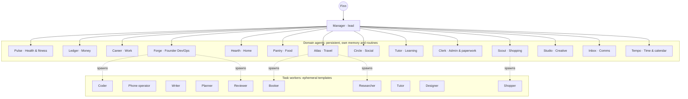
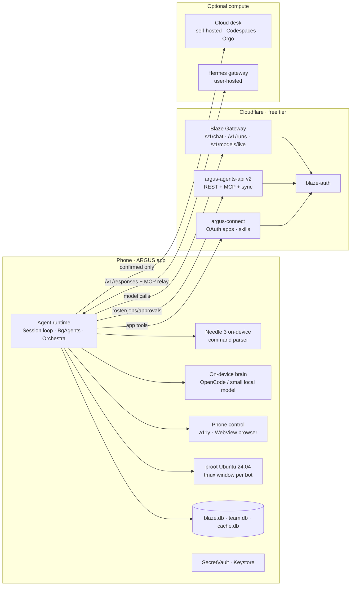
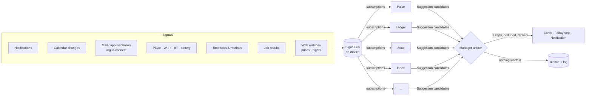
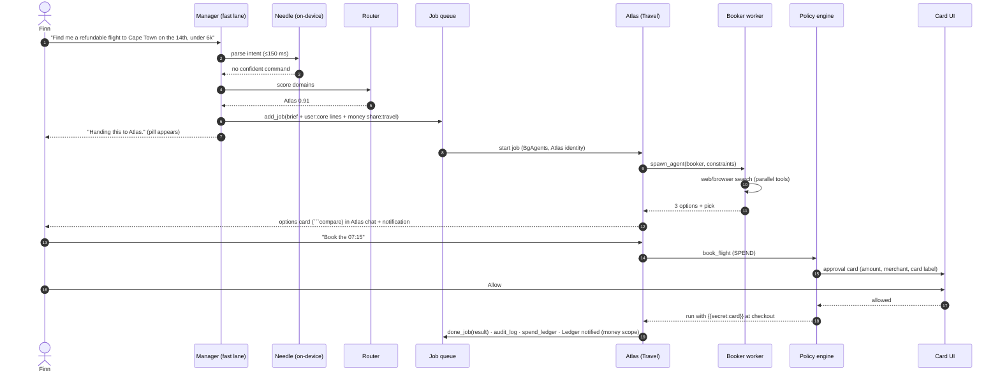
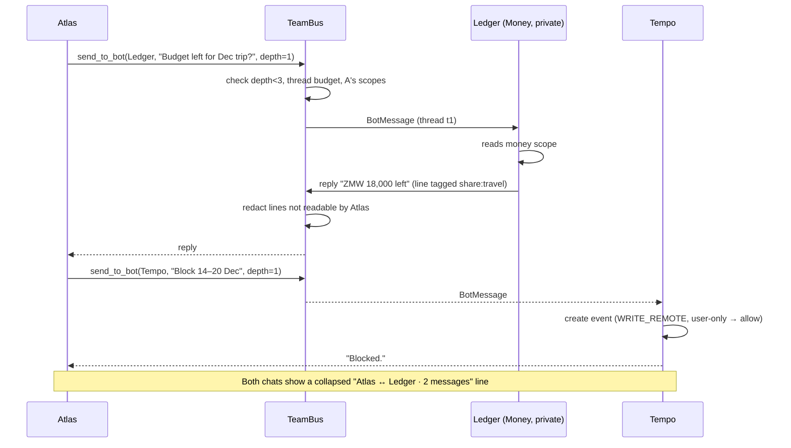
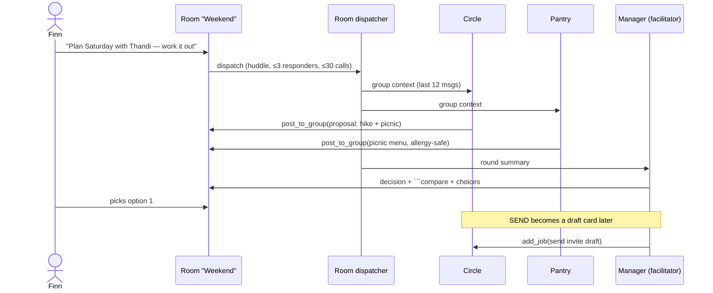
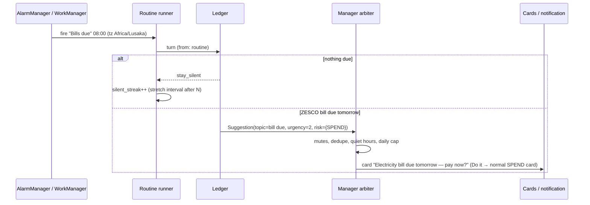
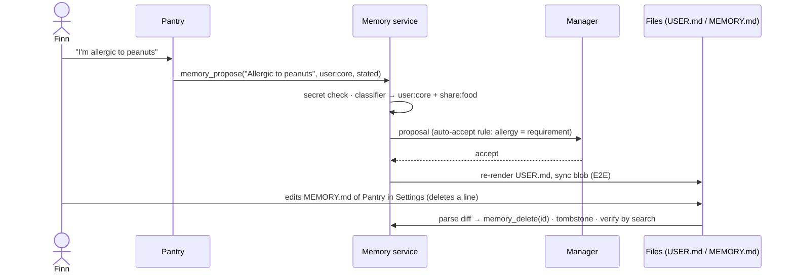
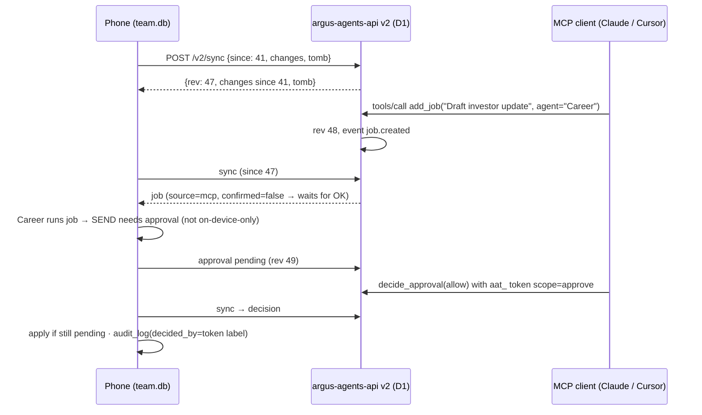
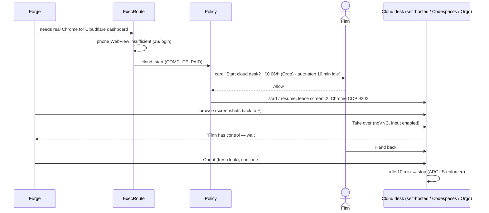

# 05 — Agent ecosystem architecture

> Slice 5 of the ARGUS overhaul (see `overhaul.md`). Owner: Specialist 5 (agent systems architect). Status: **v1 complete, 2026-11-11** (open questions in §11.3).
> Scope: how the unified ARGUS app (Kotlin/Compose, `argus-mobile`) runs an **ecosystem of specialist agents** — one per part of a person's life and per kind of task — orchestrated by a Manager. Built from what already exists in Argus-mobile (Blaze agent, BgAgents, Orchestra, Mind, Proactive, Routines, Connectors, MCP), A-team (Manager bot, jobs queue, profile memory, skills, Ubuntu workspace, cloud computer, live model picking, Needle, `argus-agents-api`) and Bot HQ (Hermes engines, per-bot MCP, approvals, rooms, subagents, soul/memory files, per-bot screen, voice).
> Nothing here is implemented yet. File references are to the three source trees as pulled on 2026-11-11.

## Contents
0. Summary and design principles
1. The agent model (what a Bot is)
2. Manager, routing, delegation, bot-to-bot, rooms, subagents, jobs
3. Catalog of life-domain specialist agents
4. Memory architecture
5. Runtime placement and open replacements for paid dependencies
6. Tool / MCP surface and the `argus-agents-api` v2 sync contract
7. Safety: approvals, spending, sending, deletion, audit, takeover
8. Proactivity and routines
9. Data models (Kotlin + SQL)
10. Sequence diagrams
11. Source → target map, build order and risks (input for slice 6)

---

## 0. Summary and design principles

**One sentence:** every Bot is the same Kotlin object — *identity + soul + memory + skills + tools + engine + apps + computer + permissions* — run by one agent runtime on the phone, with the Manager as the single front door that routes work to persistent **domain agents** (Health, Money, Work, Home…) which in turn spin up short-lived **task workers** (Researcher, Shopper, Coder…) and talk to each other through a governed message bus.

What we keep from each source, and why:

| From | Keep | Because |
|---|---|---|
| Argus-mobile | The agent runtime (`agent/Agent.kt` Session loop, `CloudRuns` resumable gateway runs, `BgAgents`, `orchestra/*` Blueprint DAG + `ToolScheduler`/`KeyedLocks`), tiered memory (Mind/`blaze.db`, chat tier, cache tier), `ConfirmGate` taint rule, `Modes`, `Specialists`/`SpecialistMatch`, phone control, `Routines`/`Triggers`/`Autopilot`, `Mcp.kt`, `Connectors.kt`, `SecretVault`/`SecretUse` | It is the most mature, tested runtime (~2.9k unit tests), native, and already never-blocking. It becomes the **engine of every bot**. |
| A-team | Manager bot + its tools and prompt, the jobs queue (deps, one job per bot, runaway guard), profile memory (stated vs inferred, kinds, secrets refused), hybrid team/private memory visibility, proactivity rules (quiet hours, 3/day cap, "stop suggesting this", risky regex), proot Ubuntu per bot (tmux window per bot), cloud computer (Orgo / Codespaces, off by default), live model list (`/v1/models/live`), Needle on-device command parsing, `argus-agents-api` (REST + MCP), argus-connect connectors and skills | It has the right **product shape**: a team of bots as chats with a lead. |
| Bot HQ | Bot record (label, mode personal/teammate, effort, voice), transcript rows (`seq`/`updatedSeq`, card kinds), approvals *inside the tool call* (Allow / Always / Don't), `send_to_bot` with hop depth, rooms (≤3 responders, `stay_silent`), subagents (hidden child bots, ≤4), soul/memory as editable files (`MEMORY.md`, `USER.md`), per-bot screen with watch / take-over, Library, check-ins with silent-streak back-off, Hermes as a pluggable engine | It has the best **multi-agent UX and safety mechanics**. |

Design principles (they resolve most later decisions):

1. **One runtime, many identities.** A bot is data, not code. Domain agents differ by soul, tools, memory scope, routines and permissions — never by a separate loop. (Avoids three agent loops: Blaze Session, A-team `CHAT.reply`, Hermes.)
2. **Manager is the front door, not a bottleneck.** The user can always talk to any bot directly; Manager handles the unaddressed message, delegation, conflicts and the daily picture.
3. **Persistent domain agents, ephemeral task workers.** Domain agents own a part of life (memory, routines, relationships with apps). Task workers (today's `Specialists.builtIn`) are templates spawned for one job and then gone.
4. **Phone first, cloud when needed, user-confirmed.** Default placement is on-device (phone control, proot Ubuntu, on-device models where good enough). A cloud computer starts only for work the phone can't do, and only after a yes (A-team rule kept).
5. **Zero-budget by default.** Free routes first (Blaze Gateway free lineup, on-device brain, Workers AI). Paid services (Composio, xAI, Orgo) become optional adapters, never requirements.
6. **Approvals live in the tool layer**, not the prompt (Bot HQ + `ConfirmGate`): every engine, every bot, every channel goes through the same policy check.
7. **Memory is the user's.** Readable, editable, forgettable as plain markdown files per bot; sensitive domains private by default; secrets never stored.
8. **Quiet by default.** Proactivity is arbitrated centrally with hard caps; most checks end in silence.

---

## 1. The agent model

### 1.1 Anatomy of a Bot

```
Bot
├── identity     id, name, label ("Money"), avatar (shape/color/face), voice, color, mode (personal|teammate), kind (agent|room|worker)
├── soul         SOUL.md  — who it is, voice, standing rules, boundaries (user-editable, versioned)
├── memory       MEMORY.md (its private notes) + scoped view of USER profile + TEAM notes  (§4)
├── skills       skill refs (bundled packs, Argus originals, user skills from argus-connect, playbooks)
├── tools        tool groups + explicit grants (≤64 tools in the prompt; ToolRouter loads groups on demand)
├── engine       which loop runs it + model policy (lane, tier, pinned model, effort)
├── apps         connector grants (argus-connect OAuth apps, MCP servers) with per-tool policy
├── computer     none | phone | ubuntu(proot, own tmux window + $HOME) | cloud(orgo|codespaces|self-hosted) | hermes-host
├── permissions  action classes allowed / ask / never, spend cap, send scope, data scopes, autonomy level
├── routines     schedules + event triggers it owns
└── relations    reportsTo (lead), members (rooms), parent (workers/subagents)
```

**Kinds:**
- `MANAGER` — exactly one, fixed id `manager`, cannot be deleted (A-team `manager.js ensure/canDelete`), soul editable only in its *user-rules* section (A-team v2.16c locked the core prompt; we keep a locked core + editable addendum).
- `DOMAIN` — persistent specialist for a life area (§3). Seeded from templates, fully editable, deletable.
- `CUSTOM` — any bot the user (or Manager via `agent_create`) makes.
- `WORKER` — ephemeral task specialist spawned for one job (today's `Specialists.Spec` + `BgAgents` entry). Hidden, no long-term memory, inherits parent's permissions minus anything it doesn't need.
- `SUBAGENT` — a hidden child of any bot for a parallel sub-goal (Bot HQ `subagents.ts`); like a worker but created by the bot itself, reports back with `send_to_bot`.
- `ROOM` — group chat; never runs its own loop (Bot HQ `rooms.ts`).
- `REMOTE` — a bot whose loop lives elsewhere (a Hermes gateway, a cloud run). Same record; `engine.kind = HERMES`.

### 1.2 Soul file (SOUL.md)

Bot HQ keeps persona in Hermes' home, A-team in `agent.prompt`, Argus in `Personas`/`OnePersona`. Unified: one markdown file per bot with fixed headings so it can be edited by hand *and* parsed:

```markdown
---
id: money
name: Ledger
label: Money
version: 7
locked_sections: [Boundaries]      # Manager & domain templates lock safety text; user can still add rules below
---
# Who you are
You look after Finn's money: spending, bills, subscriptions, savings goals...
# How you sound
Plain numbers first. Currency always. One recommendation, with the reason.
# What you own
Budgets, bills calendar, subscription audit, receipts in the Library.
# Standing rules            ← user-editable; "always/never" lines land here (A-team RULE_START detector)
- Never suggest crypto.
# Boundaries                ← locked template text
- You never move money, pay, or subscribe without an explicit yes on an approval card.
- You never share balances with other bots unless Finn allowed it (data scope money:share).
```

- Stored at `filesDir/bots/<id>/SOUL.md`, mirrored into the bot's Ubuntu home `/root/.argus/bots/<id>/SOUL.md` (like A-team `mirror()` of the profile), and — for Hermes bots — written into the Hermes home as the persona file.
- Every save bumps `version` and keeps the last 20 versions (`bot_soul_versions`) for "Undo edit".
- The system prompt is assembled as: locked Argus core rules → SOUL.md → domain playbook → skills index → memory blocks (§4) → context (time, team roster, connected apps, routines). This mirrors Bot HQ `instructionsFor()` and its **cache-stable rule**: nothing clock-dependent above the memory block, so prompt caching on the gateway stays effective; the `Now:` line (A-team `nowLine`) goes last.

### 1.3 Engines and models

| `EngineKind` | Where the loop runs | Use |
|---|---|---|
| `LOCAL` | Phone, `Agent.Session` loop; model calls to the Blaze Gateway / on-device brain per `BrainOrder` | Default for every bot. Full phone tools. |
| `CLOUD_RUN` | Blaze Gateway `/v1/runs` (CloudRuns): loop on the gateway, `needs_device` hands phone tools back | Long jobs that must survive the app closing; still the same bot. |
| `HERMES` | A Hermes gateway (`POST /v1/responses`), user-provided host; ARGUS tools exposed to it over MCP (`/mcp/<botId>` equivalent served by the phone relay or the gateway) | Power users who already run Hermes (Bot HQ's primary engine rule: never restart / reconfigure it). |
| `NEEDLE` | On-device Cactus Needle 3 (A-team `needle-worker.js`) | Not a bot engine — a **command fast path** for Manager (§2.3). |

Model policy per bot (`ModelPolicy`): `lane` (chat, quick, code, vision, long, agent — gateway `blaze_task` tags), `tier` (Spark / Flare / Inferno, `ModelChoice.forRole`), optional `pinned` model (A-team `applyModel`: Gemini with user key, or a preference the gateway honours), `effort` (Bot HQ low…xhigh → thinking budget), and `privacy` (`ZERO_RETENTION` forces BrainOrder's rule that Google-data requests only go to zero-retention models). The model id is **never typed in the app**: picks come from `GET /v1/models/live` (A-team v2.13), kept for the whole turn, gateway falls back inside the lane and reports it in headers.

### 1.4 Computers

| `ComputerKind` | Backing | Default for |
|---|---|---|
| `NONE` | — | Writer, Money (data-only) |
| `PHONE` | Accessibility phone control (`phone/flash/*`, `TapLoop`), on-phone WebView browser | Operator worker, Home (device settings), Food (delivery apps) |
| `UBUNTU` | Shared proot Ubuntu 24.04 (Argus `terminal/` + A-team `Workspace.java`); **per bot**: own tmux window, own `$HOME=/home/<botId>`, own Library dir `/root/argus/files/<botId>` | Dev/Ops, Creative, Learning, Admin (PDFs) |
| `CLOUD` | Orgo desktop, GitHub Codespace, or **self-hosted desk** (§5.3): one X screen per bot, noVNC watch / take-over (Bot HQ `vnc.ts`) | Only when confirmed: real Chrome, login/JS sites, GUI, x86 |
| `HERMES_HOST` | The Hermes machine's own screen / Chrome | Hermes bots |

Locks: real resources are held through `KeyedLocks` across all bots — `screen` (phone), `browser`, `file:<path>`, `term:<botId>`, `desk:<screenId>` — so two bots never drive one screen (Bot HQ's `BH_HOME` lesson; Argus `ToolScheduler` claims).

### 1.5 Permissions

```
Permissions(
  autonomy = ASSIST | ACT | AUTOPILOT,        // Modes: Plan≈ASSIST(read-only), Build+Auto≈ACT, Autopilot
  actions  = map ActionClass → ALLOW | ASK | NEVER,
  spendCapMonthly = Money(0, "ZMW"),           // 0 = every spend asks; never auto above cap
  sendScope = NONE | DRAFT_ONLY | KNOWN_CONTACTS | ANY,
  dataScopes = {"user:core", "health", "money", ...},   // which memory scopes it may read (§4.4)
  computerUse = { phone, ubuntu, cloud(askEachTime=true) },
  maxStepsPerTurn = 40, maxJobMinutes = 30, maxHops = 3
)
```
Action classes and defaults are in §7.

---

## 2. Manager, routing, delegation, bot-to-bot, rooms, subagents, jobs

### 2.1 Roles

- **Manager** (A-team Manager + Argus "Blaze" chat agent, merged): the default chat (the Notch "Chat" page in A-team v2.16 is bound to it). Fast lane answers itself; anything bigger is routed. Owns the roster, the job board, the user profile (writes), the proactivity arbiter and the daily brief. Tools: A-team `MGR_TOOLS` (`agents_list`, `agent_create/update/delete`, `agent_delegate`, `agent_status`, `memory_read/write/forget`, `routine_create/list/cancel`, `retry_job`) + Argus `spawn_agent`, `delegate`, `orchestrate`, `message_agent`, `cancel_agent`, `list_agents` + Bot HQ `create_group`, `ask_user`.
- **Domain agents**: own a life area; receive delegated jobs, run routines, propose suggestions, may delegate sideways (`send_to_bot`) and spawn workers.
- **Workers / subagents**: do one thing, return a result, die.

### 2.2 Message routing (who answers)

A user message arrives in a chat. Resolution order:

1. **Direct chat** with a bot → that bot answers (it may still hand off).
2. **Room** → room dispatcher (§2.6).
3. **Manager chat**:
   1. **Command fast path** (≤150 ms, offline): exact parse → Needle on-device tool call (A-team `needleCalls`: `add_agent`, `add_task`, `complete_task`, `reschedule`…) → if a confident call is produced, execute and confirm in one line. Extend Needle's tool set with `route_to(bot)`, `set_routine`, `remember` (fine-tune data lives in `a-team/needle-ft`).
   2. **@mention / explicit name** ("ask Money…", "@Pulse") → delegate.
   3. **Domain match**: `SpecialistMatch` extended to domains — keyword + embedding score of the message against each domain's `routingHints` (cheap, on-device). Score ≥ 0.75 and one clear winner → delegate silently; 0.5–0.75 → Manager delegates but says who ("Handing this to Travel."); ties → Manager answers or asks one question.
   4. **Fast lane**: quick question → Manager answers itself (Argus `FastLane`/`ChatLane`).
   5. **Multi-domain goal** ("plan my Cape Town trip within budget and keep my workouts going") → `orchestrate` with a `generic` Blueprint whose nodes are owned by domain agents (Travel, Money, Health) and a stitch node owned by Manager.
4. Manager **never blocks**: it replies in one short line and the work shows as a pill (Argus `AgentPill`) / job card (A-team).

### 2.3 Delegation = a Job

Delegation always creates a **Job** (A-team model, extended) so it is visible, resumable and syncable:

- Brief = A-team `QUEUE.brief()` shape ("You are assigned job #… Do it now… When finished call `done_job`… If you truly need something, ask and stop") + **relevant memory lines** (A-team `pRelevant`, filtered by the target's data scopes) + parent context summary.
- Queue rules (A-team `jobs.js`): a job waits on its `deps`; **one running job per bot** (more work → that bot spawns workers); priority high first; runaway guard 12 automatic starts / 10 min; proactive jobs never act unconfirmed (`MANAGER.jobAllowed`).
- Execution = a `BgAgents` entry running the target bot's identity (its soul, tools, computer), with Argus' resume-after-process-death (`resume = true`, `TaskWorker` keeps the process).
- Completion: result posted in the bot's own chat **and** summarised back to the requester (Manager or the delegating bot) + notification (A-team `NOTIF`/`AgentNotify` with avatar and edge glow).
- Failure: retry once with the error in context (Argus `AgentBudget.escalation`), then `failed` with `retryAt`; Manager's `retry_job`.

### 2.4 Bot-to-bot messaging

`send_to_bot(bot, message, expects_reply=true, thread?)` (Bot HQ) on a governed **TeamBus**:

- Delivered into the target's queue as a `BotMessage` row (`from.kind = bot`), the reply returns the same way.
- **Hop depth** carried on every message; at depth 3 the tool refuses ("answer the user directly") — Bot HQ `ctx.depth >= 3`.
- **Thread id** groups an exchange; a thread has a token/step budget (default 20 model calls) and ends when either side calls `stay_silent` or returns a result.
- **Data scope check** on the payload: a bot can't forward memory lines from a scope the receiver can't read (e.g. Health → Social only gets "Finn has a 7am run Tuesday" if `health:share-schedule` is allowed). Implemented as a redaction pass using the memory line's `scope` tags (§4).
- Visible: the user sees bot-to-bot exchanges as a collapsed "Money ↔ Travel · 3 messages" line in both chats, expandable (Bot HQ `event: bot-message`). Nothing hidden.
- **No side doors**: bots can't call each other's tools; they ask the owner bot. (Keeps permissions meaningful.)

### 2.5 Subagents and workers

- **Worker** = `spawn_agent(task, specialist, inputs)` from Argus, templates from `Specialists.builtIn` + user's custom specialists (`create_specialist`). Runs with the parent's permissions ∩ the template's tool groups.
- **Subagent** = Bot HQ hidden child (`parent_bot_id`, `hidden=1`), max 4 per parent, own context and (if the parent has a cloud desk) own screen lease; reports back via `send_to_bot` to the parent and never messages the user.
- Concurrency is global, from Argus `AgentBudget.cap()` (4 on 6 GB+, 3 on 4 GB+, 2 below, 1 low-RAM; network-only cap 3; phone-screen specialists never two at once). Cloud-run and Hermes bots don't count against the phone RAM cap but count against a per-user "concurrent cloud runs" cap (gateway side, default 3).
- **Blueprint orchestration** (`orchestra/*`) is the engine for multi-step, multi-owner work; node `role` gains `ownerBotId`, so a node can be executed by a domain agent rather than an anonymous worker.

### 2.6 Rooms (group chats)

Bot HQ semantics + Manager moderation:

- A room = `kind=ROOM` bot with `members`. A user message goes to @mentioned members, else to members whose `routingHints` match, else all — capped at **3 responders** (Bot HQ `MAX_RESPONDERS`).
- Each responder gets the last 12 room messages and replies with `post_to_group` or `stay_silent` (no repeats).
- **Huddle mode** (new): user asks the room to "work it out" → Manager becomes facilitator, runs up to N rounds (default 3) where members post proposals, then Manager posts the decision with a ```compare block and asks the user to pick. Every round costs budget; huddles are capped at 30 model calls.
- Seeded rooms (optional on setup): **"Life Admin"** (Admin, Money, Home), **"Founder HQ"** (Dev/Ops, Work, Researcher), **"Weekend"** (Social, Food, Travel).

### 2.7 Jobs, tasks and the board

- **Job** (A-team) = unit of delegated work with owner bot, due, priority, deps, run state (`queued|running|waiting|done|failed`), result, approvals.
- **Task** (Bot HQ `create_task/update_task`) = a bot's self-tracked progress item inside a job → merged as `JobStep`s, shown as the pill's step list.
- The **Board** (A-team Compose graph/job list) shows all jobs by bucket (overdue, today, tomorrow, upcoming, todo, done — `bucket()` in `api/src/index.js`), filterable by bot. Synced through `argus-agents-api` (§6.4).

---

## 3. Catalog of life-domain specialist agents

### 3.1 Two layers



- **Domain agents** have a name (persona, renamable), a label (the life area, fixed), a soul, private memory, routines and suggestion rules. They are **seeded off** except Manager, Tempo and Inbox; setup ("What do you want help with?") switches on the ones the user picks — a roster of 14 visible bots on day one would overwhelm. Manager proposes a domain bot when a kind of work keeps coming up with no owner (A-team prompt rule) — e.g. after the third food-delivery request: "Want a Food bot to keep your usual orders?"
- **Task workers** are the existing Argus specialists, now callable by any domain agent. `reviewer` is new: A-team's strict code review (`review.js`) and the research pipeline's claim reviewers, generalised.

### 3.2 Catalog

Legend — **Tools** are tool groups (`ToolRouter` groups; §6.1). **Apps** are default connector suggestions (argus-connect / MCP); none are connected without the user. **Approvals** list what always shows a card regardless of autonomy (on top of the global rules in §7). **Scope** is the memory scope it owns; "reads" are other scopes it may read by default.

| Bot (label) | Role | Tools | Apps (suggested) | Routines (default, off until accepted) | Memory scope | Approvals (always ask) |
|---|---|---|---|---|---|---|
| **Manager** (Lead) | Front door, routing, roster, job board, profile, proactivity arbiter, daily brief | team, jobs, memory(user:write), routines, web, phone(light) | — | 07:30 daily check (cheap), Morning brief (if accepted), Sunday weekly review | `user:*` (write), `team` | delete bot, create routine that spends/sends, anything another bot escalates |
| **Tempo** (Time & calendar) | Calendar, reminders, scheduling, conflicts, focus blocks, alarms | calendar, routines, device(alarms), comms(read) | Google Calendar, Outlook | Evening "tomorrow at a glance", conflict watch (event trigger) | `time` (reads `user:core`, `work`) | invites/RSVPs to others, cancelling meetings with guests |
| **Inbox** (Comms) | Mail, messages, notifications triage, drafts, follow-ups owed | connectors(mail), comms, notifications, memory | Gmail, Outlook, Slack, WhatsApp (notifications only) | Inbox triage 2×/day, "replies you owe" Friday | `comms` (reads `user:core`, `social`) | **every send** (draft card, Bot HQ `draft` card), unsubscribes, deletes |
| **Pulse** (Health & fitness) | Training plans, habits, sleep, steps, meds reminders, appointments | health(read), routines, web, calendar | Health Connect, Strava, Google Fit | Weekly training plan Sun, habit nudges, med reminders | `health` **private** | booking appointments, sharing any health data with another bot or person |
| **Ledger** (Money) | Budgets, bills, subscriptions, receipts, savings goals, price of decisions | bank(read), files, web, routines | Bank SMS/notification parser (on-device), Sheets | Bill due reminders, monthly subscription audit, "spend this week" Fri | `money` **private** | **any payment, transfer, subscribe/cancel**, sharing balances |
| **Career** (Work) | Job/career goals, CV, applications, networking, skills plan, meeting prep | web, files, writer, calendar(read) | LinkedIn (browser), Google Docs | Weekly goals check, meeting prep 30 min before key meetings | `work` | applications, outreach messages |
| **Forge** (Founder Dev/Ops) | ARGUS-specific: repos, issues, MRs, CI, deploys, infra health, Blaze-builds-Blaze loop | terminal(ubuntu), dev(gitlab/github), web, cloud(ask) | GitLab, GitHub, Cloudflare, Sentry | CI watch (event), daily "what broke / what shipped", Worker health ping | `work:argus` | merge, tag, deploy, push to protected branches (PLAN-reliable-agent §1 rules: never), touching secrets |
| **Hearth** (Home) | Home tasks, maintenance schedule, utilities, smart home, home services, household list | device, phone, web, routines | Home Assistant (MCP), utility apps | Maintenance calendar, utility bill reminders, "leaving home" checklist (place trigger) | `home` | booking services, changing device/home settings |
| **Pantry** (Food) | Meal plans, groceries, usual orders, recipes, dietary rules | web, browser, phone(delivery apps), memory | Grocery/delivery apps (browser/phone) | Weekly meal plan + list, "dinner idea" 17:30 opt-in | `food` (allergies mirrored in `user:core`) | **orders/checkouts** |
| **Atlas** (Travel) | Trips end to end: flights, stays, visas, packing, day-of travel, itinerary pages | web, browser, booker, calendar, files | Airline/hotel sites, Maps | Check-in reminders, day-before packing, flight status watch | `travel` (reads `money:budget-caps` only) | **bookings/payments**, sharing itinerary |
| **Circle** (Social & relationships) | People, birthdays, gifts, keeping in touch, plans with friends, events | contacts(read), calendar, web, writer | Contacts, Calendar | Birthday heads-ups (7 days), "haven't talked to X in a while" (opt-in, max 1/week) | `social` (people files) | any message to a person, gift purchase |
| **Tutor** (Learning) | Study plans, flashcards (`Learn`), exam coach, courses, reading list | study, web, files, ubuntu | Classroom (Argus `connect/Classroom.kt`) | Spaced-repetition reviews, exam countdown | `learning` | submitting graded work (never hand over answers — Specialists tutor rule) |
| **Clerk** (Admin & paperwork) | Forms, IDs renewals, taxes, contracts, insurance, document vault, signatures | files, pdf, ubuntu, browser | Drive, e-sign | Document expiry watch, tax-season prep | `admin` **private** (no ID numbers stored, only expiry + where) | submitting forms, signing, sharing documents |
| **Scout** (Shopping) | Product research, price watch, returns windows, order tracking | web, browser, shopper | Amazon/Takealot (browser) | Price drop watch, return-window reminders | `shopping` | **purchases**, returns that cost money |
| **Studio** (Creative) | Writing, design, images, video, social posts, pages | design, media, writer, ubuntu | Canva-like via browser, X (read) | Content calendar (opt-in) | `creative` | **posting publicly** |

Notes:
- **Researcher** is deliberately a worker, not a domain: every domain needs research; one persistent Researcher would accumulate unrelated memory.
- **Wellbeing** (mood, journaling) is folded into Pulse with a stricter scope (`health:mind`), off unless enabled; it must follow the "not a companion" rule (A-team Manager prompt: nudge toward people and life away from the screen).
- The founder (Finn) gets **Forge** pre-proposed at setup, since ARGUS work is his main context.

### 3.3 Domain template (data, not code)

Each domain ships as `assets/domains/<id>/` → `domain.json` + `SOUL.md` + `PLAYBOOK.md` (Argus `Playbooks`) + `skills/*.md`:

```json
{
  "id": "money", "label": "Money", "defaultName": "Ledger", "avatar": {"shape": "gem", "color": "green"},
  "routingHints": ["budget", "spend", "bill", "subscription", "price", "afford", "save", "bank", "salary", "receipt"],
  "toolGroups": ["bank", "files", "web", "routines", "memory"],
  "suggestedApps": ["sheets"],
  "workers": ["researcher", "writer"],
  "memory": {"owns": "money", "private": true, "reads": ["user:core"]},
  "permissions": {"autonomy": "ACT", "actions": {"SPEND": "ASK", "SEND": "NEVER", "DELETE": "ASK"}, "spendCapMonthly": 0, "sendScope": "NONE"},
  "routines": [
    {"name": "Bills due", "kind": "cron", "cron": "0 8 * * *", "prompt": "Check bills due in the next 3 days...", "silentIfNothing": true},
    {"name": "Subscription audit", "kind": "cron", "cron": "0 10 1 * *", "prompt": "..."}
  ],
  "suggestions": {"maxPerWeek": 2, "topics": ["bill due", "unused subscription", "budget overrun"]}
}
```
Users and Manager can create new domains from the same template (`agent_create` with `template`), so "a bot for my band" or "a bot for my dog" is a first-class domain.

---

## 4. Memory architecture

### 4.1 Today (three incompatible stores)

| Source | Store | Shape | Sync |
|---|---|---|---|
| Argus-mobile | `filesDir/blaze.db` `memories` (+FTS5; schema shared with Blaze Desktop/CLI — must not change) + side tables `mind_mem`, `mind_journal`; pinned core (`PinnedFacts`); chat tier (rolling summary); cache tier (`cache.db`) | Flat facts with `category`, `project`, `chat`, `pinned`, `uses` | Blaze account cloud sync (`CloudSync`, `SyncCrypto`) |
| A-team | Profile `argus.profile.v1` in localStorage (kinds: name, style, goal, project, preference, person, date, place, rule, note; `stated` vs `inferred`) mirrored to `/root/.argus/manager/profile.{json,md}`; bot memory `S.memory.bots[id]` + `S.memory.team` (visibility: own + team + reports') | JSON items | **Never synced** |
| Bot HQ | Hermes home `memories/MEMORY.md` (bot's notes) + `USER.md` (about user), entries separated by `§`; UI can list/remove | Markdown files | None (lives on the Hermes host) |

### 4.2 Target: one store, many views

**Keep `blaze.db` as the single source of truth** (the Desktop-shared `memories` table stays byte-compatible). Add one Android-side table `mem_scope` keyed by the memory id, so Desktop/CLI keep working and ignore it — the same trick as `mind_mem`.

```
                 ┌───────────────── blaze.db ─────────────────┐
                 │ memories (Desktop schema, FTS5)            │
                 │ mem_scope(id → scope, bot, kind, stated,   │
                 │           sensitivity, source, expires)    │
                 │ mind_mem / mind_journal (existing)         │
                 └───────┬───────────────┬──────────────┬─────┘
         renders ▲       │               │              │      ▲ parses edits
   bots/<id>/MEMORY.md   │   USER.md (profile view)     │   Hermes home (§-separated) for HERMES bots
   bots/<id>/SOUL.md (separate file, not facts)          │
                         ▼                              ▼
              prompt blocks per turn            Settings › "What your team knows"
```

**Scopes** (a memory line has exactly one owner scope, plus optional share tags):

| Scope | Who writes | Who reads | Examples |
|---|---|---|---|
| `user:core` | Manager (and any bot via *proposal*) | every bot | name, time zone, home city, dietary requirements/allergies, standing rules ("refundable only") |
| `user:<kind>` | Manager | bots whose domain lists the kind | `user:people`, `user:places`, `user:dates`, `user:goals` (A-team kinds) |
| `team` | any bot | every bot | "Finn is travelling 14–20 Dec", "ARGUS v2.18 ships Friday" (cross-domain facts) |
| `<domain>` (e.g. `money`) | that domain bot | that bot + Manager (summary only if private) + bots it explicitly shares with | "Netflix renews on the 3rd" |
| `<domain>` **private** (health, money, admin, health:mind) | that domain bot | that bot only; Manager sees *existence* and can show the user | resting heart rate trend, balances |
| `bot:<id>` | that bot | that bot | working notes, how it likes to do its job (Hermes MEMORY.md equivalent) |
| `session` | runtime | that chat | chat tier summary (not in `memories`; stays in chat tier) |

Visibility rule (A-team `MEM.visible`, generalised): a bot sees `user:core` + allowed `user:<kind>` + `team` + its own domain + `bot:<self>` + the domain scopes of bots that **report to it** (Manager is lead of all, but private scopes are excluded unless shared).

**Share tags** let one line be readable outside its scope without copying it: `money` line "Trip budget for Cape Town: ZMW 18,000" tagged `share:travel`. Atlas reads it; it can't read the rest of Money.

### 4.3 Writing memory

- **Stated vs inferred** (A-team): every line carries `stated: Boolean`. Inferred lines are marked and are confirmed with the user before acting on them (Argus `MemoryGate`, A-team `learn()` detectors `PREF`, `RULE_START`, `REM`).
- **Where a line goes** (classifier on save, deterministic first, quick-model second): standing rule → `user:core` + SOUL.md "Standing rules" of the relevant bot; allergy/dietary → `user:core` (and mirrored as a `food` share tag); person → `user:people`; domain fact → that domain; cross-domain event → `team`.
- **Proposals**: a domain bot that learns a user-level fact calls `memory_propose(text, scope)`; Manager (or a deterministic rule) accepts. This keeps `user:core` clean and consistent across bots.
- **Secrets refused** everywhere: A-team `SECRET` regex + Argus `SecretGuards` run on every write and every file parse; matching lines are dropped with a one-line notice. Card digits, ID numbers, passwords never stored; only "passport expires 2028-03, kept in Clerk's vault" style pointers.
- **Idle review** (Argus `MindReview` over `mind_journal`) extracts facts per chat; for bot chats it writes into that bot's domain scope.
- **Narrowness** (A-team prompt rule + Hark-style): save as narrowly as the user said it, with context (where, when, with whom); never broaden "usually" to "always".

### 4.4 Reading memory (per turn)

For bot B on turn t (extends `Memory.promptBlock`):
1. **Pinned core**: `user:core` pinned lines (≤ 1.2k chars).
2. **Soul**: SOUL.md.
3. **Relevant notes**: FTS over the scopes B can see with the message's content words (`Mind.relevantBlock`, ≤5 lines/800 chars), plus B's own `bot:<id>` top lines by `uses`.
4. **Delegation context**: lines Manager attached to the job brief (A-team `pRelevant`).
5. **Chat tier**: rolling summary + verbatim tail (Argus `ChatTier.budget`).
6. **Cache tier TOCs** (documents).
Tools: `memory_search(scope?)`, `memory_save`, `memory_update`, `memory_delete`, `memory_propose`, `cache_*`, `search_chat`.

### 4.5 User-editable files

- Settings › **Team memory**: per bot, two tabs — **Soul** (SOUL.md editor with locked sections greyed) and **Memory** (MEMORY.md list view: edit, delete, mark as stated, move scope, share with…). Plus **About you** (USER.md view of `user:*`) with A-team's add/edit/delete/"Forget everything".
- The `.md` files are **projections**: the app renders them from the DB on change and parses edits back (line = memory, `§` separator for Hermes compatibility). A parse that fails keeps the DB and shows the diff.
- For HERMES bots, the projection is written to the Hermes home over the bot's MCP relay, and Hermes-made entries are imported on each turn end (Bot HQ `engine-memory.ts` read path) — so Hermes memory and ARGUS memory don't drift.

### 4.6 Sync and privacy

- `user:*`, `team`, non-private domain scopes, `bot:*` and SOUL.md sync via the **existing Blaze account sync** (`CloudSync`, end-to-end `SyncCrypto`), never through `argus-agents-api` (which carries only roster, jobs, routines metadata and approvals — §6.4). This fixes A-team's "memory never leaves this phone" without exposing it to the Worker.
- Private scopes sync only if the user turns on "Sync private memory" (off by default), still E2E encrypted.
- Private chats (`PrivateChat`) are never paged, journaled or reviewed (Argus rule kept).
- **Forget**: deleting a line removes it from `memories`, `mem_scope`, FTS, projections, the Hermes home and the sync blob (tombstone), then re-validates by search (the Hark-style "verify after delete" rule).

---

## 5. Runtime placement and open replacements

### 5.1 Where each piece runs



**Placement decision** (per tool call, in `ExecRoute`, extending A-team's computer rule):

| Need | Run on | Fallback |
|---|---|---|
| Intent → command (add job, reminder, route) | Needle on-device | gateway `quick` lane |
| Chat / reasoning | Gateway lane via `/v1/models/live` pick; on-device brain first for private/zero-retention or offline (BrainOrder: on-device → Nous `:free` → Blaze Cloud) | next in BrainOrder |
| Long job that must survive app close | Gateway `/v1/runs` (CloudRuns) | local loop + `TaskWorker` |
| Phone apps, settings, SMS/calls, notifications | Phone | — |
| Code, scripts, files, PDFs, git, headless fetch | proot Ubuntu (bot's own tmux window/home) | cloud desk (ask) |
| Real Chrome, JS/login sites, GUI, x86 | Cloud desk, **user confirms each session**, auto-stop on idle | phone WebView browser |
| Hermes-native skills | Hermes engine | — |

Rules kept from A-team: the engine never starts the cloud computer on its own; proactive routines can't start it; low-RAM phones refuse clone-mode / heavy proot work.

### 5.2 Engine contract (so LOCAL, CLOUD_RUN and HERMES are interchangeable)

```kotlin
interface BotEngine {
    val kind: EngineKind
    /** Runs one turn; emits rows (message deltas, tool calls, cards) and live activity. */
    fun turn(bot: Bot, input: TurnInput, sink: RowSink): Flow<TurnEvent>
    suspend fun cancel(turnId: String)
    suspend fun steer(turnId: String, text: String)       // Argus message_agent / Bot HQ new message
    fun capabilities(): EngineCaps                         // tools it can run locally, max context, voice?
}
```
- `LocalEngine` wraps `Agent.Session`; `CloudRunEngine` wraps `CloudRuns.Turn`; `HermesEngine` ports Bot HQ `agent/loop.ts` (POST `/v1/responses` streaming → rows) to Kotlin, with the ARGUS tool surface served to Hermes as an MCP server through the phone relay (§6.3).
- All three emit the same `Row` model (§9) so the UI, approvals and audit don't care which ran.

### 5.3 Replacing paid dependencies

| Paid dep (Bot HQ) | Used for | Open / free replacement (recommended) | Keep paid as |
|---|---|---|---|
| **Composio** | OAuth apps, tool catalog, triggers, approvals | **argus-connect** (already exists in A-team v2.17: per-user OAuth apps on Cloudflare, `/v1/me/apps/*`) + remote **MCP servers** (`connect/Mcp.kt`) + on-device connectors (`Connectors.kt` loopback/device/token). Triggers: argus-connect webhooks/polling (Gmail push, Calendar watch) → `argus-agents-api` events → phone via FCM-free polling/WebSocket. Approvals are ours (§7), not Composio's. | Optional adapter `composio` app provider for long-tail toolkits, user's own key |
| **xAI** realtime voice, TTS, dictation | Voice calls with a bot | On-device: Android `SpeechRecognizer` (offline where available) + Android TTS / Piper-Kokoro voices in Ubuntu; gateway: Workers AI Whisper for STT (free neurons), gateway TTS lane. Voice agent = the bot's normal turn queue with a short-reply voice style (Bot HQ voice hands real work to the queue — kept). | Optional "Grok voice" provider with user's key |
| **xAI `x_search`** | Live X research | Gateway `web` search with `site:x.com` + public X embeds; honest label "limited without an X key" | Optional `x_search` tool when user adds an xAI key (vault) |
| **Orgo** | Cloud desktop + screens + VNC | **Self-hosted desk**: one Docker image (Xvfb + fluxbox + Chrome + x11vnc + noVNC, Bot HQ `server/box/*` scripts reused) runnable on Finn's PC via Blaze Desktop link, on an always-free VM (e.g. Oracle Cloud Ampere), or as a **GitHub Codespace** (A-team provider; 60 free core-h/month, idle_timeout 5 min). Screen-per-bot = one X display per bot, DevTools port 9200+display (Bot HQ). | Orgo provider kept (A-team cloud.js), billing warning shown, auto-stop enforced by ARGUS since Orgo has none |
| **Hermes** (free, but external) | Agent loop | Not replaced; demoted to optional engine. Default engine = ARGUS runtime. | `HERMES` engine kind |

---
## 6. Tools / MCP surface and the `argus-agents-api` v2 contract

### 6.1 One tool registry, namespaced groups

All three sources' tools merge into one `ToolRegistry` (Argus `CommandRegistry` + `ToolRouter` groups). A tool declares: `name`, `group`, JSON schema, `actionClass` (§7), `claims` (for `ToolScheduler`/`KeyedLocks`), `prefetchable`, `runsOn` (PHONE | UBUNTU | CLOUD | GATEWAY | REMOTE_MCP), `readOnly`.

| Group | Tools (source) |
|---|---|
| `team` | `agents_list`, `agent_create`, `agent_update`, `agent_delete`, `agent_status` (A-team) · `send_to_bot`, `create_group`, `post_to_group`, `stay_silent` (Bot HQ) · `spawn_agent`, `delegate`, `orchestrate`, `message_agent`, `cancel_agent`, `list_agents`, `check_agent` (Argus) · `spawn_subagent`, `check_subagent`, `stop_subagent` (Bot HQ) |
| `jobs` | `add_job`, `done_job`, `update_job`, `agent_delegate`, `retry_job` (A-team) · `create_task`, `update_task` (Bot HQ, become job steps) · `job_status/wait/kill` (A-team bgjobs) |
| `memory` | `memory_search/save/update/delete/merge` (Argus) · `memory_read/write/forget` (A-team profile = `user:*` scope) · `memory_propose` (new) · `cache_toc/read/search/summarize`, `search_chat`, `read_turn` |
| `routines` | `routine_create/list/cancel` (A-team) · `create_routine`, `create_event_routine`, `list_event_triggers`, `update_routine`, `delete_routine`, `set_checkins` (Bot HQ) · Argus `Routines`/`Triggers`/`Autopilot` events |
| `user` | `ask_user` (choices card), `request_app_connection` (connect card), `draft` (send card), `secure_input` |
| `files` | `save_file` → **Library** per bot (Bot HQ) = Argus `SaveFile` + A-team `files.js`; `file_read/write/edit/list` |
| `ubuntu` | `run` (A-team ```run blocks / Argus `run_shell`), `run_code`, terminal sessions per bot (tmux window = `term:<botId>`) |
| `cloud` | `cloud_start/stop/status`, `desk_screenshot/click/type/key`, `desk_bash` (A-team cloud.js, Bot HQ computer tools) — every start is `ASK` |
| `phone` / `device` / `comms` / `notifications` | Argus phone control, alarms, SMS/calls, notification read |
| `browser` | Argus `browser_*` (WebView) · CDP browser on a cloud desk |
| `web` | `web_search`, `web_fetch`, BlazeQuery · `x_search` (optional key) |
| `apps` | argus-connect app tools (`gmail_list`, `gmail_read`, `cal_list`, … A-team v2.16 helpers), `connectors_list`, MCP servers as `mcp__<server>__<tool>` |
| `dev` | `gitlab_issue_read/list`, `gitlab_branch_create`, `gitlab_mr_create`, `ci_status` (PLAN-reliable-agent §1; Forge only) |
| `design`, `media`, `study`, `bank`, `health` | Argus groups (Designs, media, Learn/Flashcards, Bank mode, Health Connect) |

Per-bot exposure: the bot's `toolGroups` ∩ permissions, connected apps' tools first, capped at **64 tools in the prompt** (A-team cap); other groups load on request (`ToolRouter`, `active_tools` table in blaze.db).

### 6.2 ARGUS as an MCP **client**

`connect/Mcp.kt` (Streamable HTTP + legacy SSE; stdio listed but needs a PC → runs via Blaze Desktop link or inside proot Ubuntu for Node/Python MCP servers — new: proot makes stdio servers possible on the phone). Each server is granted to specific bots (`BotAppGrant`), and each tool carries `Ask / Always / Off` (Mcp.kt) mapped onto §7 policies. MCP tool output counts as **untrusted** content (`ConfirmGate` taint).

### 6.3 ARGUS as an MCP **server**

Two servers, same tool definitions:
1. **On-device relay** `mcp://argus/<botId>` — used by `HERMES` bots and by Blaze Desktop. Served by the phone through the gateway relay (the phone keeps an outbound WebSocket to the gateway; the gateway exposes `POST /mcp/<botId>` with a per-bot bearer derived like Bot HQ's `SESSION_SECRET` scheme but issued by blaze-auth). Tools: everything the bot is granted. Approvals happen inside the call (card on the phone; call waits; Bot HQ semantics: Allow / Always / Don't / expired → "skipped").
2. **`argus-agents-api` MCP** (`/mcp`, cloud) — team-level tools usable from any MCP client (Claude, Cursor, Hermes): roster, jobs, routines, approvals, summary. No memory tools (privacy, §4.6).

### 6.4 `argus-agents-api` v2 contract

Today (v1, `a-team/api/src/index.js`): one KV document, a single shared `API_TOKEN`, entities agents + jobs, `POST /v1/sync` LWW per item by `u`, 30-day tombstones, REST `/v1/agents|jobs|summary`, MCP tools mirroring `OPS`.

Problems to fix: (a) single KV doc = lost updates under concurrent writers (two phones, MCP client + phone) — KV has no transactions; (b) one global token, not per user; (c) full-document sync each time; (d) no routines/approvals/events, so a remote client can't approve or see bot activity.

**v2** (same Worker, `api/` in a-team → moves to `argus-mobile/agentsapi/`):
- **Storage**: D1 (free tier) tables per entity, keyed by `user_id` (§9.3), or one Durable Object per user if realtime fan-out is wanted. D1 first (simpler, free).
- **Auth**: `Authorization: Bearer bz_…` verified with blaze-auth (same token as gateway and argus-connect). Personal access tokens (`aat_…`, scoped `read`, `jobs:write`, `approve`) for MCP clients, created in Settings, revocable. The v1 `API_TOKEN` keeps working for self-hosted single-user deployments (`custom` mode in A-team sync).
- **Entities**: `agents` (+ `kind`, `domain`, `label`, `engine`, `avatar`, `soulHash`, `toolGroups`, `reportsTo`, `members`, `parentId`, `hidden`), `jobs` (+ `run`, `result`, `parentJob`, `deps`, `source` user|manager|routine|bot|mcp, `approvalIds`), `routines` (metadata + schedule; prompt text included, it is user-authored), `approvals` (pending cards mirrored so they can be answered from another device or MCP client), `events` (append-only activity feed: job state changes, bot-to-bot summaries, routine runs — **no message bodies, no memory**).
- **Delta sync**: `POST /v2/sync {since: rev, changes: {agents:[], jobs:[], routines:[], approvals:[]}, tomb:{}}` → `{rev, changes since, tomb, serverTime}`. Per-item LWW by `u` (HLC timestamp `u = max(wall, last+1)` to survive clock skew), tombstones 30 days (kept from v1). Server assigns a monotonically increasing `rev` per user; each changed row stores `rev` so "since" is an index scan.
- **Approvals from anywhere**: `POST /v2/approvals/:id {decision: allow|always|deny}`. The phone (which executes) polls/streams `events` and applies the decision only if the approval is still `pending` and the decision is signed by an allowed token with `approve` scope. Money/delete approvals can be restricted to *on-device only* (default on).
- **REST + MCP parity** (v1 rule kept): every REST op is an MCP tool; add `list_routines`, `pause_routine`, `list_approvals`, `decide_approval`, `team_activity`.
- **OpenAPI** at `/openapi.json` (kept).

---

## 7. Safety: approvals, spending, sending, deletion, audit, takeover

### 7.1 Action classes

Every tool declares one `ActionClass`. The **policy engine** (one Kotlin object, `Policy.decide(bot, call, ctx)`) merges `ConfirmGate` (taint), `Modes` (Plan refuses all non-read at dispatch), A-team `RISKY` (money/send/delete regex for free-text tasks and routines), Bot HQ approval-in-the-call and per-tool `Always allow`, and Mcp.kt `Ask/Always/Off`.

| Class | Examples | Default | Can be pre-approved? |
|---|---|---|---|
| `READ` | search, read mail, list files, read calendar | allow | — |
| `WRITE_LOCAL` | save file in Library, memory save, create job | allow | — |
| `WRITE_REMOTE` | create calendar event (only self), edit doc | ask (allow if only the user is affected — Hark-style calendar rule) | yes, per tool per bot |
| `SEND` | email, SMS, chat message, post, invite, RSVP | **ask with full draft and recipients** | only "this recipient, this kind" standing rule; never for public posts |
| `SPEND` | buy, book, pay, subscribe, transfer, top-up | **always ask**, shows total + payee + card label | no auto above the bot's monthly cap; default cap 0 |
| `DELETE` | delete file/mail/event/bot, cancel booking, uninstall, `rm -rf` | **always ask** (destructive) | no |
| `SETTINGS` | change phone/system settings, install app | ask | yes (non-destructive) |
| `CREDENTIAL` | sign in, use vault secret, reset password | ask; password reset never without explicit yes | no |
| `COMPUTE_PAID` | start cloud desk, paid model lane | ask each session, shows cost/h | per-session only |
| `PHYSICAL` | phone screen taps in other apps | allow in task scope; ask after tainted content | — |

Decision order: `NEVER` in bot permissions → refuse · Plan mode & non-read → refuse · destructive/`SPEND`/`SEND` → card · tainted turn (read untrusted content) and action ≥ `WRITE_REMOTE` → card with "Requested after reading …" (`ConfirmGate`) · standing policy (user, tool, bot) → allow · autonomy `AUTOPILOT` and non-destructive → allow with **Undo bar** if undoable (`UndoCenter`, 10 s) · else card.

Cards (Bot HQ card kinds kept): `approval` (Allow / Always allow / Don't allow), `draft` (Send / Edit / Discard), `question` (choices), `connect`. Card rules: a new user message or timeout closes it as `skipped` (Bot HQ); "Don't allow" returns a refusal telling the bot not to retry; never two cards at once (`ToolScheduler` `user` claim) but one bot's card never stalls another bot.

### 7.2 Proactive and bot-initiated actions

- Anything started by a routine, check-in, suggestion or another bot is **never** executed unconfirmed if it is `SEND`/`SPEND`/`DELETE` (A-team `jobAllowed`, `risky()`), even in Autopilot.
- Bot-to-bot requests inherit the **lowest** permission in the chain (a worker can't do what its parent can't; Money can't ask Scout to buy beyond Money's cap).
- Hop cap 3, thread budget 20 calls, runaway guard 12 automatic job starts / 10 min, global daily model-call budget per bot (`TokenLedger`, `Budget`).

### 7.3 Spending

`SpendGuard`: per-bot monthly cap (default 0 → every spend asks), per-transaction max, currency, allowed merchants (optional). A `SPEND` card shows amount, currency, merchant, card label (never digits), and which bot asked. Card details come from the vault at final checkout only (Argus Secure Form / `SecretUse` placeholders: the model sees `{{secret:card}}`, never the number). Spend events are written to the audit log and to Ledger's `money` scope (so Money knows what was spent).

### 7.4 Sending

`SEND` requires the full draft and recipients on a `draft` card; approval covers that content and those recipients only. Optional standing rule "Inbox may send informal replies to people I've emailed before, one recipient, no CC" (Hark default rule) — off by default, user-enabled per bot.

### 7.5 Deletion

Always a card; soft-delete with 30-day tombstone where we own the data (bots, jobs, memory, Library files); bot deletion removes its desk screen, Chrome profile, Library dir, Ubuntu home and tmux window after the card (Bot HQ delete semantics), Manager can't be deleted.

### 7.6 Audit log

Append-only `audit_log` (team.db) for every non-read action and every decision: who (bot, parent chain, trigger), what (tool, args summary with secrets redacted by `SecretGuards`), decision (auto/allowed/always/denied/expired, by whom, from which device), result, undo handle, cost. Rows are hash-chained (`prev_hash`) so tampering is visible. Settings › **Activity** shows it per bot and team-wide; exportable. Synced (summaries only) as `events` to `argus-agents-api`.

### 7.7 Takeover and kill switch

- **Watch / Take over** any computer a bot is using: cloud desk via noVNC (Bot HQ `vnc.ts`: server does VNC auth; watch mode drops input server-side), proot via the Terminal tab attached to the bot's tmux window (A-team), phone via the existing "hands off" pause in phone control.
- **Pause bot** (finish current step, stop), **Stop** (A-team v2.16b instant stop: abort stream, cancel commands, `pkill` + `tmux wait-for`), **Pause all agents** (one tap in the Notch / quick settings tile: cancels every turn, holds the job queue and routines until resumed).
- Takeover state is shown to the bot ("Finn has control of your screen; wait") and the bot resumes with a fresh look (Argus `Orient`).

---

## 8. Proactivity and routines

### 8.1 Today

Argus: `Proactive.kt` (periodic look at notifications/calendar/health → most checks silent), `Jarvis` (questions, screen glances, camera looks — off by default — levels in `JarvisLogic`), `Triggers` (notification, battery, charger, app opened), `Autopilot` (place arrive/leave, Bluetooth, Wi-Fi), `Routines` (scheduled prompts, AlarmManager), `FollowUps`, `Habits`. A-team: daily 07:30 check (one cheap call, skipped if unchanged), ≤3 "Manager suggests" cards (Do it / Not now / Stop suggesting this), quiet hours 22–07, ≤3 proactive notifications/day, topic mutes, Today strip, Java alarm + JobScheduler backstop. Bot HQ: cron + event routines (Composio triggers), check-ins at chosen times with `stay_silent` and silent-streak back-off.

### 8.2 Target: Signal bus → domain proposers → Manager arbiter



- **Signals** are cheap, local events (no model call). Each domain declares subscriptions in `domain.json` (e.g. Ledger: notifications from bank apps; Atlas: calendar events with "flight"; Tempo: calendar conflicts).
- **Proposers**: a domain bot wakes only when a subscribed signal arrives or its routine fires, decides with the cheapest lane, and either emits a `Suggestion` (title, why, task, urgency, topic, risk classes) or stays silent.
- **Arbiter** (Manager, deterministic first): drops muted topics and "don't" rules (A-team `muted()`), dedupes across bots (same topic within 24 h), applies **global caps** (quiet hours, ≤3 proactive notifications/day, ≤1 per domain/day, user's PROACTIVITY preferences), ranks by urgency × relevance, and bundles the rest into the next brief. Urgent signals (flight cancelled, bill overdue today) bypass the batch but not quiet hours unless the user allows "urgent during quiet hours".
- **Back-off**: Bot HQ silent streak — a routine or check-in that stays silent N times stretches its interval; repeated "Not now" on a topic halves its frequency; "Stop suggesting this" writes a standing rule.
- Suggestions never execute `SEND/SPEND/DELETE` on "Do it" without the normal card (§7.2). Cloud desk never started proactively.

### 8.3 Routines

- **Owner**: every routine belongs to a bot (Bot HQ), visible in that bot's details and in Settings › Routines (all). Manager creates routines for others via `routine_create(bot=…)`.
- **Kinds**: `CRON` (cron or once/daily/weekly in the user's time zone, A-team `nextRun`), `EVENT` (signal match: notification, app webhook, place, Wi-Fi, BT, battery, calendar), `CHECKIN` (Bot HQ check-in times, primary/Manager only), `WATCH` (poll a URL/price/flight at an honest interval ≥ 1 h).
- **Execution**: AlarmManager exact alarm + WorkManager backstop on the phone (A-team `RoutineAlarm`/`RoutineJob`, Argus `RoutineReceiver`); each fire = a turn in the owner bot's queue tagged `from: routine`, may end with `stay_silent`. Routines that must run while the phone is off (e.g. 03:00 CI watch) can be marked **cloud** → registered on `argus-agents-api` as a Cron Trigger that starts a gateway `/v1/runs` run for that bot with read-only/cloud tools; results land as events and appear when the phone syncs. Any action ≥ `WRITE_REMOTE` from a cloud routine waits as a pending approval.
- **Templates** shipped per domain (§3.3), off until the user accepts; Manager offers a routine the second time the same request repeats (onboarding pattern).

### 8.4 The daily picture

- **Morning brief** (Manager, opt-in): collects each domain's `briefLine()` (one line or nothing) — Tempo's day, Inbox's owed replies, Ledger's due bills, Atlas's next trip step, Pulse's plan — ≤ 8 lines, a ```choices block of 2–3 offered actions.
- **Today strip** (A-team) at the top of the Manager chat: running jobs, pending approvals, next routine, suggestions.
- **Weekly review** (Sunday, opt-in): done jobs, money summary (if Ledger shares), habits, next week's calendar crunch.

---
## 9. Data models

### 9.1 Kotlin (package `com.blaze.assistant.team`)

```kotlin
enum class BotKind { MANAGER, DOMAIN, CUSTOM, WORKER, SUBAGENT, ROOM, REMOTE }
enum class EngineKind { LOCAL, CLOUD_RUN, HERMES }
enum class ComputerKind { NONE, PHONE, UBUNTU, CLOUD, HERMES_HOST }
enum class CloudProvider { SELF_HOSTED, CODESPACES, ORGO }
enum class Autonomy { ASSIST, ACT, AUTOPILOT }
enum class ActionClass { READ, WRITE_LOCAL, WRITE_REMOTE, SEND, SPEND, DELETE, SETTINGS, CREDENTIAL, COMPUTE_PAID, PHYSICAL }
enum class Rule { ALLOW, ASK, NEVER }
enum class SendScope { NONE, DRAFT_ONLY, KNOWN_CONTACTS, ANY }

data class Avatar(val shape: String, val color: String, val face: Int? = null, val image: String? = null)
data class Voice(val id: String = "default", val speed: Float = 1f, val language: String = "auto")

data class ModelPolicy(
    val lane: String = "agent",            // gateway blaze_task: chat|quick|code|vision|long|agent
    val tier: String? = null,              // spark|flare|inferno (ModelChoice.forRole); null = Auto
    val pinned: String? = null,            // user's choice; gateway still fails over inside the lane
    val effort: String = "medium",         // low|medium|high|xhigh
    val zeroRetention: Boolean = false     // BrainOrder privacy rule
)

data class EngineSpec(val kind: EngineKind = EngineKind.LOCAL, val model: ModelPolicy = ModelPolicy(),
                      val hermesUrl: String? = null, val hermesSecretRef: String? = null /* vault id, never the token */)

data class ComputerSpec(val kind: ComputerKind = ComputerKind.NONE, val provider: CloudProvider? = null,
                        val askEachSession: Boolean = true, val idleStopMin: Int = 10)

data class Permissions(
    val autonomy: Autonomy = Autonomy.ACT,
    val actions: Map<ActionClass, Rule> = DEFAULT_RULES,
    val spendCapMonthlyMinor: Long = 0, val currency: String = "ZMW",
    val sendScope: SendScope = SendScope.DRAFT_ONLY,
    val dataScopes: Set<String> = setOf("user:core", "team"),
    val maxStepsPerTurn: Int = 40, val maxJobMinutes: Int = 30, val maxHops: Int = 3
)

data class Bot(
    val id: String, val kind: BotKind, val name: String, val label: String, val domain: String? = null,
    val avatar: Avatar, val voice: Voice = Voice(), val mode: String = "personal",        // personal|teammate (Bot HQ)
    val soulPath: String,                       // filesDir/bots/<id>/SOUL.md
    val soulVersion: Int = 1,
    val skills: List<String> = emptyList(),     // skill slugs / pack ids
    val toolGroups: Set<String>, val toolGrants: Map<String, Rule> = emptyMap(),
    val engine: EngineSpec = EngineSpec(), val computer: ComputerSpec = ComputerSpec(),
    val apps: List<BotAppGrant> = emptyList(), val permissions: Permissions = Permissions(),
    val reportsTo: String? = "manager", val parentId: String? = null, val members: List<String> = emptyList(),
    val hidden: Boolean = false, val pinned: Boolean = false, val enabled: Boolean = true,
    val routingHints: List<String> = emptyList(),
    val createdAt: Long, val u: Long                                   // u = HLC for LWW sync
)

data class BotAppGrant(val appId: String, val source: String /* argus-connect|mcp|device|composio */,
                       val tools: Map<String, Rule> = emptyMap())

enum class JobRun { QUEUED, RUNNING, WAITING, DONE, FAILED, CANCELLED }
data class Job(
    val id: String, val title: String, val botId: String?, val due: String?, val priority: String = "normal",
    val status: String = "todo", val run: JobRun = JobRun.QUEUED, val deps: List<String> = emptyList(),
    val parentJob: String? = null, val source: String /* user|manager|routine|bot|mcp|suggestion */,
    val brief: String, val result: String? = null, val notes: String = "",
    val confirmed: Boolean, /* proactive jobs start false */ val retryAt: Long? = null,
    val createdAt: Long, val doneAt: Long? = null, val u: Long
)
data class JobStep(val jobId: String, val seq: Int, val label: String, val state: String, val at: Long)

data class Row(  // Bot HQ transcript row, used for every bot chat and room
    val botId: String, val generation: Int, val seq: Long, val updatedSeq: Long,
    val kind: String /* message|tool-call|card|event|notice */, val body: String /* JSON */, val createdAt: Long)

data class BotMessage(val threadId: String, val fromBot: String, val toBot: String, val text: String,
                      val depth: Int, val expectsReply: Boolean, val budgetLeft: Int)

data class Routine(
    val id: String, val botId: String, val name: String, val prompt: String,
    val kind: String /* CRON|EVENT|CHECKIN|WATCH */, val schedule: String /* cron or event spec */,
    val timezone: String, val runsIn: String = "phone" /* phone|cloud */, val enabled: Boolean,
    val silentIfNothing: Boolean = true, val silentStreak: Int = 0, val lastRunAt: Long? = null, val u: Long)

data class Suggestion(val id: String, val botId: String, val title: String, val why: String, val task: String,
                      val topic: String, val urgency: Int, val risk: Set<ActionClass>, val createdAt: Long,
                      val state: String /* new|shown|done|not_now|muted|expired */)

data class Approval(val id: String, val botId: String, val jobId: String?, val callId: String, val tool: String,
                    val actionClass: ActionClass, val title: String, val detail: String, val argsRedacted: String,
                    val tainted: Boolean, val status: String /* pending|allowed|always|denied|expired|skipped */,
                    val onDeviceOnly: Boolean, val createdAt: Long, val resolvedAt: Long?, val resolvedBy: String?)

data class MemScope(val memId: Long, val scope: String, val botId: String?, val kind: String?,
                    val stated: Boolean, val sensitivity: Int /* 0 normal, 1 private, 2 secret-refused */,
                    val shareTags: Set<String>, val source: String, val expires: Long?)
```

### 9.2 On-device SQL

`team.db` (new, Argus-only; Room or raw SQLite like `cache.db`) — kept out of `blaze.db` because that schema is shared with Desktop/CLI:

```sql
CREATE TABLE bots(
  id TEXT PRIMARY KEY, kind TEXT NOT NULL, name TEXT NOT NULL, label TEXT NOT NULL DEFAULT '', domain TEXT,
  avatar TEXT NOT NULL, voice TEXT, mode TEXT NOT NULL DEFAULT 'personal',
  soul_version INTEGER NOT NULL DEFAULT 1, skills TEXT NOT NULL DEFAULT '[]',
  tool_groups TEXT NOT NULL DEFAULT '[]', tool_grants TEXT NOT NULL DEFAULT '{}',
  engine TEXT NOT NULL, computer TEXT NOT NULL, permissions TEXT NOT NULL, routing_hints TEXT NOT NULL DEFAULT '[]',
  reports_to TEXT, parent_id TEXT REFERENCES bots(id) ON DELETE CASCADE, members TEXT NOT NULL DEFAULT '[]',
  hidden INTEGER NOT NULL DEFAULT 0, pinned INTEGER NOT NULL DEFAULT 0, enabled INTEGER NOT NULL DEFAULT 1,
  generation INTEGER NOT NULL DEFAULT 0, unread INTEGER NOT NULL DEFAULT 0, last_preview TEXT, last_activity_at INTEGER,
  created_at INTEGER NOT NULL, u INTEGER NOT NULL
);
CREATE TABLE bot_soul_versions(bot_id TEXT NOT NULL REFERENCES bots(id) ON DELETE CASCADE, version INTEGER NOT NULL,
  body TEXT NOT NULL, at INTEGER NOT NULL, by TEXT NOT NULL, PRIMARY KEY(bot_id, version));
CREATE TABLE bot_apps(bot_id TEXT NOT NULL REFERENCES bots(id) ON DELETE CASCADE, app_id TEXT NOT NULL, source TEXT NOT NULL,
  tools TEXT NOT NULL DEFAULT '{}', PRIMARY KEY(bot_id, app_id));

CREATE TABLE rows(bot_id TEXT NOT NULL, generation INTEGER NOT NULL, seq INTEGER NOT NULL, updated_seq INTEGER NOT NULL,
  kind TEXT NOT NULL, body TEXT NOT NULL, created_at INTEGER NOT NULL, PRIMARY KEY(bot_id, generation, seq));
CREATE INDEX rows_updated ON rows(bot_id, updated_seq);

CREATE TABLE jobs(id TEXT PRIMARY KEY, title TEXT NOT NULL, bot_id TEXT, due TEXT, priority TEXT NOT NULL DEFAULT 'normal',
  status TEXT NOT NULL DEFAULT 'todo', run TEXT NOT NULL DEFAULT 'QUEUED', deps TEXT NOT NULL DEFAULT '[]',
  parent_job TEXT, source TEXT NOT NULL, brief TEXT NOT NULL, result TEXT, notes TEXT NOT NULL DEFAULT '',
  confirmed INTEGER NOT NULL DEFAULT 1, retry_at INTEGER, created_at INTEGER NOT NULL, done_at INTEGER, u INTEGER NOT NULL);
CREATE TABLE job_steps(job_id TEXT NOT NULL REFERENCES jobs(id) ON DELETE CASCADE, seq INTEGER NOT NULL, label TEXT NOT NULL,
  state TEXT NOT NULL, at INTEGER NOT NULL, PRIMARY KEY(job_id, seq));

CREATE TABLE bot_threads(id TEXT PRIMARY KEY, a TEXT NOT NULL, b TEXT NOT NULL, origin_job TEXT, depth INTEGER NOT NULL,
  budget_left INTEGER NOT NULL, state TEXT NOT NULL, created_at INTEGER NOT NULL);

CREATE TABLE routines(id TEXT PRIMARY KEY, bot_id TEXT NOT NULL REFERENCES bots(id) ON DELETE CASCADE, name TEXT NOT NULL,
  prompt TEXT NOT NULL, kind TEXT NOT NULL, schedule TEXT NOT NULL, timezone TEXT NOT NULL, runs_in TEXT NOT NULL DEFAULT 'phone',
  enabled INTEGER NOT NULL DEFAULT 1, silent_if_nothing INTEGER NOT NULL DEFAULT 1, silent_streak INTEGER NOT NULL DEFAULT 0,
  last_run_at INTEGER, next_run_at INTEGER, created_at INTEGER NOT NULL, u INTEGER NOT NULL);

CREATE TABLE suggestions(id TEXT PRIMARY KEY, bot_id TEXT NOT NULL, title TEXT NOT NULL, why TEXT NOT NULL, task TEXT NOT NULL,
  topic TEXT NOT NULL, urgency INTEGER NOT NULL, risk TEXT NOT NULL, state TEXT NOT NULL, created_at INTEGER NOT NULL);
CREATE TABLE proactivity(id INTEGER PRIMARY KEY CHECK (id = 1), enabled INTEGER NOT NULL, quiet TEXT NOT NULL DEFAULT '22:00-07:00',
  daily_cap INTEGER NOT NULL DEFAULT 3, sent_day TEXT, sent_n INTEGER NOT NULL DEFAULT 0, mutes TEXT NOT NULL DEFAULT '[]');

CREATE TABLE approvals(id TEXT PRIMARY KEY, bot_id TEXT NOT NULL, job_id TEXT, call_id TEXT NOT NULL, tool TEXT NOT NULL,
  action_class TEXT NOT NULL, title TEXT NOT NULL, detail TEXT NOT NULL, args_redacted TEXT NOT NULL, tainted INTEGER NOT NULL,
  status TEXT NOT NULL DEFAULT 'pending', on_device_only INTEGER NOT NULL DEFAULT 0, created_at INTEGER NOT NULL,
  resolved_at INTEGER, resolved_by TEXT, u INTEGER NOT NULL);
CREATE TABLE policies(tool TEXT NOT NULL, bot_id TEXT NOT NULL DEFAULT '*', rule TEXT NOT NULL, set_by TEXT NOT NULL,
  at INTEGER NOT NULL, PRIMARY KEY(tool, bot_id));
CREATE TABLE spend_ledger(id TEXT PRIMARY KEY, bot_id TEXT NOT NULL, approval_id TEXT NOT NULL, amount_minor INTEGER NOT NULL,
  currency TEXT NOT NULL, merchant TEXT NOT NULL, at INTEGER NOT NULL);

CREATE TABLE audit_log(id INTEGER PRIMARY KEY, at INTEGER NOT NULL, bot_id TEXT NOT NULL, chain TEXT NOT NULL /* parent bots */,
  trigger TEXT NOT NULL, tool TEXT NOT NULL, action_class TEXT NOT NULL, args_redacted TEXT NOT NULL, decision TEXT NOT NULL,
  decided_by TEXT, device TEXT, result TEXT, undo TEXT, cost_minor INTEGER, prev_hash TEXT NOT NULL, hash TEXT NOT NULL);

CREATE TABLE screens(id TEXT PRIMARY KEY, bot_id TEXT REFERENCES bots(id) ON DELETE SET NULL, provider TEXT NOT NULL,
  display INTEGER, cdp_port INTEGER, state TEXT NOT NULL, leased_at INTEGER, last_used_at INTEGER);  -- Bot HQ screen leases
```

`blaze.db` (shared) gets one Android-side table, ignored by Desktop/CLI:

```sql
CREATE TABLE IF NOT EXISTS mem_scope(
  mem_id INTEGER PRIMARY KEY,               -- = memories.id
  scope TEXT NOT NULL,                      -- user:core | user:<kind> | team | <domain> | bot:<id>
  bot_id TEXT, kind TEXT, stated INTEGER NOT NULL DEFAULT 1,
  sensitivity INTEGER NOT NULL DEFAULT 0, share_tags TEXT NOT NULL DEFAULT '[]',
  source TEXT NOT NULL DEFAULT 'chat', expires INTEGER
);
CREATE INDEX IF NOT EXISTS mem_scope_scope ON mem_scope(scope, bot_id);
```
Migration: existing `memories` rows → `user:core` if `pinned`, else `team`; A-team profile items → `user:<kind>` with `stated`; A-team `S.memory.bots[id]` → `bot:<id>`; `S.memory.team` → `team`; Bot HQ `USER.md` → `user:core` proposals, `MEMORY.md` → `bot:<id>`.

### 9.3 `argus-agents-api` v2 (D1)

```sql
CREATE TABLE agents(user_id TEXT NOT NULL, id TEXT NOT NULL, doc TEXT NOT NULL /* public bot fields JSON */,
  u INTEGER NOT NULL, rev INTEGER NOT NULL, deleted INTEGER NOT NULL DEFAULT 0, PRIMARY KEY(user_id, id));
CREATE TABLE jobs(user_id TEXT NOT NULL, id TEXT NOT NULL, doc TEXT NOT NULL, u INTEGER NOT NULL, rev INTEGER NOT NULL,
  deleted INTEGER NOT NULL DEFAULT 0, PRIMARY KEY(user_id, id));
CREATE TABLE routines(user_id TEXT NOT NULL, id TEXT NOT NULL, doc TEXT NOT NULL, u INTEGER NOT NULL, rev INTEGER NOT NULL,
  deleted INTEGER NOT NULL DEFAULT 0, PRIMARY KEY(user_id, id));
CREATE TABLE approvals(user_id TEXT NOT NULL, id TEXT NOT NULL, doc TEXT NOT NULL, decision TEXT, decided_by TEXT,
  u INTEGER NOT NULL, rev INTEGER NOT NULL, PRIMARY KEY(user_id, id));
CREATE TABLE events(user_id TEXT NOT NULL, rev INTEGER NOT NULL, at INTEGER NOT NULL, bot_id TEXT, kind TEXT NOT NULL,
  text TEXT NOT NULL, ref TEXT, PRIMARY KEY(user_id, rev));
CREATE TABLE revs(user_id TEXT PRIMARY KEY, rev INTEGER NOT NULL);
CREATE TABLE tokens(id TEXT PRIMARY KEY, user_id TEXT NOT NULL, hash TEXT NOT NULL, scopes TEXT NOT NULL,
  label TEXT, created_at INTEGER NOT NULL, last_used_at INTEGER, revoked INTEGER NOT NULL DEFAULT 0);
CREATE INDEX agents_rev ON agents(user_id, rev); CREATE INDEX jobs_rev ON jobs(user_id, rev);
CREATE INDEX routines_rev ON routines(user_id, rev); CREATE INDEX approvals_rev ON approvals(user_id, rev);
```
Each write runs in one D1 batch: `UPDATE revs SET rev = rev + 1 … RETURNING rev`, then upsert with `WHERE excluded.u > u` (LWW). Tombstones = `deleted=1` rows, purged after 30 days.

---

## 10. Sequence diagrams

### 10.1 Unaddressed request → Manager → domain agent → approval → result



### 10.2 Bot-to-bot with hop and scope control



### 10.3 Room turn (huddle)



### 10.4 Routine fire (phone) with silence and back-off



### 10.5 Memory: proposal and user edit



### 10.6 Sync with `argus-agents-api` v2 and remote approval



### 10.7 Escalation to a cloud desk with takeover



---

## 11. Source → target map, build order, risks

### 11.1 Map

| Target component | Argus-mobile | A-team | Bot HQ |
|---|---|---|---|
| Bot record & roster | `Specialists.Spec`, `Personas` | `S.agents`, `manager.js ensure` | `types.ts Bot`, `db.ts bots` |
| Soul | `OnePersona`, `SharedPersona` | `agent.prompt`, `DEFAULT_PROMPT` | Hermes persona, `instructions` |
| Engine | `Agent.Session`, `CloudRuns`, `BrainOrder` | `CHAT.reply`, `models.js` | `engine.ts`, `agent/loop.ts` (→ `HermesEngine`) |
| Manager | chat agent + `BgAgents.leadLine` | `manager.js` tools + prompt | primary bot "main point of contact" |
| Jobs | `BgAgents`, `TaskKeeper` | `jobs.js QUEUE`, `bgjobs.js` | `tasks` table |
| Orchestration | `orchestra/*` | — | Hermes delegation |
| Bot-to-bot, rooms, subagents | `delegate` | `agent_delegate` | `send_to_bot`, `rooms.ts`, `subagents.ts` |
| Memory | Mind/`blaze.db`, chat/cache tiers | profile + `memory.js` | `engine-memory.ts` |
| Tools/MCP | `CommandRegistry`, `ToolRouter`, `Mcp.kt` | `guard.js` schemas, `connect.js` | `mcp.ts`, `agent/tools.ts` |
| Apps | `Connectors.kt` | argus-connect | `composio.ts`, `triggers.ts` |
| Computers | `terminal/` proot, phone control | `workspace.js`/`Workspace.java`, `cloud.js` | `computer.ts`, `desk.ts`, `box.ts`, `vnc.ts` |
| Safety | `ConfirmGate`, `Modes`, `UndoCenter`, `SecretGuards` | `guard.js`, `RISKY`, `jobAllowed`, review | approvals/policies in MCP call |
| Proactivity | `Proactive`, `Jarvis`, `Triggers`, `Autopilot`, `Routines` | daily check, cards, quiet hours, caps | `routines.ts`, `proactive.ts` check-ins |
| Sync | `CloudSync` | `argus-agents-api` v1 | — |
| Voice | `voice/` | — | `voice.ts` (xAI) → on-device/gateway |

### 11.2 Suggested build order (for slice 6)

1. **E0 — Team core**: `team.db`, `Bot`/`Job`/`Row` models, Manager as a `Bot` wrapping today's chat agent, per-bot chats in the A-team UI shell, `BotEngine` with `LocalEngine`. Migrate Argus `Specialists` → workers. *Exit:* Manager + 2 domain bots chat and delegate jobs on-device.
2. **E1 — Policy & audit**: unified `Policy.decide`, cards (approval/draft/question/connect), `audit_log`, Pause-all. Before any proactive or cloud feature.
3. **E2 — Memory scopes**: `mem_scope`, SOUL.md/MEMORY.md/USER.md projections + editor, A-team profile migration, scoped prompt blocks.
4. **E3 — TeamBus**: `send_to_bot`, threads, rooms, subagents, huddle.
5. **E4 — Domain catalog**: templates for the 14 domains, setup picker, routing hints, Needle `route_to`.
6. **E5 — Proactivity**: SignalBus, arbiter, routines per bot, morning brief, Today strip.
7. **E6 — Sync & MCP**: `argus-agents-api` v2 (D1, bz_ auth, delta sync, approvals, events), on-device MCP relay.
8. **E7 — Computers & engines**: per-bot proot home/tmux, cloud desk providers (self-hosted image first), noVNC takeover, `CloudRunEngine`, `HermesEngine`.
9. **E8 — Voice & optional paid adapters**: on-device/gateway voice, optional xAI / Composio / Orgo adapters.

### 11.3 Risks and open questions

| Risk | Mitigation |
|---|---|
| Phone RAM/battery with many bots | Domain agents are idle data; only running jobs cost RAM; global `AgentBudget.cap()`; signals are local and model-free; back-off on silent routines |
| Free model quality for multi-agent coordination | Deterministic routing first (Needle, hints), strong lane only for Manager decisions/huddles, `reviewer` worker on important outputs, evals (`a-team/evals`) extended with routing + delegation suites |
| Bot-to-bot loops and cost blow-ups | Hop cap 3, thread budgets, runaway guard, per-bot daily budget, visible bot-to-bot lines |
| Memory leakage across domains | Scopes enforced in the memory service and TeamBus redaction, not in prompts; private-by-default for health/money/admin |
| Prompt injection via mail/web/MCP leading to sends/spends | `ConfirmGate` taint → card; SEND/SPEND/DELETE never auto from proactive or bot-initiated work |
| KV race in v1 API | D1 + rev counter in v2 |
| Hermes/MCP relay exposes phone tools to the internet | Per-bot tokens from blaze-auth, approvals in the call, money/delete on-device-only, relay off by default |
| Too many bots overwhelm the user | Seed 3 (Manager, Tempo, Inbox) + picked domains; Manager proposes new ones only when work repeats |
| Open questions for Finn | (1) Persona names (Ledger, Pulse…) vs plain labels by default? (2) Should cloud routines (phone off) exist in v1? (3) Self-hosted desk target: his PC via Blaze Desktop, or an always-free VM? (4) Keep Hermes engine in v1 or defer to E7? |
