# ARGUS Overhaul

Status: design direction, 14 Nov 2026. Images live next to this file in `docs/overhaul/` (PNG mockups saved as JPG). Living UI v1 (Living UI 0.1.0) ships in app 0.53.3; see "Living UI v1: what shipped" below.

---

## 1. Living UI (PRIORITY until v0.5 ships)

### Principle
**SHOW, DON'T TELL.** Users get the privilege of *watching* ARGUS and its agents work, not just reading a summary of what happened.

### Where it lives
- **Its own tab, not inside chat.** Bottom nav: `Chat` | `Living`.
- **Living does NOT replace Chat** (Finn, 14 Nov 2026): chat stays the main way most people, Finn included, use ARGUS. Chat stays clean; Living is where the work is visible.

### What it looks like (reference: Zephium agent canvas, adapted for mobile)
- **Full-screen, infinite canvas**, pannable and zoomable like the existing memory render. **No blueprint background**: dark canvas with a faint dot grid.
- **The work is the star, not the orbs.** The canvas is a node tree that grows as the agent works: the user's prompt at the root, thin connector lines branching to each step.
- **What appears on the canvas**, at real, readable size:
  - **live browser sessions** the agent is driving (real URL bar, real page)
  - **charts** the agent builds from what it found
  - **comparison tables and result cards**
  - **files and code** with real text (e.g. `config.yaml`)
  - **step logs** (commands run, with check marks and results)
  - tasks still to do
- **Agent orbs are tiny**: small glowing dots pinned to the corner of the card each agent is working on, pulsing while active. They mark who is working; they never take over the screen.
- **Status pill** floating at the top ("Gatus is up, watching your app, 4 tasks") with **Next** to jump to the next update.
- On mobile the tree flows **vertically**; side branches peek in from the edges and are reached by panning.

### Reference
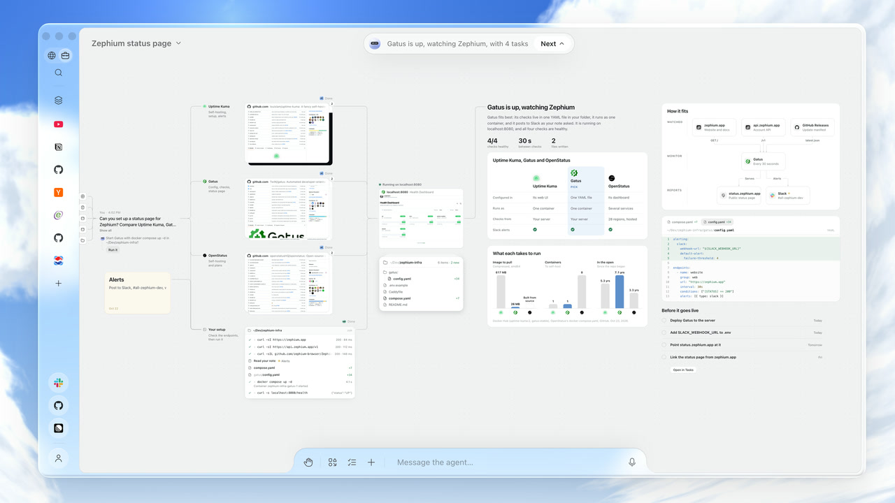

### Mockups
Overview, prompt branching into browser sessions, a comparison, a chart and code:
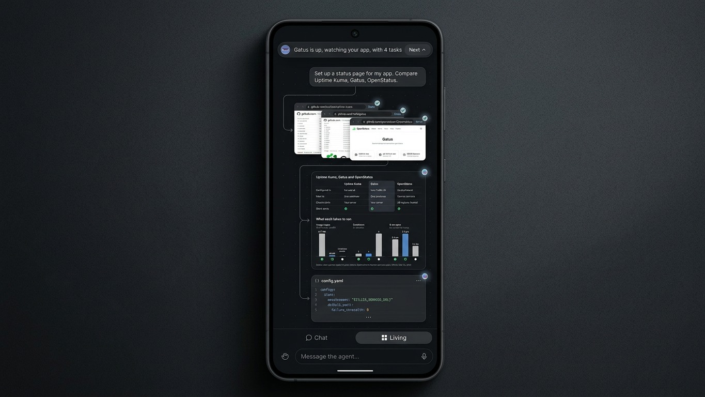

Zoomed in on a live browser session and its step log:
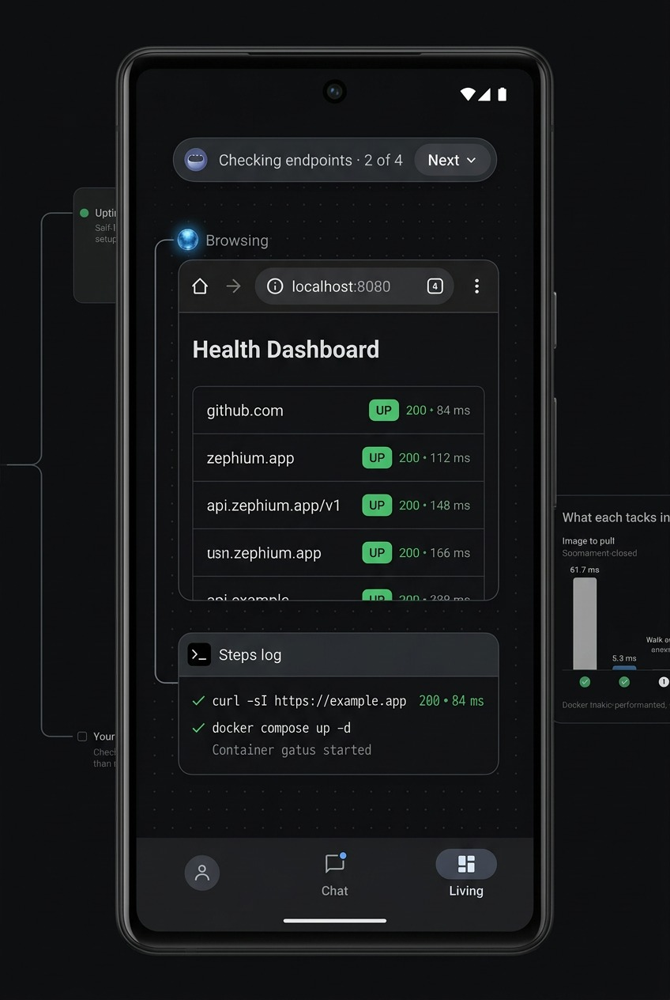

### Light mode
Reference (Finn's mobile light example):
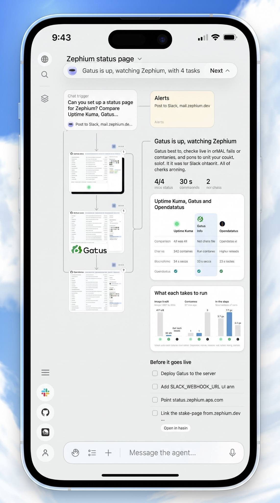

- Soft light-grey canvas with a faint dot grid, white rounded cards, soft shadows, thin grey connectors.
- Two columns on the canvas: prompt and live browser sessions on the left, results (summary stats, comparison table, chart, checklist) on the right. Sticky-note cards (pale yellow) for standing rules like alerts.
- Frosted white status pill with the tiny ARGUS orb and Next.

Overview:
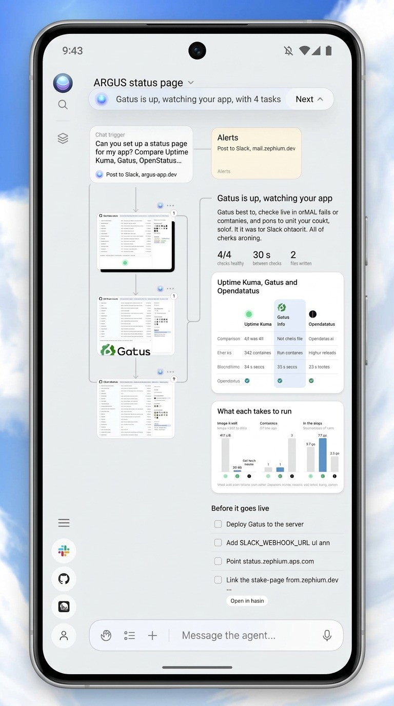

Zoomed on a live browser session and steps:
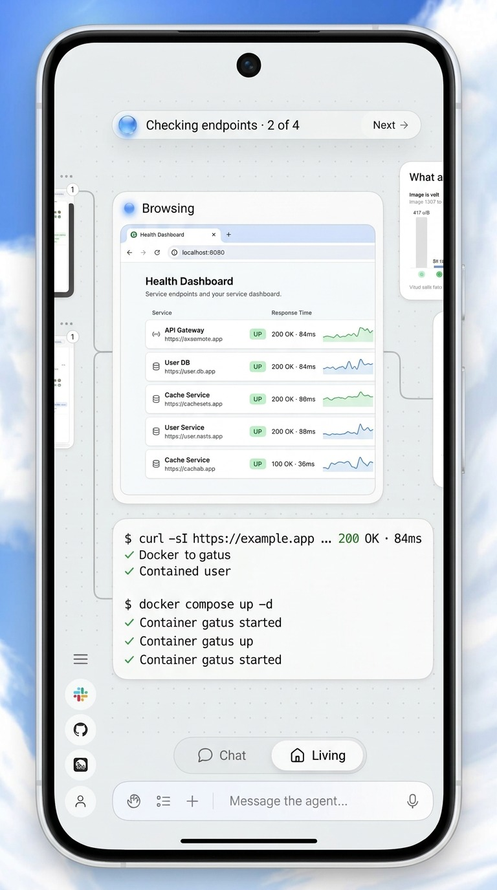

Research task, review pages feeding a chart, notes and tasks:
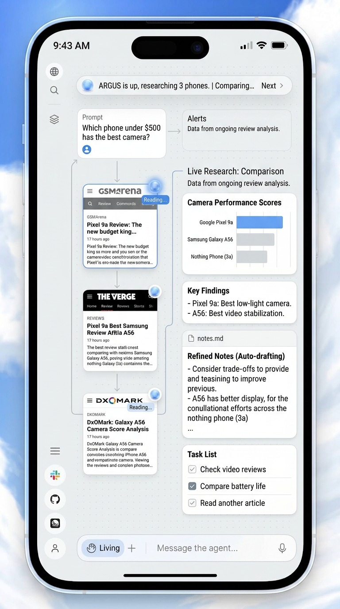

### The new browser uses this look too
Finn, 14 Nov 2026: the new ARGUS browser will look like this Living canvas as well, in both light and dark mode: the same canvas, white/dark rounded cards, thin connectors, frosted status pill with Next, and tiny agent orbs marking what's being worked on. Living UI and the browser share one design language.

### Mobile performance notes
- Draw the canvas, dot grid and links in Compose `Canvas`; only the visible viewport is drawn, nodes outside are culled.
- Orbs = pre-rendered looping sprites (animated WebP) per agent and state, glow drawn live on top. Pause all animation when the tab isn't visible or battery saver is on.
- Browser previews = periodic low-res screenshots/thumbnails of the agent's page, not live WebViews. File previews = real text rendered as text (cheap, crisp).
- Target 60 fps on mid-range devices; cap orbs and previews on screen, collapse older steps into dots.

### Living UI versioning (Finn's rule, until v0.5 is out)
- Living UI has its own version, separate from the app. **First version: 0.1.0** (Finn, 14 Nov 2026).
- Living UI builds are numbered **v0.xz.y**.
- Every new **minor** update: **y + 1**.
- **Major** updates: **x and/or z go up by one**, depending on how large the update is.

### Reference images
Finn will attach Living UI reference images; add them here when received.

### Living UI v1: what shipped (Living UI 0.1.0, app 0.53.3 / versionCode 195)
- **Where:** a `Chat | Living` switch centred over the chatbox in Chat mode (main chat; not inside project chats). Chat is the default and the app always opens on Chat; Living draws in Chat's place, the chatbox stays, Back returns to Chat. Team · Chat · Life · Desk and the notch are unchanged.
- **Canvas:** full screen, faint dot grid (no blueprint), light (soft grey canvas, white rounded cards, soft shadow, thin grey connectors) and dark (near-black canvas, dark cards) from the app theme. One-finger pan, pinch zoom (0.25×–3×), double-tap = fit everything, tap a card = zoom in on it (tap again = back).
- **Tree:** built from the same stream that drives "Show tool steps" (the chat's step messages with their exact call + `ToolTrail` results). Per turn: your message is the root card; a trunk line with rounded elbows into each step card; several page reads in a row sit side by side (up to 3) as a branch that peeks in from the right. The newest 3 turns are drawn (≤ 48 cards).
- **Card types:** prompt; browser / web (URL bar with the address or the search words, page title, page text); file (name, read / wrote, numbered monospace lines of the real text, 10 lines); steps log (commands as `$ cmd` and other tool calls in plain words, with ✓ / ✗ / running); answer.
- **Status pill** at the top: what ARGUS is doing now and the step count ("Reading a page · 3 steps", "Done · 6 steps"), with **Next** to pan to the newest active card. The canvas follows new cards until you pan; Next turns following back on.
- **Agent marks:** placeholder only (Finn designs the bots): a small dot with a soft glow, pulsing on the card being worked on and in the pill while working.
- **Performance:** only cards touching the screen are composed; the camera is read only in draw / placement, so a pan or pinch redraws without recomposing; the dot grid thins itself out when zoomed out (≤ 2,400 dots); one animation (the pulse) only on the active card, only while the app is resumed, none with reduced motion; nothing runs while Chat shows.
- **Code:** `ui/living/LivingSpec.kt` (version, palettes, grid, the Chat | Living state), `LivingModel.kt` (steps → cards, pure), `LivingLayout.kt` (positions, connectors, culling, camera, pure), `LivingScreen.kt` (Compose canvas, cards, pill, switch). ChatScreen.kt: +7 lines. Agent.kt untouched. Tests: `LivingModelTest`, `LivingLayoutTest`.

### Living UI: deferred (TODO)
- Browser screenshots: the background browser keeps no per-step screenshot today, so browser cards show the page's text; add low-res thumbnails when the browser captures them (Blaze Phone's `PhoneBrowser.frame` is only for the phone-control browser).
- Charts and comparison tables built from the agent's findings, sticky notes for standing rules, tasks-still-to-do cards.
- Collapsing older steps into dots, a minimap, and one lane per bot when team bots work in parallel; real bot orbs (Finn's design) in place of the placeholder dots.
- Battery-saver check for the pulse (reduced motion is honoured today), and Robolectric shots of the canvas in light and dark.
- The new ARGUS browser in this same design language.

---

## 2. ARGUS agent bots (real-hardware look)

**Owner: Finn** will design the bots and their final looks himself later. Renders below are concept only; Living UI v1 uses simple placeholder dots.

Five agents, rendered as physical objects: smoked black glass cores, brushed-metal orbits, charging bases. These are the source for the orbs in Living UI.

| Agent | Look |
|---|---|
| General | Glass sphere, blue ring eye, titanium orbit rings |
| Research | Atom core, wraparound glass data band |
| Creative | Pen-nib emblem, iridescent violet-pink ring |
| Productivity | Faceted gem core, blue checkmark, steel orbits |
| Guardian | Shield emblem, gunmetal armor chevron |

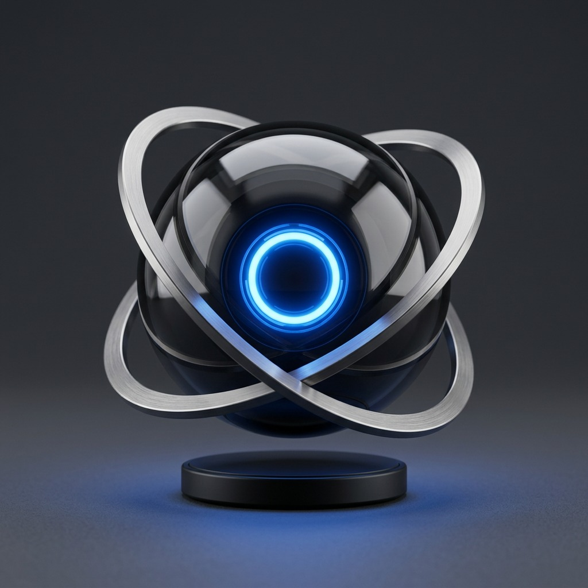

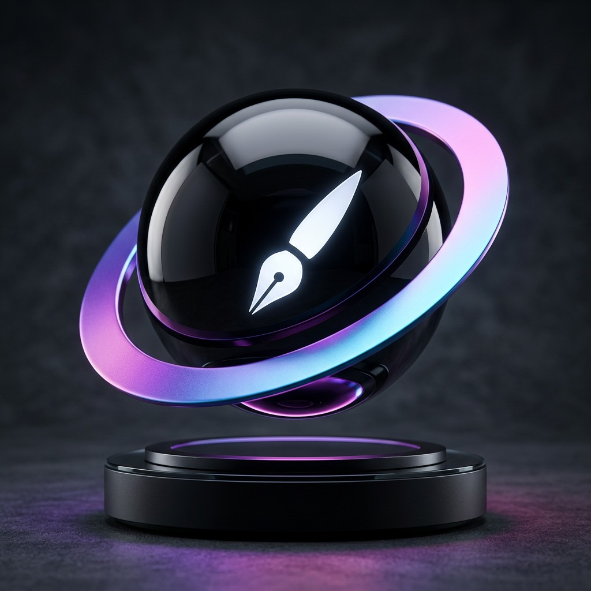
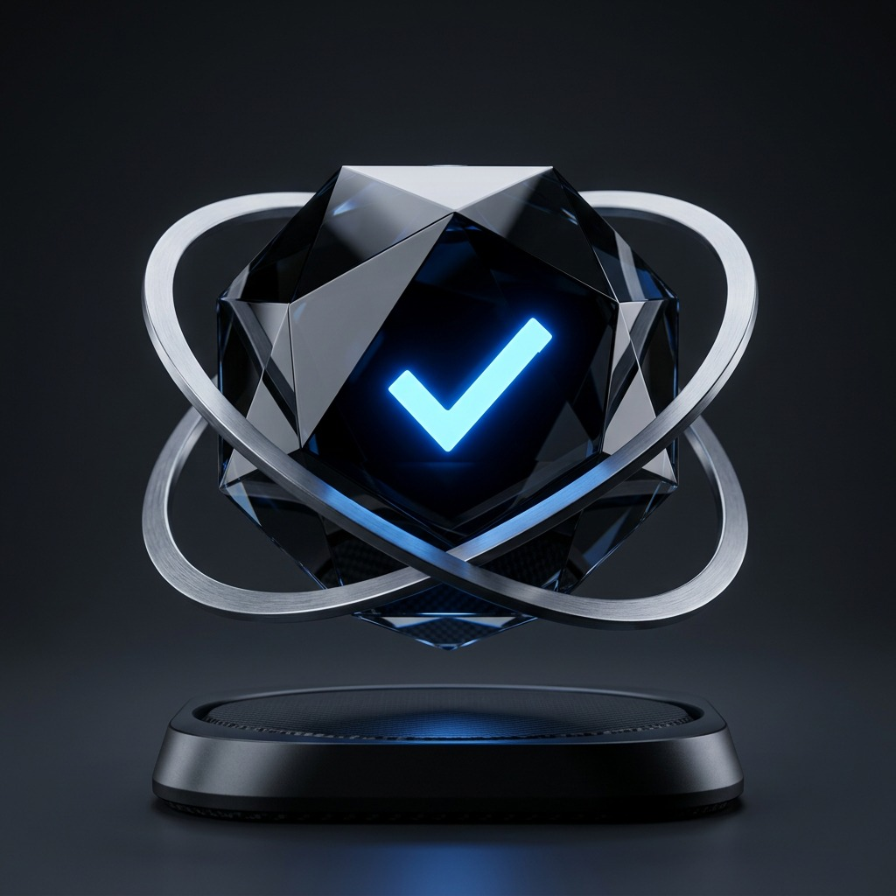
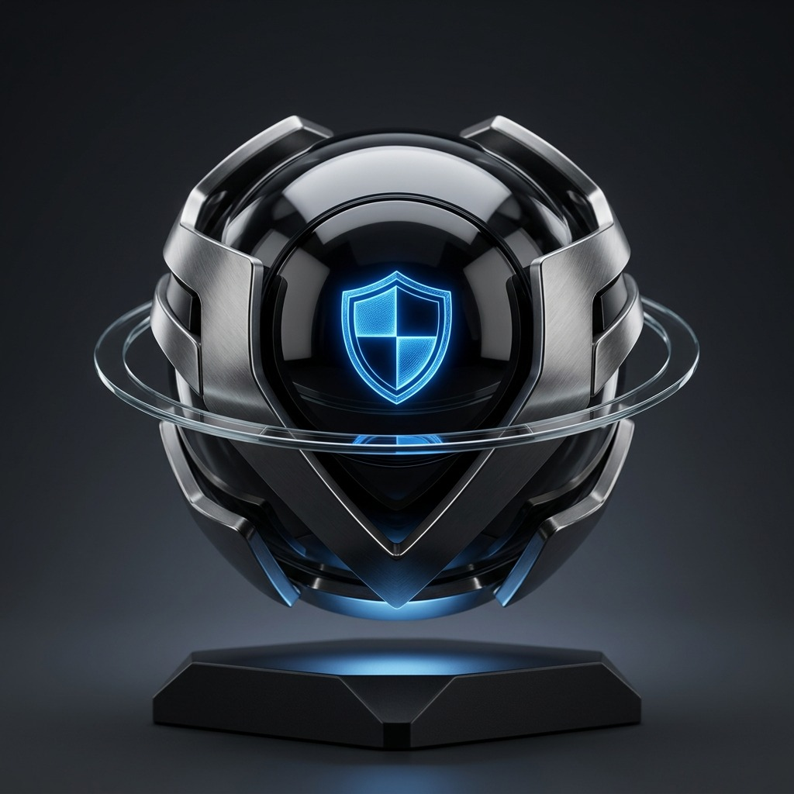

States still to render: idle, thinking, happy (faces as a live overlay).

### Keeping the look in-app (fidelity estimates)
| Approach | Fidelity | Catch |
|---|---|---|
| Static renders (WebP) | ~95–100% | No motion |
| **Pre-rendered loops per state (recommended)** | **~90–95%** | ~0.5–2 MB per state |
| Real-time 3D (Filament/SceneView, PBR glass) | ~75–85% | Battery, APK size, glass looks cheap on mid-range |
| Compose + AGSL shaders (2.5D) | ~60–70% | Android 13+ for shaders; loses glass depth |
| Lottie / vector | ~40–50% | Flat, cartoonish |

Protect the look: render on the app's exact background (or transparent with baked shadow), export 2–3× on-screen size with light noise against banding, keep faces and glow as live overlays, cap on-screen size ~256–320 dp.
