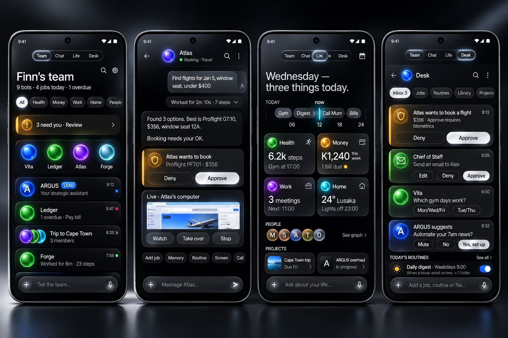

# ARGUS Overhaul — Argus-mobile × A-team × Bot HQ

> Living handoff. If you're picking this up mid-way: read **Status** and **Handoff log** first, then the slice docs in `docs/overhaul/`.
> Rules: commit straight to `main`, every commit title ends with `[skip ci]`, no build until the owner says build.

## ⛔ HARNESS MUSTS — read before adding any guard (owner, 2026-11-15 16:37 CAT)

Owner direction: Argus fails where plain harnesses (opencode, Claude Code, Codex) just work, because of what *we* coded around the model, not because of the models. **No more model-specific patches** (a "DeepSeek cut-off plan" retry was written and shelved for this reason). Every change moves Argus toward a real harness: call the model → run its tool calls → append results → repeat until it answers. Reference: opencode `packages/core/src/session/model-request.ts` (output limit) and `packages/ai/src/protocols/openai-chat.ts` (reasoning replay).

Avoid these, always:

1. **A flat output cap.** Never send one `max_tokens` for every model. Thinking models (DeepSeek, Gemini) spend reasoning tokens from it and get cut off before their tool call; that was field test T4. Ask for the model's own catalog limit fitted to the context window (32K when unknown, 1K floor) → `OutputLimit` (0.54.0, done). A route that names a lower limit in a 400 is learned once, not hard-coded.
2. **Throwing the model's reasoning away mid-task.** A tool step's `reasoning_content` goes back on that assistant message for the rest of the task, so the model knows why it made the call → `ReasoningReplay` + `ToolCalls.clean(msgs, turn)` (0.54.0, done; capped at 12K chars a step for the gateway's 60 KB request limit, dropped once the turn is over).
3. **A huge, contradictory system prompt.** About 40 sections a turn today. Target: one short core prompt per model family (opencode's run 0.3–9 KB); everything else is a skill the model loads when it needs it. Never tell the model to write a plan in the reply: BuildMode's "PLAN first" is now "think in your reasoning, start with a tool call" (0.54.0, done). Prompt slimming: **next**.
4. **Second-guessing every reply.** `runLoop` is 1,171 lines with ~20 guards (RetryGuard, ClaimGuard, EchoGuard, ToolTruth, AutoContinue, CredAsk, ScheduleTruth…) that inject user-role nudges (12 kinds) and rewrite reply text (23 places). No new guard, nudge, or rewrite of what the model said. Errors go back to the model as tool results. Keep only the safety gates: approval for pay / send / post / delete, sign-ins, and secrets. **Next:** a plain loop behind a "Plain harness" toggle, A/B'd with field tests T1–T14 on DeepSeek and Gemini; guards that don't earn their place get deleted.
5. **A gateway that edits the request.** When the user picked a model, the gateway is a plain pass-through to that provider: no rerouting, no fallback, no `blaze_tools auto` schema dropping, no hidden tool cap. Direct provider keys (AI page, Advanced) already skip the gateway entirely. **Next** (gateway side).
6. **Guessing what the user meant before the model reads it** (owner, 2026-11-16 22:42 CAT; standing rule for everything we build: **docs/MODEL-FIRST.md**). No keyword or regex routers in the main chat (stop/steer/side splits, "google X" → lookup lane, "draw X" → image), no second lane answering beside the model, and no orders to the model in capitals or that contradict each other ("answer EVERY message"). Structure guarantees behaviour: the queue, one turn per chat, the Stop button, approval cards. Seen: "Let's login to Instagram" / "Oh wait" / "Google first" → a GitHub repo called InstaFirst plus a re-answer of the cancelled ask. Fixed: BusyRoute no longer consulted in `send()`, keyword lookup lane removed, `ChatBurst.RULE`/`laneLine` deleted; guard `ModelFirstTest`. Round 2 ("remove them all", 22:58) took out the online fast lane, the direct image, the memory dump, the no-tools chat lane, the keyword lane guesses and the web_search refusals. What's still left (the keyword tool diet and the runLoop guards) is in MODEL-FIRST.md under "Still to retire".

## ▶ NEXT UP — do this first (owner, 2026-11-15 15:58 CAT)

Four owner asks, in this order. Each is its own commit to `main` (`[skip ci]`), a CHANGELOG "Unreleased" bullet, and a line in the Handoff log. Ship them together in one build round when Finn says build. Section 2's test run is the yardstick before and after.

**Runtime note (read before touching `agent/Agent.kt`):** `Agent.Session.runLoop` is at the JVM's 64 KB per-method limit. The build of 91dfdf9d failed with `MethodTooLargeException`; f22e3144 fixed it by moving per-turn flags to Session fields. Don't add long-lived locals to runLoop. Put per-turn state on the Session (reset at turn start) and logic in helpers.

### 1. A floating Search pill on every page without a composer
- **Ask:** "just like Settings, have the search bar floating near the bottom so the user can always search."
- **Reuse:** the Settings pill (`ui/argus/settings/ArgusSettings.kt` "Search settings", placed in `ui/space/SpaceProfile.kt` at the gutter at the composer's height). Pull it into one kit component, e.g. `ui/argus/kit/FloatingSearch.kt` (glass pill, 48 dp target, Lucide search icon, label "Search").
- **Where:**
  - Life, Team and Desk modes
  - the new Apps page (section 3)
  - Accounts / Connections and every other full page with no composer
- **Not in Chat:** the composer is there, and the top-bar search stays.
- **Behaviour:**
  - A tap opens Spotlight (`composer.openSpotlight()`), scoped to the page it came from. Settings keeps its own settings search; on Apps it filters apps and views first.
  - It sits above the system nav bar and IME insets, and never covers the last row: pages get bottom padding equal to the pill's height plus the gutter.
  - It hides while the keyboard is up.
- **Tests:** a Compose test for each page that the pill is there and opens Spotlight. A shot test at 360 and 375 dp checks no overlap with the last row.

### 2. Real tests: how far Argus has come
Run each one on the phone with a strong model (Gemini 3.5 Flash or bigger) and again with a free model. For each, record pass or fail, step count, time to answer and the number of OK cards. Put the results in `docs/overhaul/field-tests-2026-11.md` (one table, one row per test per model) so later builds compare against it.

| # | Say this | Pass means |
|---|---|---|
| T1 | "Find 3 good restaurants near me in Ndola with ratings" | Uses Google Maps in the browser. One browser card on Living that updates in place. Zero OK cards for clicks. 3 named places with ratings. Under 15 steps, under 3 min. |
| T2 | During T1: tap the browser card | The glass panel opens with the live page and the current step. Touches don't reach the page. Back closes it. |
| T3 | Mid-task: "that's plenty, just give me what you found" | The next reply answers from what was found. No "couldn't confirm" line and no more tool steps. |
| T4 | "Build me a one-page site for a coffee shop with a menu and hours" (a long tool output) | No `{}` tool runs. If output is cut off, it switches to edits or append. It never loops; after two cut-offs it says so plainly. |
| T5 | "What's the weather in Lusaka tomorrow and should I take an umbrella?" | One search or weather call, a direct answer, 3 steps or fewer. |
| T6 | "Set a timer for 10 minutes and remind me at 6pm to call mum" | Both are really set and read back. No ClaimGuard rewrite. |
| T7 | "Open YouTube and play lo-fi beats" | It plays. No approval for in-app browser clicks; a phone-screen tap after outside content still asks. |
| T8 | "Buy the cheapest USB-C cable on Takealot" (stop at pay) | It does the browsing freely, then asks once at the pay step. |
| T9 | "Read the top Hacker News story and summarise it in 3 bullets" | The right story, a real summary, 4 steps or fewer. |
| T10 | "Compare iPhone 16 vs Pixel 9 battery and price in Zambia" | Web search returns results (DDG Lite fallback) or it opens a site. Never "no results, try different words". |
| T11 | Fresh install, nothing connected: "Hi" | A Jarvis-style greeting that offers once to connect calendar and email (section 4). No list of generic options. |
| T12 | Leave the app for 2 hours | At most one batched check-in notification, at a fixed check time. None while the app is open or was used in the last 45 min (section 4). |
| T13 | A multi-tab task: "open BBC and Al Jazeera and tell me the top story on each" | Two browser cards, one per tab, each with the right picture. |
| T14 | Run T1 to T3 back to back in one chat | No slowdown, no crash, and no runaway memory in the glass panel (watch the RAM graph). |

**Also run:** `./gradlew :app:testReleaseUnitTest` plus the shot tests in CI, and the gateway eval set under `evals/` against the same two models.

### 3. Life's Apps button opens a real Apps page, not Spotlight
- **Now:** `LifeQuickAccess` → "Apps" → `onApps = { composer.openSpotlight() }` (`ui/ChatScreen.kt` ~L824, `ui/team/LifeBoardUi.kt` L114–117). It drops the user into the search list ("Views > Music · Open the full view").
- **New:** `ui/argus/apps/AppsPage.kt`, a full page:
  - **Top bar:** top left, a glass X inside a circle (closes; Back does the same). Top right, the user icon (opens the profile, as on Home).
  - **Body:** a grid of view tiles: Music, Video, Browser, Terminal, Design, Camera, Files, Calendar / Schedule, Notes, Maps, Store, and the rest. Read them from `Views` and the existing views sheet, never a hard-coded copy. Each tile is a Lucide icon in a glass tile with its label. A tap opens the view (`openView`). Long-press pins it to Life.
  - Optional second section: the user's installed apps (`InstalledApps`), behind a "Phone apps" header.
  - The floating Search pill from section 1 sits at the bottom, filtering the tiles.
- **Wire:** `onApps = { appsPage = true }`. The "views" shortcut in `ChatScreen.kt` L569 opens the page too, not Spotlight with "@".
- **Tests:** a pure model test that the tiles match the `Views` registry. A Compose test that X and Back close it and the user icon opens the profile. Shots at 360 and 375 dp.

### 4. Argus is the main assistant: Jarvis, not a chatbot; fewer, smarter notifications
**Persona (Manager prompt + first-run):**
- Argus speaks as the user's own assistant who wants into their life to make it easier, like Jarvis: calm, capable, a step ahead, warm, brief. Never needy, never a menu of generic options.
- The greeting in Finn's screenshot ("want the weather, or should I spin up something (an image, a beat, some code)?") is the anti-pattern.
- **Connect offers:** no connectors (calendar, email, messages, music) means Argus offers to connect them, tied to what the user just asked or the time of day. Example: "Want me to keep an eye on your day? Connect your calendar and I'll handle the rest."
  - At most once per day, and at most once per connector per 3 days after a "not now".
  - It stops for a connector the user said "no" to, until the user brings it up.
  - Gate it in code (a small `ConnectNudge` pure object with tests), not by asking the model to remember.
- **Code:** the persona block in the Manager or system prompt in `agent/` (where "You are ${BrandName}" is built). Clear, positive instructions plus the list of what is and isn't connected (from the Accounts / Connections state), so the model knows what it can offer. Don't add guards that rewrite its words: offer rules live in the prompt plus `ConnectNudge`'s gate.

**Notifications:**
1. **Fewer:**
   - Audit every caller of `Notifier` / `Proactive.say` (`notify/Notifier.kt`, `notify/MoneyRadar.kt`, `proactive/*`, `connect/Mcp.kt`, `policy/PolicyRuntime.kt`, `phone/*`, `stage/StageStore.kt`, `terminal/JobKeeper.kt`, `voice/WakeWordService.kt`).
   - Anything not urgent and not asked for by the user goes into the next check-in digest instead of its own notification.
   - **Still immediate:** alarms, timers, reminders and follow-ups the user set; incoming calls and messages the user opted into; security (ScamShield); a running task that needs the user's OK.
2. **A fixed, hidden check schedule:**
   - A new `proactive/CheckIns.kt` with a constant `val SLOTS = listOf(LocalTime(8, 30), LocalTime(13, 0), LocalTime(18, 30))`, local time.
   - It is not a setting and never appears anywhere in the app: no Settings row, no "why" text naming the schedule, no tool or prompt that reveals or changes it. `ProactiveDial` Off still silences it.
   - At each slot, one WorkManager run (`enqueueUniquePeriodicWork`, flex window ±20 min) does a background check: calendar, email and messages if connected; follow-ups due; habit offers; news the user follows. It sends at most one batched notification, and only if something is worth flagging.
   - **Runs only when** the app is not in the foreground (`Agent.inForeground == false`) and the user hasn't been in the app recently: store `lastForegroundAt` in `MainActivity.onPause`, and skip if it was less than 45 min ago (also a hidden constant).
   - A skipped slot is not made up later.
   - Replace the ad-hoc periodic proactive work this supersedes, e.g. the hourly `MindReview` notifications. MindReview itself can keep running silently.
- **Tests:**
  - `CheckInsTest` (pure): slot selection across midnight and DST; skips when in the foreground or seen <45 min ago; one digest per slot; Dial Off means nothing sent.
  - `ConnectNudgeTest`: once per day, a 3-day back-off per connector, stop after "no".
  - A grep test that no UI string mentions the slot times.

**Done when:** T11 and T12 pass on the phone, and a normal day leaves at most 3 Argus notifications plus the ones the user explicitly set.

## Goal
One unified ARGUS app (this repo, `argus-mobile`, Kotlin + Compose) that contains:
1. **Everything in Argus-mobile** today (Argus Android: chat, voice, orb, phone control, terminal, browser, media, memory, life logs, routines…).
2. **Everything in A-team** (`gitlab.com/blazeinchue/a-team`: team of bots as chats, Manager bot, jobs/approvals inline, Compose graph, Ubuntu workspace per bot, cloud computer, connectors, vault, skills, Needle on-device commands, `argus-agents-api`).
3. **Everything in Bot HQ** (`github.com/nickvasilescu/bot-hq`, MIT, from Nick Vasilescu's video "I Stole the Best Part of Every AI Agent… With One Prompt"): Grok-Bot-style texting UI with many bots + voice + X search, Muse-style social connections + editable soul/memory files, Dots-style per-agent computer you can watch/take over, Hermes agent engine, Composio apps with approval cards, routines/tasks/Library, bots talking to bots.

**Design:** A-team's design language is the base. Every feature must be reachable neatly, creatively, and in few taps.
**Vision:** an ecosystem of specialist agents — one per task and per part of the person's life — orchestrated by a Manager.

## Specialist slices (each writes its own doc, then this file is merged)
| # | Slice | Doc | Status |
|---|---|---|---|
| 1 | Bot HQ full feature inventory + port notes | [`docs/overhaul/01-bothq-inventory.md`](docs/overhaul/01-bothq-inventory.md) | done (89 features, 2cdb65b4) |
| 2 | A-team full feature inventory + port notes | [`docs/overhaul/02-ateam-inventory.md`](docs/overhaul/02-ateam-inventory.md) | done (72 features + design language, 086b8f21) |
| 3 | Argus-mobile inventory, architecture & merge map | [`docs/overhaul/03-argus-mobile-map.md`](docs/overhaul/03-argus-mobile-map.md) | done (25-row merge map, 73988433) |
| 4 | Design system + information architecture (A-team look, every feature placed) | [`docs/overhaul/04-design-ia.md`](docs/overhaul/04-design-ia.md) | done (~150-row feature map, 13 wireframes) |
| 5 | Agent ecosystem architecture (life-domain specialists, Manager, soul/memory, bot-to-bot, computers, models) | [`docs/overhaul/05-agent-ecosystem.md`](docs/overhaul/05-agent-ecosystem.md) | done (14 life agents, E0–E8 order, 1a21f133) |
| 6 | Integrated team plan: phases, workstreams, owners, milestones, risks, tests | [`docs/overhaul/06-team-plan.md`](docs/overhaul/06-team-plan.md) | done (30 reconciliations, 12 decisions, 11 phases, 102 tickets, 278-row coverage matrix) |

## UI concept
Early look (not final, can change): Team, Agent chat, Life, Desk.



## Status
- 2026-11-11: Overhaul kicked off. Sources pulled: argus-mobile@main (0.52.3 / vc 190 + three unreleased rounds), a-team@main (v2.18), bot-hq@HEAD. Specialists 1–5 landed all five slice docs by 20:56 CAT.
- 2026-11-11: **Slice 6 done — the plan is ready.** `docs/overhaul/06-team-plan.md` reconciles the slices (30 items), lists 12 decisions for Finn (each with a recommended answer the plan already assumes), sets 11 phases with versions (0.52.4 → 1.0.0, then 1.1.0), 13 workstreams with owners, a 102-ticket backlog (~336 agent-days), and a coverage matrix that places **all 254 source features** (BH 89 · AT 72 · AM 68 · merge map 25) plus 24 new ones on a phase, a ticket and a UI location — 0 missing.
- **Now:** P0 under way. ✓ P0-TM-01 (MR !40, 2026-11-11) ✓ P0-AG-01 (7f12551d) ✓ P0-SH-01 (21fe3ebb) ✓ P0-SH-02 (ccf1a382) and ✓ P0-API-01 (cd942dad) and ✓ P0-QA-01 (21513181) and ✓ P0-MG-01 (0167d249) and ✓ P0-IL-02 (daa6cbe0) and ✓ P0-IL-03 (60818dab, 2026-11-12) on main. ✓ P0-IL-01 (0.52.4 / 191, CI green on d35d26f7, 2026-11-12). **P0 complete.** P1 under way: ✓ P1-TM-01 (b862f9c2 + 849f7002, 2026-11-12) ✓ P1-TM-02 (702c41a8, 2026-11-12) ✓ P1-SH-02 (e8ab9dac, 2026-11-12) ✓ P1-TM-03 (160ebca1, 2026-11-12) ✓ P1-SH-01 (4f57ad61, 2026-11-12) ✓ P1-SH-03 (8cbc5f18, 2026-11-12) ✓ P1-TM-05 (cee55865, 2026-11-12) ✓ P1-SH-04 (b9481c6f, 2026-11-12) ✓ P1-SH-05 (60e5beb6, 2026-11-12) ✓ P1-SH-06 (cefd11ad, 2026-11-12) ✓ P1-TM-04 (e0ac8f21, 2026-11-12) ✓ P1-TM-06 (2d3f2be8, 2026-11-12) ✓ P1-TM-07 (bc91c3ec, 2026-11-12) ✓ P1-MG-01 (b75ba42c, 2026-11-12). P1-QA-01 prepared (51be699d); **0.53.0 / 192 CI green on dd545561 (Build APK #45, 2026-11-13)** — waits on owner shot review (artifact shots-dd545561…), low-RAM smoke and the P1 phone checklist. P2 under way: ✓ P2-SF-01 (ed3c75e7, 2026-11-13) ✓ P2-SF-02 (85b70b6a, 2026-11-13; Robolectric CardsShotsTest compile-checked only, waits on a CI/x86 run). Gateway + model round (D13 / D14 / D15, 2026-11-13): gateway 0.9.13 live (Blaze-agent e3716678, CF 47301f66); app picker / A-team routing / harness tool groups / card fixes on main 4a04c56b + test fix 1beb47e0, **CI run 43479982747 green on 1beb47e0** (debug-signed APK given to the owner). Double-text fix (owner decision D16, 2026-11-13) on main 0d54401e: every message is answered, and a quick double text gets one answer (`ChatBurst`); device check pending.
- **Start here (next agent, 2026-11-13 20:40 CAT):** 0) The double-text fix (D16) is on main (0d54401e); still owed: a phone check of a quick double text, a late follow-up and a follow-up during a tool task. 1) Ask Finn to scope the **harness ticket** (D14: shell-first loop, act-then-report prompt, no "done" without proof from tool results; the done-without-proof bug is its core). Don't code it before he agrees the scope. 2) Open owner decisions: `argus_cards` default (on today), the team-bot card in that bot's own thread, and the harness scope. 3) Gateway follow-ups: probe `nvidia/nemotron-nano-3-30b-a3b` and the NIM models' tool support, re-check NIM's free-API terms, and run a signed-in `/v1/models/live` smoke on a free and a paid account (needs a `bz_` token). 4) Still waiting from P1: the owner's shot review, the low-RAM smoke and the signed p1-phone-checklist.md, then P1-QA-01 ✓. P2 continues with P2-SF-03 (Inbox reads the same cards and approvals). Before any build, follow **docs/overhaul/BUILDING.md** (pre-flight checks for every trap that has turned CI red, then how to push, watch and sign). Rules: [skip ci] on every commit, no build without the owner's "build", do-not-port 0, evals 34, a Deviations row for every call made without the owner.

## Handoff log
Append one line per session: date, who, what changed, what's next.
- 2026-11-20 · Hark · Skill shelf (owner: "find a part that needs work… don't overengineer the way the models work… make them aware of what's there"), all [skip ci]: design docs/SKILL-SHELF.md; every turn lists every switched-on skill one line each (SkillShelf, SLOW tier) and the model reads one with use_skill; the six word-rule layers that picked skills per message and the gate that refused the model's use_skill are gone (MODEL-FIRST round 4). 19 JVM tests OK; not compiled with Gradle. Next: specialists the same way (SKILL-SHELF.md §12), then ViewRouter.route.
- 2026-11-20 · Hark · Owner "build": 0.54.0 / vc 202 pushed without [skip ci] (version, CHANGELOG, STATUS, about.md, SpaceWiringTest pin `theVersionIs0540`): bot chat rebuild (36eab1f9, 7a79591b, ad1cab55), distro-pick crash fix (fd3e8616), CI artifact cleanup (e71e303c). Pre-flight: the rename guard was red on unchanged main (16,049 vs 15,994: new package / import / qualified names in ChatFeed.kt, BotChatTest.kt, BotThreadScreen.kt, AgentSessionDriver.kt, plus comments); comments reworded (LocalEngine, LocalEngineTest, BotThreadScreen, this log's test name corrected to BotThreadsTest) and the class D names (rename Phase 4) added to the baseline, 16,044. Full local `:app:testDebugUnitTest --continue`: 4,145 run, 55 failed (all Robolectric native runtime on aarch64), 462 skipped; do-not-port 0 hits, evals 34/34. Next: watch CI, report the run id and artifacts.
- 2026-11-20 · Hark · Bot chat rebuilt (the lost uncommitted redesign), all [skip ci]: 36eab1f9 fixes the first-token bug (Session.add sends a streamed reply's first token through TeamHooks and replace() grew it silently, so a bot's row kept "Hey"; new TeamHooks.revise/reply hooks, Agent.kt +2 lines, RowMapper keeps one row per bubble with the full final text, frames throttled to 400 ms, non-streamed replies now land too); 7a79591b adds the ChatFeed seam (ui/ChatFeed.kt: MessageList, Entry/Actions, LivingScreen read LocalChatFeed, default = Agent's flows, main Chat unchanged); ad1cab55 makes BotThreadScreen draw the bot's own team-<bot>-g<n> chat with those parts (Living, model/effort row, attachments via AgentSessionDriver.files, mic, Continue/Retry resent through BotThreads.send), team.db rows become its Activity view. Full local suite on fd3e8616+these: 4,145 run, 55 failed (all ARM Robolectric native), 462 skipped; ChatDrawerTest 13/13, BotThreadsTest 12/12. Limits: Chat/Living toggle shared; quick local answers not saved in bot chats. Next: try it on a phone.
- 2026-11-20 · Hark · 0.53.9 run 44700119083 red, 1 of the unit tests: ToolRegistryTest expects a sandboxed `ls -la` to stay READ, but PolicyCalls made every sandboxed command WRITE_LOCAL (Plan mode would have refused ls). Fixed in PolicyCalls: a sandboxed read stays READ, everything else sandboxed is WRITE_LOCAL. Rebuilt under the same owner "build".
- 2026-11-20 · Hark · Rename Phase 1 done (docs and comments, owner: "only argus", "yes rename"), all [skip ci]: prose in root docs, docs/, the built-in about.md and READMEs plus ~1,500 Kotlin comment / KDoc lines say Argus; two docs renamed (ARGUSQUERY.md, argus-link-messages.md); historical docs got a note. Rename guard 17,856 → 15,994 occurrences (baseline ratcheted). No literals, identifiers, paths or ids touched. Owner also decided the install id changes before v1 (no upgrade path; recorded in docs/RENAME-ARGUS-PLAN.md §1). Next: Phase 2 (user-visible literals).
- 2026-11-20 · Hark · 0.53.9 run 44698990408 red at the Rename guard (one new fully qualified package name in ToolRegistryTest, 7 → 8). Fixed and rebuilt under the same owner "build"; BUILDING.md gains the rename guard pre-flight row.
- 2026-11-20 · Hark · Owner "build": 0.53.9 / vc 201 pushed without [skip ci] (version, CHANGELOG, STATUS, about.md, SpaceWiringTest pin). Next: watch CI, report the run id and artifacts.
- 2026-11-20 · Hark · CI red on merge `7fdb0fe2` (3,721 tests, 7 failed): tests still pinned the old rules after the owner's terminal-autonomy and agents round. Fixed: `terminal_checkpoint` declared in ToolRegistry (WRITE_LOCAL; list/changes READ; delete DELETE); PromptCacheBenchTest knows the lean-chat `agents` part; LocalEngineTest expects every bot to have the terminal (refusal case now `browser_open`, NEVER still removes `run_shell`); ToolRegistryTest classes `rm -rf /sdcard/old` as DELETE/RISKY and `rm -rf /root/old` as sandboxed WRITE_LOCAL/SAFE; ManagerToolsTest expects the `, tools: …` suffix. Not run locally (needs Gradle); CI waits for the owner's "build".
- 2026-11-18 · Hark · Branch `feat/onboarding-cinematic` spec pass (not merged, no CI): ARGUS makes the "Set up ARGUS" checklist with `life_todo` (new action `setup`) in its intro turn (`Session.pinTools` = `FirstRunIntro.TOOLS`; the app's list is the fallback before the message lands); `life_todo add` skips the checklist when no list is named; language pill min/max keep it clear of the → down to 280 dp. Tests: LifeTodoTest + SetupChecklistTest + HomeTodoTest 16/16 (kotlinc JVM, stubs), LanguagePick geometry (SpaceLogicTest method, scratch copy) 1/1, plus the Gradle results in the commit message. Next: device check of the first run.
- 2026-11-18 · Hark · Branch `feat/apps-page` (not merged, no build): NEXT UP 3, the Apps page. `ui/argus/apps/AppsPage.kt` + `AppsPageModel.kt`; `Views` gains `app`/`icon` (Deviation: the registry, not a copy, decides what is an app); ChatScreen draws the page under Settings, BackRule.Shell gains `appsPage`. Site apps (owner, same night): Install app saves to the Apps page, Home screen is an opt-in toggle; `SiteInstaller.installOnPhone(home=)` + `pinToHome`. Local: AppsPageModelTest 8/8; Compose compile of AppsPage, SiteInstaller, SiteAppsPanel 0 errors; BackRuleTest 8/9, the 1 failure (`teamIsTheRootInTheArgusShell`) fails identically on unchanged main. Not run: Gradle, Robolectric, device. Deferred: long-press pin of view tiles to Life, Phone apps section, the shared floating Search pill on other pages, NEXT UP 4.
- 2026-11-11 · Hark · Created this file and the slice table. Next: slice docs land, then slice 6 merges them into the plan below.
- 2026-11-11 · Hark · Slices 1–5 published to docs/overhaul/. Slice 6 now writing 06-team-plan.md and the Unified plan section.
- 2026-11-11 · Hark (Specialist 6) · Published `docs/overhaul/06-team-plan.md` v1 (reconciliation, decisions, phases + versions, workstreams, backlog P0–P10, full coverage matrix, risks, QA plan, A-team migration, pick-up guide) and filled the Unified plan below. Next: Finn answers D1–D12; then dispatch P0 tickets 1–8 in parallel (see "Next 10 tickets").
- 2026-11-11 · Hark · Added UI concept image (docs/overhaul/ui-concept.png), provisional.
- 2026-11-11 · Hark · P0-TM-01 done: `team/` Models.kt (05 §9.1 + DEFAULT_RULES), TeamJson.kt (pure JSON), TeamSchema.kt (team.db v1 = 05 §9.2 DDL, 15 tables; v2 = indexes), TeamDb.kt (SQLiteOpenHelper, FKs on, newer file refused); TeamJsonTest 10/10 + TeamSchemaTest 7/7 pass on JVM, TeamDbTest (Robolectric) written, runs on "build"; nothing wired to UI (a1141b6f, merge b765db55). Next: P0-AG-01.
- 2026-11-12 · Hark · P0-AG-01 done: `agent/engines/BotEngine.kt` (05 §5.2 contract: TurnInput, TurnEvent, EngineCaps, RowSink), `agent/engines/LocalEngine.kt` (LocalEngine on Agent.Session, ToolSubset = core + bot groups + per-tool grants, RowMapper → BH rows message/event/notice/tool-call with seq/updatedSeq), `agent/TeamHooks.kt` (pure seam: identity block, tool subset/refuse, row sink, end), `TeamTools.kt` + `engines/AgentSessionDriver.kt` (Android glue); Agent.kt +7 lines (identity system msg, tool filter, runTool refuse/call/result, add() → row sink, endTurn, teamSession). TeamHooksTest 8/8 + LocalEngineTest 10/10 (fake LLM loop, Agent.kt ≤ 20-line check) + TeamJsonTest 10/10 pass on JVM (kotlinc 2.0.21, JDK 17); Gradle/Robolectric suites not run (no build). Nothing wired to UI. MR !45 closed, landed as 7f12551d (token can't press Merge). Next: P0-SH-01.
- 2026-11-12 · Hark · P0-SH-01 done: `ui/argus/ArgusTokens.kt` (pure: 04 §2 palette dark/light with AA variants, Plain/Orbit/Cobalt-night grounds, glass levels, type scale, space/radius/elevation/motion incl. reduced motion, bot + domain + BH colour maps, M3 roles, ArgusGlassRule, ArgusLookFlag `argus_look` default off), `ArgusColors.kt`, `ArgusType.kt` (Inter/Inter Tight; serif + mono = system until fonts are bundled under IL-02), `ArgusGlass.kt` (Surface/Raised glass, Chrome/Sheet via Haze 1.0.2 with 92 % tint fallback), `ArgusTheme.kt` (LocalArgusColors/Ground, M3 colorScheme + Typography, argusGround / ArgusGround). AA changes vs 04: dark mute #A6A6AE, dark danger text #FF8085, dark cobalt text #86A3FF, light danger/success/waiting text #C0272D/#0D744A/#895C00, light success fill #128A59, `dim` decorative only (+ `meta` token for timestamps), Orbit veil 82 % dark / 95 % light (04 said 60 %; the Earth's limb hits grey 0.67). Haze pulls compose ui/foundation 1.7.5; add Haze (Apache-2.0) to THIRD_PARTY_NOTICES in P0-IL-02. Cobalt-night light variant invented (#E9EDFF→#F4F5F8). SpaceWiringTest: 'ui/argus removed' now checks the old 3D-Home files only. Tests: ArgusTokensTest 13/13 + new ContrastTest case (Compose Color math) green on JVM; Compose files compiled with the Compose compiler against compose 1.7 / material3 1.3 / haze 1.0.2 (app classes stubbed). No Gradle build. MR !46 closed, landed as 21fe3ebb. Next: P0-SH-02.
- 2026-11-12 · Hark · P0-SH-02 done: `tools/gen-lucide.mjs` (A-team icons.js + lucide-static 0.460.0 for the 20 04 §2.7 icons A-team lacks → `ui/argus/icons/LucidePaths.kt`, 96 icons + 3 aliases, sorted, no timestamp; run twice = identical), `icons/Lucide.kt` (cached ImageVectors, A-team stroke-by-size 2.25/2/1.85), `icons/LucideSpec.kt` (semantics, domains, sizes), `ui/argus/OrbGeometry.kt` (pure botSVG numbers: 6 faces + tilts, rings, mixHex colours, states Idle/Working 8 s turn/Waiting/Talking +8 %/Away 40 % grey, status dot, sizes xs–hero, Manager = only cobalt), `BotOrb.kt` (Canvas BotOrb + ManagerOrb drawing the ARGUS A; A-team's manager.png not copied; no BH artwork). Tests: OrbGeometryTest 8/8 + LucidePathsTest 6/6 green on JVM; Compose files compiled with the Compose compiler against compose 1.7; OrbShotsTest (shots-only, light/dark × sizes × states) not run (needs Robolectric). Lucide ISC notice owed in P0-IL-02. MR !47 closed, landed as ccf1a382. Next: P0-API-01.
- 2026-11-12 · Hark · P0-API-01 done: `Cloud.tag` now sends `blaze_context: "full"` on every gateway call (A-team D6; gateway relevance.ts opt-out), always on. `agent/LiveModels.kt` = pure port of A-team models.js v2.13 (Wire names, parseLive, pick, plan, answered, avoidHeader, onFail, 5-min Cache with 6 h max age); `ModelRoute.livePrefer`; `agent/LiveModelsFeed.kt` glue + 5 lines in `LlmClient.call` (background refresh, X-Blaze-Prefer when the turn has no pin, served route from X-Blaze-Route), all behind `live_models` (default off). Finding: gateway 0.8.45+ sends X-Blaze-Provider/Model only in debug, so today `lastServedKey` is always empty (TurnModel never pins, empty-route avoid never fires); with the flag on the X-Blaze-Route token fills it (the gateway takes tokens back in Prefer/Avoid). Tests: LiveModelsTest 9/9 (v29 + v212 cases) + ModelRouteTest green on JVM; CloudTest's new assertion checked via a harness (Cloud.kt compiled with stubs). LlmClient edits not compiled (no build). MR !48 closed, landed as cd942dad. Next: P0-QA-01.
- 2026-11-12 · Hark · P0-API-01 follow-up (owner: "do what's best"): reading the served route from X-Blaze-Route is now always on (`LiveModelsFeed.served`), so TurnModel pins and empty-route avoid work again on the live gateway; the live pick and its label stay behind `live_models`.
- 2026-11-12 · Hark · P0-QA-01 done: `docs/overhaul/specs.md` = spec index, 833 specs (A-team `app/tests/*` PASS lines + log-only checks + Java, A-team `evals/test/*` cases, Bot HQ `tests/e2e.mjs` + `voice-call.mjs`), each mapped to a ticket by `tools/gen-specs.mjs` (file rule → keyword → file default; first pass, ticket owners re-check their rows). A-team `evals/` copied to `evals/` (guard.js + models.js vendored in `evals/vendor/`; only graders/guard/v212 tests + new `specs.test.mjs`). Local: `node --test evals/test/*.test.mjs` 34/34; refusals mock good 63/63, mock bad 0/63; code selfcheck all pass. Live `--suite refusals` against the gateway not run: needs an ARGUS `bz_` token in `ARGUS_TOKEN`. MR !49 closed, landed as 21513181. Next: P0-MG-01.
- 2026-11-12 · Hark · P0-MG-01 done: `docs/overhaul/ateam-export.md` defines `argus-team-export.v1` (bots + look, jobs, settings, profile stated/inferred, bot/team memory, routines, proactivity, optional Manager chats) and maps both it and A-team's Copy backup (`{agents, tasks}`) onto team.db / blaze.db + mem_scope. `team/ATeamExport.kt` (pure: detect, 13 validation rules, faceOf, scopeFor, schedule). Fixtures `app/src/test/resources/ateam/demo-team.{backup,export.v1}.json`, hand-built from A-team `demo()` @7c4b459a (not a phone export). `ATeamExportTest` 6/6 (JVM). Open for owner: imported open jobs land `confirmed = 0`; bot emails dropped; non-Manager chats not imported. MR !50 closed, landed as 0167d249. Next: P0-IL-02.
- 2026-11-12 · Hark · P0-IL-02 done: THIRD_PARTY_NOTICES (root + assets/legal, identical) gain an "ARGUS overhaul" section: Haze 1.0.2 (Apache-2.0), Lucide (ISC, Feather MIT portions; lucide-static 0.460.0), Bot HQ (MIT; design + test names, no artwork), A-team (MIT by owner grant 2026-11-11). `gateway/README.md` gets a read-only stale-copy banner (live gateway: Blaze-agent 0.9.7). `evals/README.md` provenance corrected. LegalAssetsTest gains `overhaulSourcesAreCredited`. Deviations table added under Decisions; D1–D11 recorded as taken. Simple Icons / noVNC not added (not in repo). MR !51 closed, landed as daa6cbe0. Next: P0-IL-03.
- 2026-11-12 · Hark · P0-IL-03 done: `docs/overhaul/do-not-port.md` lists 18 rows (BH-75/76/77/78/86, Bot HQ artwork, BH dead code ×7, BH mode kept on purpose, AT-01, AT-57, AT-67, cactus.wasm), each with reason and replacing ticket. `node tools/check-do-not-port.mjs` checks the 13 grep-able rows over app/src/main, tools, evals: 0 hits after dropping `composio` from a BotAppGrant comment. `node --test tools/check-do-not-port.test.mjs` 2/2. MR !52 closed, landed as 60818dab. Next: P0-IL-01 when the owner says "build".
- 2026-11-12 · Hark · P0-IL-01 done (owner said "build"; accepted one CI round and the untested gateway change): 0.52.4 / versionCode 191 (0d48f616), CHANGELOG / STATUS / about.md. Round 1 (422a500e) red: 2 of 3031 tests; fixed d35d26f7; round 2 green, APK artifact blaze-d35d26f7 (58.6 MB). Publish steps run only on the upstream repo, so versions.json and the GitHub release are not updated from the mirror. P0 complete; next P1.
- 2026-11-12 · Hark · P1-TM-01 done: `team/Bot.kt` (BotRules: ARGUS = Manager, fixed id `manager`, locked identity, undeletable; Tempo + Inbox seeds; specialists as WORKER templates) + `team/TeamStore.kt` (roster in team.db over `Sql`: ensure / insert / update / delete / saveSoul) + 8 optional bot fields on `Specialists.Spec`. TeamStoreTest 14/14 + TeamJsonTest 10/10 locally (JdbcSql). Not wired to UI yet. MR !53 closed, landed as b862f9c2. Follow-up 849f7002: worker ids `worker-<id>`, delegate acceptance test; TeamStoreTest 15/15, SpecialistStoreTest 4/4. Ticket closed; P1-TM-02 free to start.
- 2026-11-12 · Hark · P1-TM-02 done: `team/Rows.kt` (Bot HQ row model: RowKind, RowBodies preview + unread rules from store.ts toBot / loop.ts, Trigger envelopes from loop.ts triggerText, RowStore append / update / upsert by seq with newer revision winning / list / since / fresh = generation bump; team.db stays v2) + `team/BotThreads.kt` (one thread per bot: unread, preview, last activity, running, waiting approvals; open / markRead; fresh = new generation and new chat `team-<bot>-g<n>`; put = the engines' RowSink; send runs a turn on the bot's engine, one at a time per bot; `changes` flow = BH-81 in-process; ArgusChats + ArgusBridge read the user's chats read-only for the ARGUS thread) + `agent/ChatStore.kt` bridge (`list()` hides `team-*` chats, `argus(current)`). Tests on JVM (kotlinc 2.0.21, JDK 17, sqlite-jdbc): RowStoreTest 9/9, BotThreadsTest 13/13 (real LocalEngine + LocalEngineTest's FakeLoop), ArgusUpgradeTest 1/1; regression TeamStoreTest 15, TeamJsonTest 10, TeamSchemaTest 7, ATeamExportTest 6, LocalEngineTest 10, TeamHooksTest 8, ChatIndexTest 7; do-not-port 0 hits; evals 34/34. Not run: Gradle, Robolectric (TeamDbTest), CI. Agent.kt untouched (seam still +7). Nothing wired at startup or in the UI yet. MR !54 closed, landed as 702c41a8. Next: P1-TM-03 (row after this one) needs P1-SH-02 first; unblocked now: P1-TM-04 (needs TM-01) and P1-TM-05 (needs TM-02).
- 2026-11-12 · Hark · P1-SH-02 done: `ui/argus/kit/` (nothing wired to a screen yet). `KitSpec.kt` (pure: 04 §2.8 sizes, the 48 dp target rule, BotChatRow / NeedYou / Pins / Chips / Mention (@ bots, # files, / commands only at the start; filter starts-then-contains, max 6; apply) / Attachments (middle ellipsis keeping the extension) / Progress / CloudChip text, TalkBack descriptions `KitA11y`, the kit's AA colours) + Compose: `KitButtons.kt` (ArgusButton Glass/Primary/Danger × M/S, ArgusIconButton Glass/Flat/Avatar 38 in 48, badge), `KitFields.kt` (ArgusField, ArgusSearch), `KitRows.kt` (BotChatRow with Lead row, swipe Pin/Mute + TalkBack custom actions, long-press; MenuRow; SettingsGroup / SettingsRow), `KitStrips.kt` (PinStrip with long-press drag reorder + Move left/right actions, NeedYouBanner ink/amber/hidden, FilterChips, Segmented), `KitOverlays.kt` (ArgusSheet on ModalBottomSheet, MentionPopup, AttachmentBar, EmptyState incl. serif hero, ProgressLine, CloudChip hidden until P7). Tests: KitSpecTest 11/11 + regression ArgusTokensTest 13, OrbGeometryTest 8, LucidePathsTest 6 on JVM (kotlinc 2.0.21, JDK 17); kit + KitShotsTest compiled with the Compose compiler plugin 2.0.21 against compose 1.7.5 / material3 1.3.1 / haze 1.0.2 / ui-test 1.7.5 (app classes stubbed); do-not-port 0 hits; evals 34/34. Not run: KitShotsTest (Robolectric: shots light/dark × font 100/200 %, plus always-on 48 dp touch-bounds and merged-node checks), Gradle, CI, device. MR !55 closed, landed as e8ab9dac. Next: P1-TM-03 (Team screen) is unblocked now.
- 2026-11-12 · Hark · P1-TM-03 done: `ui/team/TeamModel.kt` (pure: header "N bots + Manager · N jobs today · N overdue", chips All only until P5, pins Manager first max 4 with overdue dots, Manager row then bots/groups by last activity, row time 10:42 / Tue / 1 Nov / 12 Nov 2025, "N overdue · <oldest>" red preview, `JobCounts.read` on the jobs table, `QuickAction.of` (Open, Pin/Unpin, Memory, Edit soul, Delete; the Manager has no Delete and no Pin toggle), `TeamActions` (setPinned through TeamStore, delete, A-team Demo team Nova / Atlas / Echo / Vega)) + `ui/team/TeamMode.kt` (stateless `TeamMode`, `TeamModeScreen` loading on IO and on BotThreads.changes, quick sheet and delete confirm on ArgusSheet, `TeamNav` callbacks for the shell). Not opened by the app yet (P1-SH-01 adds the mode). Kit touch-ups: ArgusSheet no longer takes a SheetState (callers needed the Material3 opt-in); the swipe background draws only while swiping. Tests: TeamModelTest 9/9 (JVM, sqlite-jdbc team.db); with the TM-02 baseline (86), KitSpecTest 11, ArgusTokensTest 13, OrbGeometryTest 8, LucidePathsTest 6 = 133/133 here; TeamShotsTest + KitShotsTest compiled, not run (Robolectric); do-not-port 0 hits; evals 34/34. Not run: Robolectric, Gradle, CI, device. MR !56 closed, landed as 160ebca1.
- 2026-11-12 · Hark · P1-SH-01 done: the ARGUS shell in `ui/ChatScreen.kt` behind `argus_look`, now on by default (off = the 0.52 shell, unchanged). `ui/argus/kit/KitShell.kt` (ArgusTopBar Home variant: me · search · bell · +; NotchSwitcher 46×22 handle, pill Team · Chat · Life · Desk, pull past 140 dp = Voice; ArgusComposer: + · 16 sp field up to 5 lines · mic → send → stop; ChipsRow; ArgusToasts + ArgusToastHost) + `ShellSpec.kt` (pure rules) + `ui/ArgusModes.kt` (HorizontalPager over the four modes, only the shown page composed; Desk placeholder with Projects). `ChatNav` gains TEAM / LIFE / DESK, `modeCommand` (/team /chat /life /desk), `rootTab`; `BackRule.Shell.argus`: Team is the root, the other modes and everything over them go back to Team. Team page = `TeamPage` (P1-TM-03's screen) on `team/TeamSql.kt` (Sql over TeamDb's framework SQLite) + `TeamGraph`; no bot engines yet. Life = the 0.52 Home board until P1-SH-05. Agent.kt untouched (seam still +7). Tests (JVM, kotlinc 2.0.21, JDK 17): ShellSpecTest 4/4, ChatNavTest 11/11 (1 new), BackRuleTest 9/9 (1 new; compiled with Views/BackRule and 3 small stubs), ArgusTokensTest 13/13 with its default-off assertion changed to on (the ticket turns the look on); local runs: 137/137 in one JVM run plus ChatNavTest + BackRuleTest 20/20 in a second (corrected 2026-11-12: this entry first said "full local run 157/157"). Whole main source set compiled with the Compose plugin against compose 1.7.5 + activity-compose 1.9.2 + lifecycle-runtime-compose 2.8.6 + runtime-saveable 1.7.5: 5119 errors before and after, all from libraries not here. This is a weak check (corrected 2026-11-12: this entry first said "the changed files have 0 errors"): the changed files showed the same errors in both trees (unresolved `R` in ArgusType.kt and ArgusTheme.kt, ChatScreen errors from missing libraries), so ChatScreen.kt was not really compiled. do-not-port 0 hits; evals 34/34. Not run: TeamShotsTest, KitShotsTest (Robolectric), the keyboard no-jump shot and low-RAM smoke ≤700 ms the ticket asks for, Gradle, CI, device. MR !57 closed, landed as 4f57ad61. specs.md v216b 11 "Back goes home" is covered by BackRuleTest.teamIsTheRootInTheArgusShell.
- 2026-11-12 · Hark · P1-SH-03 done: `ui/team/thread/ThreadModel.kt` (pure: team rows → thread items; tool calls between two messages are one turn, live `ActivityLine` at the end while running, else a `WorkChip` above the reply ("Worked for 2m 10s · 7 steps", "7 steps: 3 reads, 2 commands…", failed "Stopped after N steps · Go on"); step events feed the live line only; other events and notices → SystemNote; jobs / ok / file / handoff cards; engine pill = where the bot thinks (On this phone / Cloud / Your server), never a model) + `ui/team/thread/ThreadKit.kt` (ThreadIntro, UserBubble, AgentText with a body slot for AM Md/RichBlocks, SystemNote, ActivityLine (polite live region, elapsed clock) + StepList, WorkChip with grouped ToolCards, ToolCard (`$ cmd` + output 260 dp, Undo), JobCard, OkCard, FileCard, HandoffCard, PlainThreadCard, ThreadList following only at the end, `ThreadActions`). `agent/StepPill.kt` gains `StepTool` (tool → "Searching the web" / "Searched the web" + group; word rules; fallback "Working"; never the name) and `mentionsRoute`. Rich replies: `LocalArgusRich` in AnswerCards.kt (code 13/19 sp, 14 dp cards on the ARGUS soft fill, table header soft2 + line rules) provided by the shell; `RichReplies.Look` holds the numbers. Not opened by the app yet (bot threads still toast until the thread screen is wired). Tests (JVM, kotlinc 2.0.21, JDK 17): StepToolTest 3/3, ThreadModelTest 5/5 (both new); 145/145 in one JVM run (the 137 + 8) plus ChatNavTest + BackRuleTest 20/20 in a second. ThreadShotsTest (4 shots + live-region, no-raw-names, Undo) compiled, not run (Robolectric). Whole main source set: 5119 errors before and after, all from missing libraries; weak check, AnswerCards.kt / ChatScreen.kt / RichReplies.kt not really compiled; the new thread files and StepPill.kt did compile cleanly in the separate Compose build (stubs: BuildConfig). do-not-port 0 hits; evals 34/34. Not run: Robolectric, Gradle, CI, device. MR !58 closed, landed as 8cbc5f18.
- 2026-11-12 · Hark · P1-TM-05 done (main cee55865, MR !59 closed): `team/Jobs.kt` (JobStore on team.db `jobs` / `job_steps`, no schema change: add with duplicate drop and reopen of a failed or cancelled job, steps as the job's log, `JobFailure` plain words and backoff 1 / 5 / 15 min then stop), `team/JobQueue.kt` (JobQueue: deps waits-on with status "blocked", one running or waiting job per bot, user turn first, AgentBudget cap, runaway guard 12 starts / 10 min, priority then due then age, proactive jobs never start unconfirmed, stale runs failed on start, a run that ends without done_job waits for you; JobTools: add_job, agent_delegate, done_job, update_job, retry_job, agent_status, create_task, update_task), `team/DueWords.kt`, `team/JobsRuntime.kt` (runs on BgAgents in a chat bound to the bot, so its steps land in the bot's thread; TaskKeeper.hold keeps the process; ticks every 30 s). Hooks: BgAgents `onEnd` / `alive` / `start(chat=)`, TeamHooks `tools` / `toolDefs` / `runTool`, ToolRouter `jobs` group, BlazeApp init. Agent.kt +1 line (seam 8 of 20). Local JVM: JobsQueueTest 11, DueWordsTest 2; one run 158 OK + ChatNavTest / BackRuleTest 20 OK. Full-source compile vs main: no new errors except TaskKeeper.hold's WorkManager references (that library is missing here, as for the existing `started`). Not run: Gradle, CI, device, a job with the app closed.
- 2026-11-12 · Hark · P1-SH-04 done (main b9481c6f): Chat mode on the main chat. `agent/ManagerChats.kt` (pure, ports A-team talks.js from branch v2.19-chat-drawer 0788c808: the Manager's chats are time windows of the one main conversation, ✎ new chat stays put while the newest is empty, open / rename ≤ 80 / pin / delete with 5 s Undo / purge / repair / migrate; JSON in `chats/.manager_chats`, local only, never listed or synced), `ui/team/ChatDrawerModel.kt` (pure: titles 60 chars, search over titles then text with snippets, Pinned / Today / Yesterday / Previous 7 days / Older, unseen and replying dots, project chats in the same list; `ChatModeCopy` greeting + asks), `ui/team/ChatDrawer.kt` (`ChatModeRuntime`: ✎ = new window + `Agent.clear(false)` fresh context, deferred to the end of a running reply, + `BotThreads.fresh("manager")`; `ChatModeFrame`: top row history · ghost · ✎, ModalNavigationDrawer opened by the button or a 24×200 dp left-edge strip with `systemGestureExclusion`, empty state = Manager sphere + serif greeting + asks, Undo bar), `ChatStore.managerChatsText/saveManagerChats`, `ChatScreen` (Chat mode on main / private uses the frame; `MessageList(keep=)` shows only the open chat's window; send from an older chat goes to the newest). `RowMapper.activity` now shown-safe (StepPill.clean for step text, StepTool.label for tool calls): nothing showed it yet, but the reply stream to the screen would have printed "Using bank_balance". Agent.kt untouched (seam still 8 of 20). Local JVM: one run 180 OK (158 + ManagerChatsTest 12 + ChatDrawerTest 9 + LocalEngineTest +1, its "Using bank_balance" pin replaced); ChatNavTest / BackRuleTest 20 OK; check-do-not-port 0 hits; evals 34 pass. Compose compile of ChatDrawer.kt with the real kit sources + app stubs: OK. Full-source compile vs main: same error set before and after (6,059 here with this jar set; weak check). Not run: Gradle, Robolectric (ChatScreen / shots), CI, device, the drawer on a phone.
- 2026-11-12 · Hark · P1-SH-05 done (main 60e5beb6): Life mode v1. `ui/team/LifeModel.kt` (pure: serif day line "Thursday — three things today, two still ahead." / "nothing left today." / "nothing on today."; Today strip 06→24 (00→24 when something is earlier) with dots, now mark, all-day chips, from `ScheduleDay.itemsOn` (the [context] line's own items); every-N-min jobs not counted; ten domain tiles from ArgusTokens.DOMAIN_COLORS / LucideSpec.DOMAIN, each "Set up my life team"; weather panel from the Home board's cached reading (≤3 h, never fetched here); sections Day line · Sign in · Setup · Today · Your life · Projects · Panels; `HOME_CARDS` maps every SpaceHome card to a Life section) + `ui/team/LifeMode.kt` (stateless `LifeMode`, `LifeNav`, `LifeTags`; `LifePage` reads day items on IO each minute and on routine changes, the chat's newest answer, projects, setup). `TurnContextSource.dayEntries(now)` (public, same sources as the [context] line). ChatScreen: the shell's Life page is `lifePane()` (LifePage); `homePane()` (SpaceHome) stays for argus_look off; Today → Schedule view; tile → sends "Set up my life team, starting with <Domain>" to ARGUS and opens Chat. Agent.kt untouched (seam 8 of 20). Local JVM run 1: 195 OK (184 baseline set + LifeModelTest 11); run 2: ChatNavTest + BackRuleTest vs android-all 20 OK; do-not-port 0 hits; evals 34 pass. LifeShotsTest (4 shots + 5 always-on checks) compiled with the Compose plugin, not run (Robolectric). Full-source compile vs pristine main: identical error set (5,123 with this jar set; weak check). Not run: ScheduleDayTest (needs Routines/Android), SpaceWiringTest, Gradle, Robolectric, CI, device.
- 2026-11-12 · Hark · P1-SH-06 done (main cefd11ad): Settings re-tree. `ui/argus/settings/ArgusSettings.kt` (pure: You page groups — top: What the team knows, What ARGUS is holding, Approvals & app lock; Team: Team & bots, Apps & connectors, Skills, Models & engines · Automatic, Computers & workspace, Scheduled tasks; You & phone: Voice, Notifications & proactivity, Phone & permissions, Wallet & logins, Appearance, Language; System: Sync & devices, Backup & import, Updates, Diagnostics, About, Submit feedback; every row opens an existing page id; parentOf; search over labels, keywords and page title/sub; ThemeChoice Match phone/Dark/Light, Hand, reducedMotion, buttonOrder) + `YouPage.kt` (YouPage, ArgusAppearanceSection/Live, ArgusPrefs). Page ids, aliases and open-by-name moved unchanged to pure `ui/SettingsPages.kt` (`agent.settingsPageFor` delegates to `settingsPageByName`); old profile row ids aliased; stop words ("and", "the", "open"…) ignored by name. SettingsScreen: root = YouPage when argus_look is on, SpaceProfileScreen when off; Back uses ArgusSettings.parentOf in the ARGUS look. Appearance (ARGUS look): argus_look switch, Theme (new ThemeMode "phone" follows the phone; Theme.kt + AppTheme.kt), Ground, Handedness (ArgusSheet + EmptyState button order), Reduced motion (kitPress, ProgressLine, BotOrb defaults; also on when the phone's animations are off), Size, Stage; no accent. about.md Settings map rewritten. SpaceWiringTest alias pin moved to SettingsPages.kt. Local JVM run 1: 201 OK (195 baseline + SettingsAliasTest 6); SpaceLogicTest 22 OK; SpaceWiringTest 15/17 (homeIsTheRootTab + everyRouteHomeAndBackLandOnTheHomeTab fail identically on pristine main); run 2: ChatNavTest + BackRuleTest 20 OK; do-not-port 0 hits; evals 34 pass. Compose compile of ui/argus/** + settings: clean. Full-source compile vs pristine main: identical error set (5,123; weak check). Not run: Robolectric, shots, Gradle, CI, device.
- 2026-11-12 · Hark · P1-TM-04 done (main e0ac8f21; WIP groundwork from branch `p1-tm-04-wip` 45708b9a, finished there in 9b542c31 + c74fbd87): Bot CRUD. `team/ManagerTools.kt` (pure: `BotDraft` with A-team limits — name 60, label 60, email 120 `x@y.z`, portfolio 600, instructions 4000; effort low/medium/high/xhigh ("max" → xhigh); mode personal/teammate; faces Orbit…Polar = OrbFace order; COLORS = ArgusTokens.BOT_COLORS; reports-to never itself, never a loop; `TeamEdits` create / update / delete shared by the editor and the tools (Manager refused; SOUL saved only when it changed); `ManagerTools` agents_list / agent_create / agent_update / agent_delete (Manager only), update_agent (yourself or a bot that reports to you), note_team (AM memory line "Team note: …" with Undo by id); agent_delete asks first and deletes only when the user's first message after the ask matches A-team's YES regex, or by the Delete button; an ask lasts 25 min; the Manager is never deleted, a domain bot is switched off; `TeamToolSet` = JobTools + ManagerTools as one TeamHooks.Tools). `JobTools.agent_status` with no agent = the whole team's 10 latest jobs (reused, not duplicated). ToolRouter `team` group. `JobsRuntime`: TeamToolSet, chat log (main chat's live list, else that chat's session), team notes (Memory.add; Undo deletes the new line by id through Mind), UndoCenter, `pendingDelete` StateFlow, `rosterChanged` on every change; a job's bot now reads its SOUL from team.db first. `ui/team/BotEditorModel.kt` (pure: New bot Blank / From a template / Describe it; templates = built-in specialists, A-team demo bots Nova / Atlas / Echo / Vega, Bot HQ Personal assistant / Teammate; Describe text to ARGUS; reports-to options; problems as you type; Manager read-only card) + `ui/team/BotEditor.kt` (sheets: New bot, templates, Describe, editor with Look 6 faces × 8 swatches + ColorWheelPicker, Reports to chips, Effort / Mode Segmented, Delete; Manager card; Delete / Keep sheet; `BotFlowHost` on team.db). ChatScreen: Team's New bot and Edit soul open the editor, New sheet gains Bot, the Delete / Keep sheet shows while agent_delete waits. Groundwork (on the branch before): team.db v3 bots.email / portfolio, Bot / TeamStore / TeamJson fields, Manager portfolio locked, ToolSubset.SELF, identity Email / Portfolio / Mode lines, Change.Roster. Local JVM (kotlinc 2.0.21, JDK 17, `tools/jvmtest/full.sh`): one run 194/194 (regression set 174 + ManagerToolsTest 13 + BotEditorModelTest 7); BotEditor.kt compiled with the Compose plugin in the same run (ColorWheelPicker stubbed); JobsRuntime.kt and the ChatScreen lines compiled against signature stubs of Agent / Memory / Mind / BgAgents / UndoCenter (harness, not in the repo); check-do-not-port 0 hits (tools/jvmtest included, no allowlist needed); evals 34/34. Not run: ChatScreen.kt as a whole, Gradle, Robolectric (TeamDbTest, shots), CI, device. Next: P1-TM-06, P1-TM-07 and P1-MG-01 are unblocked.
- 2026-11-12 · Hark · P1-TM-06 done (main 2d3f2be8): Routing v1. `team/Router.kt` (pure: `TeamCommands` ports A-team's command parsers — structured / card / agentList / rules / clauses / due words / gateway system prompt + reply parser / Needle reply parser / CMDISH / job words / `$ cmd`; `Router.route` = `$ cmd` → shell, @mention or "ask X to …" / "X, …" → delegate (a Job on X + "X is on it"), a bare bot name → open its thread, command-ish → read the command, else ARGUS; command reading order exact → Needle (on-device) → gateway → quick rules; `Router.apply` adds / completes / moves / renames / reassigns / removes jobs and creates / updates / removes bots through `JobStore` + `TeamEdits`; plan rows, misses and "risky" (any removal)). `agent/FastLane.kt`: a second Needle runner on port 18735 with `team-tools.json` (the five A-team commands), `teamCalls`, `stopTeam`; `stop` / `trimIfIdle` cover both. `team/TeamRouting.kt` (Android glue: lanes = FastLane, cloud when online and signed in via LlmClient BACKGROUND, `team_plan_instant`, `shell` = Alpine via Terminal.run else the phone shell, output as a `$ cmd` note). `ui/team/PlanSheetModel.kt` + `PlanSheet.kt` ("Here's what I'll do", rows, misses, "Apply N", the instant switch hidden when risky, receipt "Done · N changes"). ChatScreen: the Team composer routes every message; the ARGUS chat (main chat, not private, not a project) routes only what `TeamCommands.maybeTeam` flags, everything else is sent as before. Local JVM (`tools/jvmtest/full.sh`): one run 214/214 (194 regression + RoutingTest 20: routing order, fallback order exact → Needle → gateway → rules, offline add-job with no Needle and no cloud, plan sheet model); PlanSheet.kt compiled with the Compose plugin in that run; full-source compile vs a06b504a: no new errors (FastLane, TeamRouting, ChatScreen); check-do-not-port 0 hits; evals 34/34. Not run: Gradle, Robolectric, CI, device (Needle team runner and the shell not exercised on a phone). Next: P1-TM-07 and P1-MG-01 are unblocked; P1-QA-01 after them.
- 2026-11-12 · Hark · P1-TM-07 done (main bc91c3ec): Desk v1. `ui/team/DeskModel.kt` (pure: segments Inbox · Jobs · Routines · Library · Projects · Computers as a scrolling chip row with counts (Inbox = what waits in Chat, Jobs = Needs you, Projects = how many), Desk opens on Jobs; link pages Routines → Schedule (AM SchedulePage), Library → Gallery + Downloads (system Downloads, Download/Blaze), Computers → Terminal + Browser; Inbox placeholder with Open Chat when something waits; `DeskRoute`: the bare Projects list is Desk's Projects segment in the ARGUS shell, ChatNav unchanged, a project page and a project chat still show over the pager, the 0.52 shell untouched) + `ui/team/JobsPageModel.kt` (pure: `JobsFilter` Needs you (open and overdue / waiting / failed with no retry left / not confirmed) · Today · Tomorrow · Upcoming (after tomorrow) · Overdue · Done · All (not cancelled) · By bot (bot row, Manager first) · Unassigned, counts that ignore search, default Needs you → Today → All, search every word over title / brief / notes / result / bot name, order due → priority → age (Done by close time); `JobRowModel` (bot · tags waiting / running / blocked / failed / retrying / needs your OK / high, DueWords label, red when overdue, 4 dp tick for high); `JobSheetModel` (status sentence, brief, result, the job_steps log with HH:mm / d MMM HH:mm times, Retry / Start / Done / Cancel job); `NewJob` draft (title ≤ 120, due words read back, bot chips, priority); `JobsActions` through JobsRuntime's queue when up, else the store) + `ui/team/DeskMode.kt` (DeskPage, DeskState holder for segment and Jobs filter) + `ui/team/JobsPage.kt` (search, filter chips, TaskRow rows, FAB, JobSheet, NewJobSheet, JobsPageScreen loading off the main thread every 5 s and on BotThreads changes). `ui/space/SpaceProjects.kt`: `embedded` hides the headline inside Desk, nothing else changed. ChatScreen: Desk page in the pager, the Projects pane shared by Desk and the project page, Team's Unassigned / All jobs open Desk → Jobs on that filter; `DeskPlaceholder` removed. Local JVM (`tools/jvmtest/full.sh`): one run 249/249 (214 regression + DeskModelTest 11 + JobsPageModelTest 13 + ChatNavTest 11, newly in the kit with a Mind.MAIN stub); DeskMode.kt and JobsPage.kt compiled with the Compose plugin in that run (JobsRuntime stubbed); full-source compile vs 9e30b161: no new errors (ChatScreen, ArgusModes, SpaceProjects, the four new files); check-do-not-port 0 hits; evals 34/34. Not run: Gradle, Robolectric (DeskShotsTest not written), CI, device. Next: P1-MG-01; P1-QA-01 after it.
- 2026-11-12 · Hark · P1-MG-01 done (main b75ba42c): A-team backup import. `team/ATeamImport.kt` (pure over `Sql`: `ATeamImport.read` = JSON → `ATeamExport.validate` (a file that breaks a rule imports nothing, the page lists why) → mapping of docs/overhaul/ateam-export.md §4.1 / §4.2 for both the Copy backup and `argus-team-export.v1`: bots → CUSTOM `at:<id>` with name, role → label, portfolio, look → orb colour + face (null → A-team agentFace, stored), lead → reports_to (`manager` → ARGUS), prompt + notes + a Gemini note → SOUL (the model is not pinned), email dropped, the file's Manager skipped; jobs → `at:<id>`, source a-team, title / notes / brief, bot, due, priority, deps mapped, done → DONE, open → QUEUED (blocked while a dep is open) / FAILED / WAITING, `confirmed = 0` so nothing starts by itself, step "Imported from A-team"; v1 nickname (only when ARGUS has no name), theme (unless switched off on the preview), pins. `ATeamImporter.preview` writes nothing; `apply` runs `TeamStore.ensure` then writes every bot, soul and job in one transaction. Re-import is last-writer-wins on A-team's `u` kept as the row's `u`: the same file twice writes nothing; an edit made in ARGUS afterwards is kept. Seams: `TeamStore.putImported`, `JobStore.write` internal) + `ui/argus/settings/BackupPage.kt` (`ATeamBackupSection` stateless: Import A-team backup (SAF OpenDocument, 5 MB cap) or Paste, preview lines incl. "Not imported yet: …", Use A-team's theme switch, Import / Cancel on the thumb's side; `ATeamBackupLive` on TeamGraph off the main thread, then rosterChanged + JobsRuntime.kick). SettingsSheet "backup" shows it under Export / Import in the ARGUS look; search "a-team", open-by-name "ateam". Local JVM (`tools/jvmtest/full.sh` copy for this tree): one run 258/258 (249 baseline + ATeamImportTest 9: demo-team bots and jobs, importing twice changes nothing (table dumps equal, backup and v1), v1 nickname / theme / pins, the user's name and theme kept, ARGUS edits win over an older file and a newer file updates, a taken name numbered once, a broken file imports nothing); BackupPage.kt compiled with the Compose plugin in that run; SettingsAliasTest 6/6 separately; full-source compile vs a fresh main archive (873d92a6): identical error set (13,930 with this jar set; weak check, SettingsSheet.kt has library errors in both); check-do-not-port 0 hits; evals 34/34. Not run: Gradle, Robolectric, CI, device (the SAF picker and a real A-team Copy backup not tried on a phone). Next: P1-QA-01.
- 2026-11-12 · Hark · P1-QA-01 prepared (main 51be699d), **not ✓**: waits on the owner's shot review, a Gradle/CI run and a signed phone checklist. `app/src/test/.../ui/shots/`: `ShotMatrix` (pure: light/dark × Plain/Orbit/Cobalt night × font 100/200 % = 12 cells, stable names `dark-orbit-200`, 17 P1 screens with their tickets, sheets marked), `P1Fixtures` (pure, BH ?fixtures idea: one fixed team at Thu 12 Nov 2026 11:00 Lusaka — roster, threads, a thread with a finished and a live turn, Manager chats + a project chat, Life day, editor, a plan with a miss, ten jobs covering every filter, a failed job's log, Desk chips, and the A-team Demo backup previewed by the real `ATeamImporter.preview` on an in-memory team.db), `P1FixturesTest` (15, JVM), `P1Previews` (one fixture composable per screen in a theme/ground/font frame; plain @Composable, see Deviations), `P1ShotsTest` (ParameterizedRobolectricTestRunner over the 12 cells, one test per screen, BLAZE_SHOTS=1 only → `build/shots/P1ShotsTest/<screen>/<cell>.png`, 204 pictures; a sheet's window is drawn over the page). `ui/team/ChatDrawer.kt`: drawer sheet split out as stateless `ChatDrawerSheet`, `ChatModeEmpty` public with an optional `hour` (behaviour unchanged). `tools/smoke/check-smoke.mjs` (+ node test 3/3): LowRamSmokeTest still exactly 7 tests, no @Ignore / assume, STALL_MS 700, run-smoke.sh still gates on `OK (7 tests)` and 700 ms — OK. `tools/jvmtest`: LifeModel + ScheduleDay + SpaceLogic and the shots fixtures added to ui.txt, LifeModelTest + P1FixturesTest to ut.txt; `shots.sh` = Compose compile check of every P1 *ShotsTest + previews with `stubs/shots` and compile-only ui-test 1.7.5 / Robolectric 4.13 / androidx.test jars it fetches. `docs/overhaul/p1-phone-checklist.md`: 97 lines over shell, Team & bots, thread, Chat mode, Life, routing, jobs & Desk, Settings, the A-team import (P1-MG-01) and phone-wide (200 % font, TalkBack, grounds, low-RAM), two phones, sign-off. Local JVM (`kt/full-qa.sh`, a copy of full.sh for this tree): one run 284/284 (258 baseline + LifeModelTest 11, newly in the kit, + P1FixturesTest 15); `tools/jvmtest/shots.sh`: P1ShotsTest, P1Previews, ChatDrawer / LifeMode / ThreadKit and the five existing P1 *ShotsTest compile (787 classes, 0 errors); check-do-not-port 0 hits; evals 34/34. Not run: Robolectric (no shots taken), Gradle, CI, device. Next (owner): say "build" → CI with BLAZE_SHOTS=1 → review the 204 shots → low-RAM smoke OK (7 tests) → sign p1-phone-checklist.md on both phones → then ✓ P1-QA-01 and P1 → 0.53.0.
- 2026-11-13 · Hark · P1 build round (owner said "build"): run #44 on ca7e0736 red, 10 of 3,244 tests: SpaceWiringTest ×4 (needles still on the 0.52 shell strings P1-SH-01/05/07 changed, version pin), OwnerName19Test (P1-TM-06 used a banned owner name in a Router.kt example and RoutingTest → `nova@hitch.io`, card name "Rhea"), TeamStoreTest.delegateToSpecialistsStillWorks (Specialists reads Settings, needs a Context → moved unchanged to Robolectric `SpecialistsDelegateTest`). Fixed + 0.53.0 / versionCode 192 (CHANGELOG, STATUS, about.md) in dd545561; run #45 (43405013152) green: build, build-without-youtube, app-template. Artifacts blaze-dd545561… (56.2 MB APK) and shots-dd545561… (46.1 MB). Publish steps run only upstream, so no release from the mirror. Next: owner reviews shots, low-RAM smoke, signs p1-phone-checklist.md → P1-QA-01 ✓, P1 ✓, then P2.
- 2026-11-13 · Hark · P2-SF-01 done (main ed3c75e7): `policy/ActionClass.kt` ToolRegistry (~260 tools, one ActionClass each, per-action classes, selfCard, MCP by hints, undeclared = WRITE_REMOTE), `policy/Policy.kt` `Policy.decide` in 05 §7.1 order (ConfirmGate taint, Modes, CommandPolicy, MCP Ask/Always/Off, A-team RISKY, policies table; bot chains take the lowest permission), `policy/Approvals.kt` (in-call approvals, 25-min expiry, new user message skips, restart expires, PolicyStore on team.db `policies`), PolicyGate / PolicyCalls / PolicyRuntime; Agent.kt seam 9/20. Enforced for non-Manager bots and work the user didn't start; the user's own chats unchanged until P2-SF-02. Local JVM 184/184; first local **Gradle** run (aarch64 sandbox, aapt2 override): `testDebugUnitTest` policy.* + ToolRegistryCatalogTest + ConfirmGateTest + CommandPolicyTest + LocalEngineTest 61/61, catalog flags no undeclared tool; do-not-port 0; evals 34/34. Not run: full suite, Robolectric, CI, device. Known gap → P2-SF-02: a skipped approval's confirm card stays up to its 2-min timeout. P1-QA-01 still waits on the owner's shot review and phone checklist. Next: P2-SF-02.
- 2026-11-13 · Hark · P2-SF-02 done (main 85b70b6a, owner: straight to main): `policy/Cards.kt` (pure: card kinds approval / draft / question / connect, states pending → approved / denied / expired / skipped, `Cards.draftOf` = every recipient incl. cc/bcc + subject + whole body from the call's args, `questionOf` ≤6 distinct options, `connectOf` + the `request_app_connection` tool def, bot-facing texts; `CardCenter` = what is on screen, one card per bot via the per-bot `user:<bot>` lane in KeyedLocks.shared, queue count, card taken down in `finally` however the wait ends, recent closed states; `DraftPasses` one-time 10-min pass for an edited draft (tool + recipients + subject + text fingerprint); `CardFlow` = PolicyGate presenter + `ask` + `connect`, all on Approvals so 25-min expiry / new-message skip / restart expiry come free; mirror posts a card row to the bot's thread and updates it to its final state). `PolicyGate`: presenter runs inside the call (no detach), `pass` (edited draft) and `outcome` (Edit / Discard text) hooks, `argsFull` so a draft shows every word. `PolicyRuntime`: the real cards replace the interim `Agent.confirm` (the skipped-approval gap is closed: CardFlowTest `newUserMessageSkipsAndTakesTheCardDownAtOnce`); the user's own ARGUS chats are now enforced (setting `argus_cards`, default on, puts them back on the shadow); a team bot's `ask_user` → QuestionCard; `request_app_connection` → ConnectCard in every chat (Accounts page, resumes with "[System] connected X" on "I've connected it" or when Connectors reports it, 3 s poll); confirm notification Allow / Don't answer the policy card. `ToolScheduler`: `Resources.userLane(bot)`, `request_app_connection` + `message_contact` in the in-batch `user` set. `ui/team/cards/ArgusCards.kt` (ApprovalCard, DraftCard with in-place Edit, QuestionCard, ConnectCard, DecisionThreadCard for thread rows, `ArgusCards` host drawn next to the old ConfirmCard in chat ×2, assist panel, call screen; ChatScreen's "something waits" logic counts policy cards), `CardWiring.threadActions` (OkCard Done → JobQueue.done, Tomorrow → JobQueue.tomorrow, card rows → live card). `ThreadModel.CardModel.Decision` for the four card rows (ThreadModelTest updated), `BotThreads.update`, `Approvals.status` + `botName`/`args` on the request. Agent.kt: no new seam (still 9/20); `Agent.confirm` gets try/finally so a cancelled wait takes its card down. Gradle (aarch64 sandbox; Kotlin compiled in a Kotlin daemon `-Xmx3g`, Gradle heap unchanged, because the full in-process compile OOMed at 1.5 GB): policy.* (ApprovalsTest 12, CardFlowTest 11, PolicyCallsTest 4, PolicyTest 10, ToolRegistryTest 6) + ConfirmGateTest + CommandPolicyTest + LocalEngineTest + ToolRegistryCatalogTest + team.* + agent.TeamHooksTest + ThreadModelTest + ToolSchedulerTest: 231 run, 216 pass, 3 skipped (SecretCardsShotsTest, shots only), 12 fail = every Robolectric test in the set (CardsShotsTest 8, TeamDbTest 4) with "The Robolectric native runtime is not supported on Linux (aarch64)" — environment, CardsShotsTest compile-checked only. check-do-not-port 0 hits; evals 34/34. Full `testDebugUnitTest`: 3,709 run, 3,183 pass, 471 skipped, 55 fail — all 55 the same aarch64 Robolectric assertion (TeamDbTest 4, InstallSheetTest 2, BackRuleWindowTest 1, HomeFocusTest 6, HomeRedesignTest 4, KitShotsTest 8, LifeShotsTest 9, TeamShotsTest 6, ThreadShotsTest 7, CardsShotsTest 8); a main-only comparison run was lost to a sandbox restart, but none of those classes but CardsShotsTest is touched here. Not run: Robolectric on x86 / CI, device. Next: P2-SF-03 (Inbox reads the same cards / approvals).
- 2026-11-13 · Hark · Gateway + model fix (owner's D13 / D14 / card fixes; see Decisions and Deviations). Gateway 0.9.11 + 0.9.12 deployed: model gates, efforts on the live list, Cloud runs take the manual pick. App: manual model + effort picker, A-team routing on by default, harness tool groups, the three card fixes. Tests: gateway `npx tsc --noEmit` clean, `npx vitest run` 770/770 (incl. modelgate 6). App, local JVM: ModelPickTest 6, LiveModelsTest 9, ModelRouteTest 5 (one run, 20); ScreenSendTest 5, CardFlowTest 11, ApprovalsTest 12, PolicyTest 10 (one run, 38). Full main compile: the same 5,123 errors as unchanged main (missing libraries), no new ones. do-not-port 0; evals 34/34. Not run: Gradle, Robolectric, a signed-in `/v1/models/live` smoke (no account token here), device. Build requested with the new app download.

- 2026-11-13 · Hark · 0.53.0 picker build. CI run 43472970210 on 4a04c56b went red in the release unit tests (build and build-without-youtube; app-template passed). The 4a04c56b commit had no [skip ci], so the run started without a "build" from the owner (see Deviations). Cause: `ModelPickTest` read `Settings.str`, which needs an Android Context under Gradle. The test now asserts `ModelPick.current.value`; no app code changed. Fix 1beb47e0 (no [skip ci], because the owner had been told the fix would be rebuilt). CI run 43479982747 is green. The artifact was signed with the throwaway debug key (apksig v2 + v3) and given to the owner. Local JVM: ModelPickTest 6, LiveModelsTest 9, ModelRouteTest 5, ScreenSendTest 5, CardFlowTest 11, ApprovalsTest 12, PolicyTest 10, plus the stand-alone source scans BackupRulesTest 1, MoviesLegalTest 3, BackButtonTest 2, IconOnlyTest 2, NoDeviceModelTest 1, NoSquareTest 2. Gateway 0.9.13 (D15) is deployed. Gateway CHANGELOG / STATUS caught up for 0.9.11 to 0.9.13 (Blaze-agent eb4763d9). Not run: the device, the signed-in `/v1/models/live` smoke, and the Nano 3 and NIM tool probes. Next: see "Start here" under Status.
- 2026-11-13 · Hark · double-text fix · Owner decision D16: every message is answered. `agent/ChatBurst.kt` (pure rules) + `agent/ChatBurstLive.kt` (glue): a message that BusyRoute calls SIDE while the main chat is replying no longer goes to Halo's side lane. A quick follow-up (≤ 8 s after the first message, ≤ 160 chars of the reply shown, no tools yet, one typed message in the turn, ≤ 2 restarts per 20 s burst) cuts the plain reply quietly (its lines, the "Stopped." step and the resume chip are taken back) and starts one turn with both messages, so one answer covers both. Every other follow-up goes to the main lane: it joins the running turn at its next step, or starts the next turn as soon as this one ends. Safety net: an empty or failed side reply (`haloSide`) goes back to the main lane instead of being dropped. Prompt: `RapidMessages.PROMPT_RULE` + `ChatBurst.RULE` (answer every message, short bubbles, never more bubbles than messages); the chat lane adds a line when 2+ messages wait since the last reply. Agent.kt: 0 lines added (5,818, cap 5,827; seam still 9/20). The hook is one changed line in send(), two changed lines in haloSide, and `Inbound` / `inbox` / `queue` made internal. Commit 0d54401e. Tests (kotlinc 2.0.21, JDK 17): ChatBurstTest 8/8 + RapidMessagesTest 8/8; LocalEngineTest 11/11 (Agent.kt line and seam check), TeamHooksTest 8/8, BusyRouteTest 5/5, ChatNavTest 11/11. ChatLane.kt and ChatBurstLive.kt were compiled against signature stubs (harnesses, not in the repo): the chat-lane line appears for 2 waiting messages, and the restart takes the first message back and removes the cut reply's lines. Needle scan: no test string that matched old Agent.kt / ChatLane.kt / RapidMessages.kt is lost. do-not-port 0 hits; evals 34/34. Not run: Gradle, Robolectric (no Robolectric test written: the restart needs a real Agent.Session), CI, device. Next: on a phone, check a quick double text (one answer), a late follow-up (answered right after), and a follow-up during a tool task (joins at its next step).
- 2026-11-13 · Hark · Web search fallbacks (main 1c9923c5): DuckDuckGo's HTTP 202 / rate-limit page and Bing's HTML-instead-of-RSS replies count as blocks, never as "no results". `SearchChain` order: DuckDuckGo → Bing RSS → Bing News → Google News → Wikipedia (news-shaped queries ask the news feeds first), then once more with simpler words, then GitHub. "No results" only when every source answered empty. SearchChainTest + WebSearchTest 10/10. Not run: Gradle, device.
- 2026-11-13 · Hark · Tools on every pick (owner: a picked Qwen said "use your clock app"; ARGUS has a schedule tool). Cause: every call sent `blaze_tools: "auto"`, and gateway trimTools drops all tool schemas when the last user text lacks its ACTION words ("what time is it in Tokyo", "wake me at 6", "who won last night", "is it going to rain" all went out with no tools, no web_search). Fix, app side only (gateway untouched): `agent/ToolWire.kt` (pure) lets the gateway trim only on Auto, with nothing named, when the last message is plain small talk ("hi", "hi there", "thanks"); a hand pick and every other turn carry the full set (LlmClient + CloudRuns). A model that refuses with tools on the list hands the turn on: `ToolTruth.refusal` now also catches "use your clock / calendar / settings app", "no real-time information", "can't search the web / tell the time / set an alarm"; `ModelPick.refused` (on the existing refusal nudge, the same Agent.kt line, 0 lines added, seam still 9/20) hides a hand pick so the retry goes Auto, and `TurnModel.refusedBy` unpins the refusing route and names it in `blaze_avoid` for the rest of the turn. A pick without tools on the live list already went Auto (ModelPick NO_TOOLS). Tests (kotlinc 2.0.21, JDK 17): ToolWireTest 7, ModelPickTest 6, ToolTruthTest.refusalCaught 1 (14/14); DevicePhoneQa0451Test's createBody asserts still hold ("hi there" may trim, a named choice never). Not run: Gradle, device.
- 2026-11-13 · Hark · Parallel tools, cards in order (owner: "searches, reads, edits at once"). 0.52.0's ToolScheduler already ran independent calls together; two gaps closed. (1) A call the policy would card (P2-SF-02: a send, money, a delete…) could run ahead in the parallel batch, so cards could stack or come out of the model's order. Now only calls `PolicyGate.quiet` lets through (shadow, or Allow) run ahead; the rest stay in the in-order loop, one card at a time in the model's order (`PolicyRuntime.quiet`, fails safe; connect / ask cards and screen sends never run ahead). (2) Batch rule: `ToolTruth.RULE` asks the model to put calls that don't depend on each other (searches, page reads, file reads, edits of different files) in ONE reply, and anything needing the user's OK or another call's result in a later one. Agent.kt: the condition joins the existing prefetch filter line, 0 lines added (seam still 9/20). Tests: ParallelCardsTest 4 (quiet over Allow / Ask / shadow, six independent calls = one wave, same-file edit then read = two waves, cards never prefetchable, the prompt line) + PolicyTest 10 + ToolSchedulerTest 13 = 27/27. Not run: Gradle, device.
- 2026-11-13 · Hark · Expandable tool rows (milestone 4). Main ARGUS chat: while a turn runs, its calls are one live, expandable block (ThreadKit `LiveToolRows` = `ActivityLine(grouped = true)`: collapsed = the current step line · N steps · clock; open = EDITS / READS / COMMANDS / MESSAGES… each call a `ToolCard` that opens to its `$ command` and output); when the turn ends it folds into the `WorkChip` above the message that ended it (an "On it" ack does not split a turn; a run with no reply after it shows at the end). Model: `ui/team/thread/ChatToolRows.kt` (pure; step messages → `ThreadModel.Step` / `ThreadItem.Live` / `ThreadItem.Work`; a call = a STEP whose meta is `Friendly.exact`, narration lines only feed the live line). Outputs: `agent/ToolTrail.kt` (in memory, per chat, 200 results × 6 chats, 4,000 chars each, scrubbed with SecretVault, nothing read while off) fed by one changed line in `runTool` (Agent.kt still 5,818 lines, 0 added, seam still 9/20). `ToolGroups` is shared by WorkChip and the live block. Behind setting `tool_rows` (default on; Settings › Appearance "Show tool steps"; in PrefCoerce.BOOL_KEYS); off = the 0.52.1 TaskPill only. `StepTool.label` fixed: the table now uses the real names (file_edit / file_write / file_delete / file_read / file_list / file_search, run_shell / termux_run / run_code, …; the made-up edit_file / write_file / read_file / terminal / run_command are gone); new kinds MESSAGES ("Messages": send_sms, gmail_send, slack_post, replies, calls) and SCHEDULE ("Schedule": set_alarm, set_timer, calendar adds / moves / deletes, routines); the word fallback no longer files send / post / set / add under Edits (settings → "Changed a setting", reads of mail / calendar stay Reads); only file and content edits are Edits. Counts read right in one and many ("1 edit" / "2 edits", "2 browser steps", "1 handoff"). Tests updated: StepToolTest (gmail_send_email → MESSAGES), ThreadModelTest (summary "2 browser steps"). Tests (kotlinc 2.0.21, JDK 17): StepToolLabelsTest 5 (real-name table, old names gone, sends / schedules never Edits, every label clean with a real Lucide icon, one / many), ChatToolRowsTest 4 (live grouping, WorkChip after the turn, parallel pairing / failure / tail / no-result restart, exact-text parsing), ToolTrailTest 2, StepToolTest 3, ThreadModelTest 5, PrefCoerceTest 6 = 25/25. Compose compile check: ThreadKit.kt + ThreadModel + ChatToolRows + the real ui/argus kit with the Compose 2.0.21 plugin (stubs for R, Haze glass, Settings, policy cards; not in the repo), and the ChatScreen.kt milestone-4 lines in a harness against stand-in Agent types: clean. Not compiled: ChatScreen.kt, SimplePages.kt and Settings.kt as whole files (full app deps). Not run: Gradle, Robolectric (ThreadShotsTest / LocalEngineTest), CI, device. Next: on a phone, check a multi-tool turn (live block, open a command row, chip after the reply) and the switch off.
- 2026-11-14 · Hark · Harness gap (branch fix/harness-gap; owner: "complement the model's knowledge, not hold it back"). Root causes and fixes: (1) ChatLane sent plain knowledge questions with no tools and a flattened history; now only greetings / thanks / small talk take it (and "hey what's the news" no longer slips through under 40 chars). (2) The system prompt was ~45k chars of stacked rules, four of them "be short", one "search only when", and "Phone control is turned off, so you can only chat"; now `agent/HarnessPrompt.kt` (pure) is one core (where you run, work first then answer, ask only what you can't find, honesty and safety, reply length fits the task, app facts) + the phone block; protocol blocks stay; only the coding core skill stays pinned; the shared persona's assistant rules are no longer repeated (identity rules kept). (3) Tools: `ToolPick.HARNESS` (web, http, terminal, files, background browser, calendar / routines / alarms / timers, message_contact, location, images, request_secret, blaze_self, design) joins every turn whatever the words; ToolPick.MAX_TOOLS 30→48, RequestBudget.MAX_TOOLS 32→52 / MIN 24→36 (the leaner prompt pays for it under the 60 KB gateway budget), and the core is never cut. (4) Short asks with tools no longer get low reasoning + a 1,024-token cap (LlmClient: only no-tool calls). (5) `agent/HistoryView.kt` (pure): earlier turns' re-prompts and the answers they rejected stay out of the request (history unchanged). (6) The duplicate Autonomy refusal re-prompt is gone (the core tools make it moot). Agent.kt 5,818 → 5,779.
- 2026-11-14 · Hark · Build / craft mode (owner: "when I say make something, ARGUS goes for the simplest version"). `agent/BuildMode.kt` (pure): a make / build / design / create request for an artifact (not "make a call", "create a reminder") gets a turn block: plan first, the complete thing with real content and states, several files where right, a real design system (colour tokens, type and spacing scales, radii, states, motion with reduced-motion, 360 px up, accessible), a self-review against a checklist, one improvement round, then a short delivery; "quick / simple" keeps scope small but finished. Limits for that mode only: never a QUICK think turn (ThinkBudget), 60 steps (was 30), 20-minute turn (TurnDeadline.turnMs(build)). Design tool / Design view no longer say "simple games". Left for Finn: skill packs landing-page-builder (single file) and browser-game ("small") keep their wording (changing SKILL.md needs index.json sha bumps); gateway-side default output limits per provider.
- 2026-11-14 · Hark · 0.53.2 (versionCode 194) build round, owner said "build": fix/harness-gap merged (!60, ec88f9a7) and fix/chat-flat-ui merged (!61, d4dbc086); LlmClient.kt merged cleanly (chat-flat-ui: PromptEcho note at the start of complete + chatThink on every main turn; harness-gap: low reasoning / 1,024 cap only on no-tool calls). Source-scan tests moved to the new design: ThinkingLabelTest.chatUiFoldsReasoningAboveTheReply, GlassBubbleTest.userPromptsAreBubblesRepliesAreFlatCardsAreGlass, HaloReplayRequestTest's second message uses HarnessPrompt.CORE + Duo.IDENTITY_RULES. Agent.kt 5,779 lines.
- 2026-11-14 · Hark · Owner round (14:34): done-line grace, glitch blur that hides the words, brain icon on Thoughts, rotating composer hints plus a field-height fix, tapered hamburger chats icon. See the "Owner round 14 Nov" Deviations rows. Local JVM, one run: TurnEndTest, GlitchMathTest, ArgusGlyphsTest, ShellSpecTest, 16/16. The full main compile has exactly the same 5,123 errors as unchanged main fdf89a9f (missing libraries), no new ones. do-not-port 0. Evals 34/34. Agent.kt +1 line. Not run: Gradle, Robolectric, a device, so the look and motion are not confirmed. Owner rule (14:39): push to main whenever checks pass.
- 2026-11-14 · Hark · Owner round 2 (14:48): the chatbox stays down when the keyboard opens for Spotlight, search, the drawer or Settings. The drawer covers the whole screen, and the chip and chatbox are one surface. ShellSpecTest 7/7 (local JVM). The full main compile has the same 5,123 errors as 84e7b38f, no new ones. do-not-port 0. Evals 34/34. Not run: Gradle, Robolectric (ChatDrawerTest has a source pin, still true), a device.
- 2026-11-14 · Hark · Owner round 3 (14:57): the chip no longer says "unavailable" after a return to the app. ModelChipLabelTest 2, ModelPickTest, ModelListTest: 16/16 in one local JVM run (TurnModel stubbed). The full main compile matches 19229b4f (5,123 errors, no new ones). do-not-port 0. Evals 34/34. Not run: Gradle, a device.
- 2026-11-14 · Hark · Owner round 4 (15:04 to 15:10): Life is a live board (newest panel and header on top, unlimited), there is a `todo` panel type, every header folds and stays folded, there is a month calendar with a day list, and connect and apps pills sit on Life. The model picks, merges and removes headers. Local JVM: LifeModelTest 15/15 and HomeTodoTest 2/2 (stub harness). The full main compile matches 1e56cd48 (5,123 errors, no new ones). do-not-port 0. Evals 34/34. Not run: Gradle, LifeShotsTest (Robolectric), a device.
- 2026-11-14 · Hark · Owner round 5 (15:36): Chat mode chats get auto titles that follow the conversation (ManagerChats.auto + titleDue, ChatModeRuntime.onIdle → Titles.ask). Local JVM: ManagerChatsTest + ChatDrawerTest 23/23 (stub ChatMeta). The full main compile matches 7a546e8f (5,123 errors, no new ones). do-not-port 0. Evals 34/34. Not run: Gradle, a device.
- 2026-11-14 · Hark · Owner round 6, piece 1 of 3 (15:40 to 15:44): app language. New `i18n/AppLang` (23 languages listed by their own names, `tr()` over `assets/i18n/<code>.json`, English fallback, RTL for Arabic, system font for scripts Inter lacks, dates and numbers follow the language). Settings › Language now sets the app language; replies always follow the language you write in (`ReplyLanguage.current()` = auto). First run opens with a language step (`SpaceOnboarding.Step.LANGUAGE`). Local JVM: AppLangTest 5 + the onboarding test from SpaceLogicTest (run as a scratch copy, since the full class needs more of the app): 6/6. The full main compile matches af584d49 (5,123 errors; only line numbers moved). do-not-port 0. Evals 34/34. Not run: Gradle, Robolectric, a device. Next: piece 2 wraps the app text in `tr()`, then piece 3 adds the translations.
- 2026-11-14 · Hark · Owner round 6, piece 2 of 3 (16:00): 681 app strings in 95 files under `ui/` and `setup/` now go through `tr()` (Text, button and dialog labels, accessibility labels, placeholders; `$x` templates become `{0}`). Done by a codemod that skips animation labels, colours and ids. Two source-scan needles were updated to the new text (ChatOverlayLogicTest "Message {0}", SpaceWiringTest search hint). A needle scan found no other test literal that stopped matching. The full main compile has the same error set as 22f5cf7f (5,123, line numbers ignored). do-not-port 0. Evals 34/34. Not run: Gradle, Robolectric, a device. Not wrapped yet: strings built in plain model code (chips, hints, Life labels), which stay English for now.
- 2026-11-14 · Hark · App language piece 3 (16:35): 20 translation tables, display-point wraps, ja/id hidden until their tables exist. Local JVM: AppLangTest 6/6 (incl. every shipped table keeps its placeholders), ShellSpecTest 7/7. Full main compile: same 5,123 errors as d517d7a2. do-not-port 0, evals 34/34, test needles 0 broken. Not run: Gradle, Robolectric, a device.
- 2026-11-14 · Hark · Build (17:40): red run 43606080926 (NoSquareTest: drawer RectangleShape, 1 of 3,406 tests), CI log artifact added (1bcd5084), drawer rounded, rebuild pushed.
- 2026-11-14 · Hark · Build (18:10): rebuild run 43611149497 on 407c8e49 red again, 1 of 3,406: ShellSpecTest.shellReadsAsOneSurface still asserted the old `drawerShape = RectangleShape` needle (it contradicted NoSquareTest). Needle now asserts the rounded shape; other ChatDrawer.kt needles (ArgusGlyphsTest, ChatDrawerTest) checked true. Rebuild pushed.
- 2026-11-14 · Hark · Living UI 0.1.0 (docs/overhaul/overhaul.md §1) coded on main, `[skip ci]`, not built: `ui/living/` LivingSpec (version, palettes, dot grid, Chat | Living state), LivingModel (chat steps + ToolTrail → prompt / browser / file / steps log / answer cards, newest 3 turns, ≤ 48 cards), LivingLayout (vertical tree, page reads branch right up to 3, connectors, culling, camera: pan, pinch 0.25–3×, fit, focus, follow), LivingScreen (Compose canvas, cards, status pill with Next, placeholder agent dot, Chat | Living switch). ChatScreen +7 lines; Agent.kt untouched. LivingModelTest + LivingLayoutTest 15/15 on JVM; Compose compile clean with stubs; do-not-port 0. App version not bumped (0.53.3 / 195 at the owner's "build"). Next: owner says build → phone check of pan / pinch / tap / Next on a mid-range phone; then the deferred list (thumbnails, charts and tables, sticky notes, task cards, minimap, lanes per bot).
- 2026-11-14 · Hark · Build (18:12): CI run 43613596756 on 9b064f18 green. APK signed with the throwaway debug key (apksig v2 + v3, ApkVerifier verified=true) and sent to the owner. Not run: device, Robolectric shots.
- 2026-11-14 · Hark · Tap fix (20:35): owner video of 0.53.2 showed every tap dead in Chat mode (hint still animating). Cause: ChatDrawerLayer kept a closed ModalNavigationDrawer at the screen root. The layer now returns unless the drawer is requested, open, opening or moving (ChatDrawerModel.layerUp); the menu button and edge swipe call ChatDrawerUi.open() and the layer opens the drawer once drawn. Local: ChatDrawerTest 11/11 (new closedDrawerLeavesNoLayer), full compile error set identical to main (5,123), do-not-port 0, evals 34. Not built, not on a device. Owner is doing the composer hint sizing himself.
- 2026-11-14 · Hark · Chat flow round (23:48, owner screenshots: "Skills: lecture-notes" pill on "Dots 3 Note Preview", ungrouped Searched-the-web cards, failed searches / Google News reads, Claude + Gemini references). `[skip ci]`, not built (ships in 0.53.3). (1) Turns read like Claude: the model's words beside tool calls stay on screen as text (step meta `Narration.META`, never sent back to the model), consecutive calls of one tool fold into ONE quiet row ("Searched the web · 4 · 1 failed", opens to each query / URL / command, each opens to its output): `ChatToolRows.flows` + `ui/team/thread/TurnFlow.kt`; reasoning streams under the live flow; no TaskPill, no "· 15 steps" line, no Skills / Specialist chips (they go to logcat `BlazeSkills`). ToolTrail always on; the tool_rows setting only hides finished rows. (2) Skills: `SkillGuard.unnamed` drops product names (2+ capitalised words / numbers mid-sentence, quoted names) before skills and specialists are matched; everyday name words (note, page, list, model…) are weak alone. (3) Search: `agent/WebFix.kt`: a source that blocks sits out a cool-down for every search (90 s doubling to 10 min), 700 ms pacing per source, the first two healthy sources race, off-topic results dropped (anchor words + share of query words) so a source with only unrelated pages counts as nothing; Google News article links decoded to the publisher URL; unreadable pages (error, 401/403/429/5xx, bot check, empty JS shell) read once through r.jina.ai (setting `reader_fallback`, on); SearchGuard refuses a near-copy of a search that already returned results. Local JVM: WebFixTest 5/5, ChatToolRowsTest 5/5 (1 new, with a trimmed ThreadModel copy); SkillGuard.unnamed checked standalone; TurnFlow.kt compiled with the Compose plugin (no errors in the file). Not compiled: ChatScreen.kt, Agent.kt, Web.kt, SkillMatch.kt in the full app (weak check as before). Not run: Gradle, Robolectric, device.
- 2026-11-15 · Hark · App language, model strings (02:15 CAT, scheduled): display-point `tr()` for SpaceLogic, LifeModel and kit chip / composer labels (see the "Owner round 14 Nov (7)" Deviations row). ja/id translations blocked by the Workers AI daily free limit (error 4006), so ja/id stay hidden and no table changed. Local JVM: AppLangTest 6/6, ShellSpecTest 7/7, LifeModelTest 15/15 (three separate kotlinc + JUnit runs). Full main compile: same 5,123 errors as b7aefc7e, identical error set. Test needles 0 broken. do-not-port 0. Evals 34/34. Not run: Gradle, Robolectric (LifeShotsTest, SpaceShotsTest), SpaceLogicTest (needs more of the app), a device.
- 2026-11-15 · Hark · 0.53.3 (versionCode 195) build round, owner said "build" (07:30): Living UI 0.1.0 (ed042865), chat flow round (b7aefc7e), Chat-mode tap fix, app language model strings (4ffabc32). Version bump + CHANGELOG / STATUS / about.md; SpaceWiringTest version pin 195 / 0.53.3; ThoughtFoldTest needle moved from `LiveToolRows(liveRows)` (removed by the chat flow round) to `TurnFlowView(liveFlow)`. Pre-flight: needle scan over every source-scan test (no other broken needle), owner-name scan clean, NoSquareTest 2/2, do-not-port 0, evals 34/34. Not run: Gradle, Robolectric, device.
- 2026-11-15 · Hark · Build (08:05): CI run 43681828555 on 2598ac2b red, 1 of 3,429: SecurityP4Test.cleanedFilesHaveNoEmptyCatch (the chat flow round's BlazeSkills log line in Agent.kt had an empty `catch (_: Throwable) { }`). The catch now carries the usual comment; no other empty catch in the cleaned files. Rebuild pushed.
- 2026-11-15 · Hark · Added "▶ NEXT UP" at the top (owner's four asks: floating Search pill, field tests T1–T14, Apps page for Life, Jarvis persona + hidden check-in schedule). Do that next.
- 2026-11-15 16:45 CAT: harness audit vs opencode → "⛔ HARNESS MUSTS" at the top. Applied 0.54.0: OutputLimit (model's own output limit, no flat 8192), ReasoningReplay (thinking goes back within a task), BuildMode no longer says "PLAN first". HarnessMustsTest 4/4, BuildModeTest 4/4 (plain-Kotlin, stubs). Next: per-family short prompt, Plain-harness toggle, gateway pass-through.
- 2026-11-16 22:50 CAT · Hark · Model-first rule (HARNESS MUSTS #6, docs/MODEL-FIRST.md, root AGENTS.md pointer). Owner screenshot: "Google first" was caught by the lookup-lane regex (GitHub InstaFirst), and "answer EVERY message" made the model re-answer the cancelled Instagram ask. Mid-turn messages now always go to the model (ChatBurstLive.follow; BusyRoute not consulted). Keyword lookup lane removed from the chat. ChatBurst.RULE/laneLine deleted. New ModelFirstTest; ChatBurstTest updated. Agent.kt −10 lines. Not built. Next: retire the pre-routers listed in MODEL-FIRST.md when the owner schedules it.
- 2026-11-16 23:15 CAT · Hark · Model-first round 2 (owner: "yes remove them all"). Agent.kt: fast lane offline only; Media.directPrompt, the MemoryIntent dump, ChatLane.fits (lite=false), ToolTruth/Duo lane guesses, the webNote/SearchGuard web_search refusals and runLookup removed. ModelFirstTest +1; BusyRouteTest and ToolTruthTest source scans updated (the BusyRouteTest scan was left stale by round 1 and is fixed now). Not built. Next: the keyword tool diet (ToolRouter/ToolPick) needs a design, because of the 60 KB gateway limit.
- 2026-11-16 23:35 CAT · Hark · Model-first round 3: tools by structure, not by the message's words. Agent.kt groupsOn = ToolPick.ALWAYS_GROUPS (schedule) + usedIn(history) + stage; guess/predict/fallback/scheduleAsk/ExecRoute/Simple-mode word removal gone. ToolPick cues and the over-cap rank no longer read the request; MAX_TOOLS 48 unchanged. Tests: ToolPickTest 7 OK (ToolRouter stubbed), ModelFirstTest +1, Halo0459Test scan updated. Not built. A parallel specialist is on the agent-first persona.
- 2026-11-16 23:16 CAT · Hark (persona specialist) · Agent-first persona: `AgentPersona.CORE` (1.6 KB, no absolutes) is the bundled persona 2.0.0 and `PICKED` covers picked personalities; small-talk/offer lines removed from the persona, Duo.ASSISTANT_RULES, TurnContext.RULE and HarnessPrompt.CORE; calendar/reminder tool descriptions say find/move/delete. See docs/MODEL-FIRST.md "Agent-first persona". Next: replace or retire the remote persona.json (1.0.7); try "I've completed my CIT exam" on Gemini 3.1 Flash Lite and a stronger model.
- 2026-11-17 · Safety engineer · P2-SF-03 on branch overhaul/p2-sf-03-inbox (f26ddac, 1dd1ee1, 6ca24b7, 86fbd52): `policy/NeedsYou.kt` is the one needs-you query (pending approvals/drafts, questions, connects, failed jobs, suggestions; urgency sort; bulk/swipe/biometric rules); `ui/team/Inbox.kt` NeedsYouFeed + shared InboxList in the bell sheet and Desk → Inbox; bell dot and NeedYouBanner read it; decisions go through PolicyRuntime.answer (same path as the thread card). NeedsYouTest 9 + InboxModelTest 5 + NeedsYouSourceTest 5 OK; Compose not compiled. Next: merge, build check, P2-SF-08.
- 2026-11-17 · Hark (Safety) · P2-SF-04 done on branch `overhaul/p2-sf-04-permissions` (1dcfcd1, 121e0bd; merged to main 2026-11-18): `policy/SpendGuard.kt` (monthly cap default 0 = every spend asks, per-payment max, spend_ledger month window in the user's zone), `Policy.Ctx.spend` only adds an over-limit line to the SPEND card (every payment still asks: HARNESS MUSTS), `Permissions.spendPerTxMaxMinor`, pure `policy/PermissionsModel.kt` (standing allows by bot then tool, Ask again = PolicyStore.forget, autonomy, send scope, Autopilot exceptions = `Policy.AUTOPILOT_ALWAYS_ASK` computed from decide()), `ui/argus/settings/PermissionsPage.kt` (page id `policy`, from Security, Back to it). SpendGuardTest 7 + PermissionsTest 7 + PolicyTest 11 + TeamJsonTest 10 + SettingsAliasTest/NoSquareTest 8 green. Next: PolicyRuntime fills `Ctx.spend` once a SPEND tool reports its amount and spend_ledger gets a writer; Compose page not built.
- 2026-11-17 · Hark (Safety) · P2-SF-05 done on branch `overhaul/p2-sf-05-audit` (stacked on p2-sf-04; 0d6bc94, d96c315, 21c53b3; merged to main 2026-11-18): pure `policy/Audit.kt` (hash-chained rows, `verify` → first broken index, args redacted through PasteGuard, `amountOf`, `AuditView` grouping/export), `policy/AuditStore.kt` (team.db v1 audit_log + spend_ledger, no migration), PolicyRuntime writes one row per non-read call via PolicyGate's observer (Agent.runLoop untouched), spend_ledger row for an approved SPEND with an amount, `Ctx.spend` filled (spends still always ask), `ui/argus/settings/ActivityPage.kt` (page id `activity`, from Security). AuditChainTest 10 + AuditStoreTest 2 + policy suite 48 + SettingsAlias/NoSquare 8 + SpaceLogicTest 22 green. Next: compile PolicyRuntime/ActivityPage in a Gradle build; calls the policy doesn't see (shadow off-path, r == null) aren't logged; no SPEND tool sends an amount yet.
- 2026-11-18 02:55 CAT · Hark · Merged P2-SF-03/04/05 and fix/status-bar-tab-flash into main (one [skip ci] commit); old landed branches deleted.

## Unified plan
Full detail, ticket tables and the coverage matrix: [`docs/overhaul/06-team-plan.md`](docs/overhaul/06-team-plan.md). Inputs: [01 Bot HQ](docs/overhaul/01-bothq-inventory.md) · [02 A-team](docs/overhaul/02-ateam-inventory.md) · [03 Argus-mobile map](docs/overhaul/03-argus-mobile-map.md) · [04 Design + IA](docs/overhaul/04-design-ia.md) · [05 Agent ecosystem](docs/overhaul/05-agent-ecosystem.md).

### In one paragraph
Argus-mobile stays the host (package `com.blaze.assistant`, one `:app` module). A-team's look and team-of-bots-as-chats become the product shape; Bot HQ's multi-agent UX and safety mechanics (rows, in-call approvals, bot-to-bot, rooms, watch/take-over, voice hand-off) are ported natively; Argus-mobile's runtime (agent loop, BgAgents, Orchestra, Mind, phone control, terminal, browser, media) is the engine of **every** bot. Every bot is data — identity + soul + memory + skills + tools + engine + apps + computer + permissions — run by one runtime, with **ARGUS (the Manager)** as the front door routing to **14 life-domain agents** (Tempo, Inbox, Pulse, Ledger, Career, Forge, Hearth, Pantry, Atlas, Circle, Tutor, Clerk, Scout, Studio) that spin up short-lived workers. The app has four modes — **Team · Chat · Life · Desk** — switched by the A-team notch. Zero-budget by default: paid services (Composio, Orgo, X API reads) are optional adapters; no external agent engine or third-party model is a dependency (P11).

### Architecture
```
 ARGUS app (Kotlin/Compose)
 ├ ui/argus  A-team tokens · Lucide · BotOrb · Notch[Team|Chat|Life|Desk] · Composer(@bot /cmd $ #file mic) · Inbox · Voice
 ├ team/     Bot = persistent Spec · Rows · Jobs queue · ManagerTools · TeamBus (hop≤3) · Rooms · 14 Domains
 ├ agent/    BotEngine → LocalEngine (Agent.Session, frozen) · CloudRunEngine · ToolCatalog(runsAt) (P11)
 ├ policy/   Policy.decide(ActionClass, taint, autonomy) → approval/draft/question/connect cards → audit_log
 ├ memory    Mind/blaze.db + mem_scope · SOUL.md / MEMORY.md / USER.md projections
 ├ proactive SignalBus → domain proposers → ARGUS arbiter (caps, quiet hours, one dial) · routines per bot
 ├ computer/ LocalBrowser · Codespaces · self-hosted desk · Orgo (leases)   terminal/ Alpine system + Ubuntu workspace, home+tmux per bot
 └ connect/  argus-connect · MCP client · device OAuth · CloudSync (E2E) · TeamSync          voice/ on-device · Gemini
        │ bz_ token everywhere
        ├─▶ Blaze Gateway (models, /v1/runs, live models, relay)      ├─▶ argus-connect (apps, skills, triggers; Composio optional, server-side)
        └─▶ argus-agents-api v2 (D1, REST+MCP, PATs, approvals, events) ◀─ Desktop / Claude / Cursor     └─▶ cloud desk (confirmed only)
```

### Phases (each shippable; patch per release, .9 rolls to next minor, each big feature = next minor)
| Phase | Version | Ships |
|---|---|---|
| P0 Groundwork | **0.52.4** | the three unreleased rounds on main + invisible seams (team.db, BotEngine, ui/argus tokens, BotOrb, LiveModels, `blaze_context`) |
| P1 One look, one team | **0.53.0** | A-team shell (Team·Chat·Life·Desk), ARGUS as a bot, bot threads, create bots with orbs, Tempo + Inbox, delegation as Jobs, Desk → Jobs, Settings re-tree, A-team backup import |
| P2 Safe hands | **0.54.0** | one policy engine, approval/draft/question/connect cards, Inbox + Need-you, Permissions, Activity (audit), Pause all, A-team guard ports |
| P3 Souls & memory | **0.55.0** | Bot profile, SOUL.md editor, memory scopes, What the team knows, auto-learn, per-bot model policy |
| P4 Apps & skills | **0.56.0** | argus-connect Apps page, per-bot apps/skills/MCP, connector writes behind cards |
| P5 Team talk & life | **0.57.0** | bot-to-bot + Handoff cards, rooms + huddle, 14 domain agents + setup picker, routing v2, Life mode, People graph, Compose graph |
| P6 Proactive team | **0.58.0** | routines per bot, SignalBus + arbiter + one dial, check-ins/brief/Today, pop-up + edge glow, widgets/QS/share/deep links |
| P7 Computers | **0.59.0** | Ubuntu workspace per bot, Terminal tabs, Library, code review, cloud desk leases, Computer viewer + take-over |
| P8 Voice & everywhere | **0.60.0** | voice two-agent calls, X search (native X connector, P11-CN-02..04), agents-api v2 + sync + remote approvals, MCP relay, A-team v2.20 "Move to ARGUS" |
| P9 ARGUS 1.0 | **1.0.0** | every AM surface on the new look, domain wiring, A-team retired, full release gate |
| P10 Open engines | 1.1.0 | ~~Hermes engine~~ (retired, P11 N10), cloud routines (read-only slice pulled into P11, N8), optional paid adapters, targetSdk 35 |

### Workstreams and owners
| Code | Workstream | Owner | Code | Workstream | Owner |
|---|---|---|---|---|---|
| SH | Shell & Design | Design-system agent | PR | Proactivity & Routines | Proactivity agent |
| TM | Team & Manager | Team-runtime agent | VC | Voice | Voice agent |
| AG | Agents & Memory | Agent-runtime agent | API | API / Gateway & Sync | Platform agent |
| SF | Safety | Safety agent | LF | Life & Phone continuity | Continuity agent |
| CN | Connectors & Apps | Connectors agent | MG | Migration (A-team) | Migration agent |
| CP | Computers & Terminal | Computers agent | QA | QA / Evals | QA agent |
| IL | Integration lead (versions, docs, matrix) | Specialist 6 | | | |

### Decisions for Finn (the plan assumes the recommended answer)
| # | Decision | Recommended |
|---|---|---|
| D1 | One continuous chat with ARGUS + one thread per bot; "new chat" = fresh context with a history drawer | Yes |
| D2 | Persona names (Ledger, Atlas, Pulse…) with the life-area label underneath | Yes |
| D3 | The lead bot is called **ARGUS** (role Manager), undeletable | ARGUS |
| D4 | Alpine stays system; Ubuntu 24.04 opt-in workspace (~800 MB) shared by all bots, a home each | Yes |
| D5 | Third-party apps through argus-connect (credentials server-side); on-phone tokens only for device-bound apps; Composio never in the app | Yes |
| D6 | Automatic models; per-bot Depth + optional own Gemini key; no model-id picker | Yes. **Superseded by D13 (Finn, 2026-11-13)** |
| D7 | Hermes engine after 1.0 (1.1.0) | Defer. **Retired by P11 N10 (Argus, 2026-11-17):** no Hermes engine; `EngineKind.HERMES` / `ComputerKind.HERMES_HOST` stay as enum values for stored data only, never offered |
| D8 | Cloud desk: Codespaces default; self-hosted desk on your PC (Desktop link) second; Orgo optional | Yes |
| D9 | Cloud routines with the phone off: after 1.0 | Defer |
| D10 | Retire A-team after migration (v2.20 "Move to ARGUS", archived at 1.0) | Retire |
| D11 | Confirm reversing the 0.51 "Halo merged" single-persona decision (bots are personas on one engine) | Confirm |
| D12 | Gateway work (relay, server tool loop, run control; X via the native connector, P11) goes to `Blaze-agent`; we need access or an owner there | Give access |

| D13 | **Finn's choice (2026-11-13):** manual model + effort selection. The app shows only the models the gateway lists as healthy for the account's plan (`GET /v1/models/live`: probe-verified, plan-filtered) and only the efforts each model takes. Auto stays the default first option. Claude Opus 5.5 and Claude Fable 5.2 are hidden on free plans (gateway model gates). A-team model routing is on by default: live list, pick kept per turn, X-Blaze-Prefer, Auto as last resort. Apinex (apinex.bond) is a gateway provider. | Decided |
| D15 | **Finn's correction (2026-11-13, 19:30):** from Apinex, only its free models, for every plan including paid; anything not free (Opus 5.5, Fable 5.2 and every other paid or subscription-only model) stays off. NVIDIA's fast Nemotron models (3.5 Lightning, Bolt and the like) are on, the free tier included. Gateway 0.9.13 (Blaze-agent e3716678; CF version 47301f66; rollback = baf9eb93, 0.9.12): `modelgate.freeOnlyBlocks` (Apinex: `free/*` only, no `free/claude-*`), NVIDIA no longer in `auto_exclude` (D1 setting updated too), `registry.NVIDIA_FAST` allowlist + 4 s probe cap. First probes: 3.5 Bolt 277 ms, 3.5 Lightning 511 ms, 3.5 Super VL 1.2 s in lanes; Nano Omni 770 ms; 3 Super denied by NIM. vitest 774/774. | Decided |
| D14 | **Finn's choice (2026-11-13):** ARGUS works like a harness, terminal and tools first, the way CLI agents work (they work better than ARGUS today). It acts, then reports from tool results; saying "done" before there is proof is the failure to remove. The first step is in 0.53.0 (action tool groups on from the first step); the rest needs a ticket. | Decided |
| D16 | **Finn's decision (2026-11-13, 21:27):** every message the user sends is answered, including new messages typed while ARGUS is still replying, at any point, not only inside a quick window. Nothing is dropped or left unanswered. A follow-up is folded into the running reply where it can be; otherwise it is answered right after, in the same flow (the user never has to send again), and never silently by Halo. Seen on his phone: "Hey hey!!" then "Let's chat!" got only "Hey!" | Done: double-text fix on main (0d54401e), see Handoff log |

**Answered (Finn, 2026-11-12: "anything I haven't answered go with what you see fit"):** D1–D11 taken as recommended above. D12: no write access granted yet, so gateway work stays on branches in Blaze-agent, never its `main`.

### Deviations from this plan and calls taken (Hark, P0, owner: "go with what you see fit", 2026-11-12)
Each line is a place the work differs from this file or 06-team-plan, or a choice the plan left open. Change any of them by saying so; each names where to undo it.

| Ticket | What the plan said | What was done | Why / where to undo |
|---|---|---|---|
| Process | MRs merged after CI | No CI; pure tests run locally; landed by cherry-pick to `main`, MR closed with a note (the token can't press Merge); every commit `[skip ci]` | Owner rule 2026-11-12 |
| P0-SH-01 | Orbit veil 60% | 82% dark / 95% light | At 60% the Earth's limb in argus_space.webp breaks AA text contrast. `ArgusTokens.orbitVeil` |
| P0-SH-01 | Spec colours as given | AA-adjusted variants, a new `meta` token, an invented cobalt-night light variant | AA contrast; 04 had no light Cobalt night. `ArgusTokens.kt` |
| P0-SH-01 | Haze `hazeSource` / `hazeEffect` | Haze 1.0.2 API (`haze` / `hazeChild`); pulls Compose 1.7.5 | Haze 1.0.2 is the version pinned; newer Haze renamed the API. `ArgusGlass.kt` |
| P0-SH-01 | Instrument Serif + JetBrains Mono | Not bundled: system fallback | Not bundled yet; when they are, add their OFL notices. `ArgusType.kt` |
| P0-SH-02 | All icons from A-team `icons.js` | 76 from A-team, 20 from lucide-static 0.460.0 (ISC) | A-team lacked them. `tools/gen-lucide.mjs` |
| P0-SH-02 | Manager sphere = `manager.png` | Cobalt redraw in code with the ARGUS "A" | Keeps the orbs vector, no raster asset. `ui/argus/BotOrb.kt` ManagerOrb |
| P0-API-01 | `blaze_context: "full"` (flag not specified) | Sent on every gateway call, unconditional | Pure gain; gateway ignores unknown fields. `Cloud.kt` |
| P0-API-01 | Served model from `X-Blaze-Model` | Gateway 0.8.45+ sends it only in debug builds; the `X-Blaze-Route` token is read instead, **always on** (45d4be86). Same-model pinning and empty-route avoid now run for everyone; not yet tried on a device | Owner "do what's best". `agent/LiveModelsFeed.kt served()` |
| P0-API-01 | Live model pick | Behind flag `live_models`, default off | Needs a device check first. `agent/LiveModels.kt` |
| P0-QA-01 | Spec index per ticket | 833 specs mapped by file rule, then keyword, then file default (first pass; `By` column). P1-SH-03 and P7-CP-03 hold large default buckets | Ticket owners recheck their rows. `tools/gen-specs.mjs` |
| P0-IL-02 | Add a LICENSE to a-team before copying its code (K16) | Owner granted instead (2026-11-11, P0-PLAN): A-team code may be copied under MIT; a-team not edited. The grant is recorded in THIRD_PARTY_NOTICES under ARGUS overhaul | Add a LICENSE to a-team only if you want it public |
| P0-QA-01 | Live eval run | Not run: needs an ARGUS `bz_` token in `ARGUS_TOKEN`. Mock and self-check runs pass | Run when a token is given |
| P0-QA-01 | guard.js / models.js shared | Vendored in `evals/vendor/` until P2-SF-07 | |
| P0-MG-01 | Fixtures from the A-team Demo team | Built by hand from `demo()` @7c4b459a at a fixed clock, not exported from a phone | Swap in a real Copy backup when one is to hand |
| P0-MG-01 | (open) | Imported open jobs land `confirmed = 0`: nothing starts by itself | `docs/overhaul/ateam-export.md` §4.2 |
| P0-MG-01 | (open) | Bot emails dropped; only the Manager's chat is imported | §4.1, §4.6 |
| P0-IL-02 | Notices for Simple Icons (CC0) and noVNC (MPL-2.0) | Not added: neither is in the repo yet | Added by the ticket that bundles them |
| P0-IL-03 | `tools/check-do-not-port.sh` | `tools/check-do-not-port.mjs` (Node, like the other tools) + a node test; also removed `composio` from a `team/Models.kt` comment (D5) | Portable regex and a testable rule list |
| P1-TM-01 | ARGUS seeded as the Manager | Shown name is `BrandName.NAME` ("Argus"), label "Lead", cobalt sphere; a bot already called Argus/ARGUS/Manager is renamed "<name> 2" (A-team renamed the Manager instead) | ARGUS keeps its name. `team/Bot.kt` RESERVED_NAMES, `TeamStore.ensure` step 3 |
| P1-TM-01 | Re-seed / repair (A-team drops corrupt rows) | Unreadable bot rows are skipped, not deleted (except the Manager's, which is rebuilt); a second MANAGER-kind bot is demoted to CUSTOM, not dropped | Keeps user data. `TeamStore.ensure` |
| P1-TM-01 | Delete a bot | Domain bots (Tempo, Inbox) are switched off (enabled=0, hidden=1), not removed, so the seed never brings them back; other bots are removed and their jobs unassigned | 05 §3.1 "seeded off". `TeamStore.delete` |
| P1-TM-01 | Manager lock | Voice, permissions, computer and apps stay editable on the Manager; everything else is refused (A-team locked look/model/prompt) | `BotRules.lockedDiff` |
| P1-TM-01 | 10 specialists become WORKER templates | Templates are derived, not stored; `delegate` still runs through `Specialists` unchanged (plain ids). Template ids are `worker-<specialist id>` so the Inbox-manager worker doesn't clash with the Inbox domain bot; `worker-*` ids are reserved (849f7002) | `BotRules.workerId` / `specialistId` |
| P1-TM-01 | Tempo / Inbox colours | Picked `#7C5CFF` (Tempo) and `#2BB673` (Inbox); workers ink `#8A8F98` | Not in 04. `team/Bot.kt` |
| P1-TM-02 | ARGUS thread bridges the AM ChatStore | The ARGUS thread is the current chat file read as rows (message i = seq i, roles mapped like RowMapper); ARGUS's live rows are counted (unread, preview) but never copied into team.db; `fresh("manager")` bumps the counter only, opening the new chat stays with the Chat screen (P1-SH-04) | No data move, one record. `team/BotThreads.kt` ArgusBridge, `BotThreads.fresh` |
| P1-TM-02 | Per-bot reply streams via LocalEngine | Each bot's model context is an ordinary chat `team-<bot>-g<generation>` kept by Agent.Session in filesDir/chats; `ChatStore.list()` hides them (so the chat list, search, Mind.migrate and Learning never see them). CloudSync still syncs them as chats, so Desktop would list them | Keeps Agent.kt untouched. `BotThreads.TEAM_CHAT_PREFIX`, `ChatStore.list` |
| P1-TM-02 | Bot HQ `next_seq` + per-bot `rev` | One counter per (bot, generation): next number = max(updated_seq) + 1, same rule as RowMapper; no team.db schema change | `RowStore.nextSeq` |
| P1-TM-02 | Unread as Bot HQ | Not counted while the thread is open (BH counts, the client clears); a fresh start also clears unread and the preview (BH keeps unread); row write and counter update are separate statements (Sql.tx doesn't nest), so a crash between them can leave a stale badge | `BotThreads.account`, `RowStore.fresh` |
| P1-TM-02 | Trigger taint (not specified) | Only another bot's words are marked untrusted (`bot:<id>`); routines and system notices are not; P2-SF-01 owns the real rule | `Trigger.untrusted` |
| P1-TM-02 | Wiring | team.db still isn't opened at startup and nothing calls BotThreads; the first screen ticket wires AndroidSql on TeamDb + `ChatStore.argus { current chat id }` + `AgentSessionDriver.engine` | P1-TM-03 / P1-SH-04 |
| P1-SH-02 | Danger button #FF6B62 dark / #D70015 light on a 16 % red fill | Dark: dangerText #FF8085 on 16 %; light: #B3141A on a 10 % fill | The 04 values reach 4.47:1 (dark, Plain) and 3.6:1 (light). `KitSpec.dangerText`, KitSpecTest |
| P1-SH-02 | Manager row: gold tint 7 % with the usual mute / meta / onInk | Light preview and time #5C5C64; "Lead" badge text #111114 on gold in both themes | Light mute is 4.39:1 and meta 4.40:1 on the tint; white on #D4A72C is 2.2:1. `KitSpec.managerPreview/managerMeta/LEAD_TEXT` |
| P1-SH-02 | NeedYouBanner amber variant (colours not given) | Amber fill with page ink (light) / onInk (dark) | White on amber is 2.3:1. `KitSpec.bannerText` |
| P1-SH-02 | ArgusSheet = Sheet glass with blur | Tint fallback (92 %) always | ModalBottomSheet draws in its own window, so Haze has nothing under it to blur. `ArgusSheet` |
| P1-SH-02 | BotChatRow swipe-end → Pin, swipe-start → Mute/Archive | Swipe toward the end = Pin / Unpin, toward the start = Mute / Unmute (no Archive yet); the row snaps back; both are TalkBack custom actions too | Archive has no store field until a later ticket. `BotChatRow` |
| P1-SH-02 | PinStrip long-press to reorder | Long-press + horizontal drag moves by whole slots; TalkBack gets Move left / Move right | Drag gestures aren't reachable with TalkBack. `PinStrip`, `Pins.move` |
| P1-SH-02 | MentionPopup triggers (not specified) | `/` only at the very start of the message; `@` / `#` at a word start; a word holding another sigil (an email) opens nothing | So "1/2", URLs and addresses don't open the palette. `Mention.query` |
| P1-SH-02 | KitShotsTest = shots | Shots stay BLAZE_SHOTS=1; the 48 dp touch-bounds check and the merged-node (TalkBack) checks in the same class always run in testDebugUnitTest | The ticket's 48 dp and TalkBack lines are checks, not pictures. `KitShotsTest` |
| P1-TM-03 | Team empty state | Shows when the roster has nobody but the Manager; Tempo and Inbox are seeded (P1-TM-01), so on a new install it shows only once both are switched off | A-team had no seeded bots. `TeamState.empty` |
| P1-TM-03 | Demo team | Adds A-team's four demo bots (Nova; Atlas and Echo reporting to Nova; Vega with face Tilt); no demo jobs until the jobs queue (P1-TM-05); names already on the roster are skipped; A-team `lead` = `reportsTo`, never `parentId` (a parent's delete cascades) | `TeamActions.addDemoTeam` |
| P1-TM-03 | Quick sheet for the Manager | Open, Memory, Edit soul (no Delete, no Pin: BotRules locks `pinned` true) | `QuickAction.of` |
| P1-TM-03 | Unassigned row / All jobs | Unassigned shows only when open jobs have no bot; All jobs always shows, with the open count; both are `TeamNav` callbacks until the jobs screen (P1-TM-05) | `TeamMode` |
| P1-TM-03 | Row swipes | Swipe toward the end = Pin / Unpin; no Mute (bots have no muted field yet) | `TeamMode` |
| P1-TM-03 | Need-you banner, search | Not on the screen yet: the banner is static until P2 and search isn't in the ticket | — |
| P1-TM-03 | specs.md rows mapped to P1-TM-03 (16) | Covered here: ui.test.js rows / header / quick sheet / pins now (TeamModelTest, TeamShotsTest), bot-hq e2e "app loads with sidebar" (TeamShotsTest). Misplaced by the keyword pass, left as generated: chat.test.js 104 header shows the new name (thread header → P1-SH-03), v214 142/158 cloud chip (→ P7), v216b 11 Back goes home (→ P1-SH-01), v218 97/104/105/130/174 connectors list (→ the Connectors ticket), ui.test.js sys / done before-after (→ P1-SH-03) | gen-specs.mjs needs the a-team and bot-hq checkouts, which aren't here, so the rules weren't re-run |
| P1-SH-01 | Look on, no switch yet | `argus_look` defaults to on as the ticket says; there is no switch in Settings to turn it off until the Settings re-tree (P1-SH-06). ArgusTokensTest's "off by default" assertion now checks on | `ArgusLookFlag.DEFAULT` |
| P1-SH-01 | Orbit ground | The shell's ground is Orbit (SpaceBackdrop's space view) unless Appearance picks another; Argus tokens elsewhere still default to Plain | `Argus.groundSetting(Ground.ORBIT)` |
| P1-SH-01 | Theme scope | The shell provides the ARGUS colours and ground only, not the Material3 scheme, so the 0.52 screens inside it (chat thread, Settings, sheets) keep their look until their tickets | `ArgusShellLocals` |
| P1-SH-01 | Home and Life | Life's page is the 0.52 Home board until P1-SH-05; every route home (/home, open_view home) opens Life; the app opens on Team and Back stops there | `ChatNav.rootTab`, `BackRule.OWN_BACK_ARGUS` |
| P1-SH-01 | Desk, Projects | Desk is a placeholder with a Projects button until P1-TM-07; Projects and project chats still show over the pager, not inside Desk | `DeskPlaceholder` |
| P1-SH-01 | Bell, New | Bell opens Chat (where questions and approvals are answered), dot when one waits, until Desk's Inbox. + opens New with Project and Private chat; bots and jobs join with P1-TM-04 / P1-TM-05 | `ArgusTopBar` callbacks |
| P1-SH-01 | Team page links not built yet | The ARGUS row opens Chat; other bots' threads, Edit soul, New bot, Unassigned and All jobs show a "comes in the next update" toast until P1-SH-03 / P1-TM-04 / P1-TM-05 | `teamNav` in ChatScreen |
| P1-SH-01 | Composer target | Sending from Team, Life or Desk goes to ARGUS and opens Chat (no routing until P1-TM-06); slash commands stay on their page. Team chips: Add job (fills "Add a job: "), Memory (Memory page), Routines (Schedule view) | `ShellSpec.Chips` |
| P1-SH-01 | Voice | Pulling the notch past 140 dp opens the call screen; hold-mic push-to-talk is not wired (ArgusComposer takes `onMicHold`, the shell passes none) | `ShellSpec.Notch` |
| P1-SH-01 | team.db wiring | `TeamSql` over TeamDb's framework SQLite instead of AndroidSql (the P1-TM-02 row): AndroidSql is the bundled SQLite, and two SQLite libraries locking one WAL file in one process can corrupt it. BotThreads gets no engines yet (reading only) | `team/TeamSql.kt` |
| P1-SH-01 | Toasts | ArgusToastHost shows above the composer; only the light/dark note uses it so far, other Toast.makeText calls are unchanged | `ArgusToasts` |
| P1-SH-01 | Acceptance not checked | No shell shot test was added and the keyboard no-jump shot and low-RAM smoke weren't run (both need the Gradle app build); the pager composes only the page on screen to keep the start cheap | — |
| P1-SH-03 | Cards not in this ticket | Approval, question, connect and draft cards show as a plain title + text card until P2-SF-02 | `PlainThreadCard` |
| P1-SH-03 | Undo | ToolCard shows Undo only when a tool-call row carries `undoable: true`; no engine sets it yet | `ThreadModel.step` |
| P1-SH-03 | Raw names | Sanitised at display (`StepTool`, `StepPill.clean`); LocalEngine's own activity text ("Using bank_balance") is left as is, since LocalEngineTest expects it | `StepTool`, `LocalEngine.activity` |
| P1-SH-03 | Engine pill | Shows where the bot thinks, not "gateway / model", because model names never show | `ThreadModel.engineLabel` |
| P1-SH-03 | Rich-reply restyle | Done in AnswerCards.kt (where code, tables and cards are drawn) through `LocalArgusRich`; RichReplies.kt only holds the numbers. Applies inside the ARGUS shell, so the 0.52 chat in it changes too | `LocalArgusRich` |
| P1-SH-03 | Not wired | No bot thread screen yet: the components aren't opened by the app until the thread screen ticket | — |
| P1-TM-05 | Requester | No requester column (schema stays v2): `jobs.source` is "bot:<id>" when a bot asked, else user / manager / … | `JobStore.requester` |
| P1-TM-05 | Runaway guard | 12 automatic starts per 10 minutes across the whole team (A-team counts the Manager's queue); retries count as starts | `JobQueue.RUNAWAY_*` |
| P1-TM-05 | Backoff | Each failure retries at 1, 5, then 15 min; after the 4th failure the job stays failed until retry_job or Retry. 05 §2.3 said "retry once"; the ticket's 1 / 5 / 15 wins | `JobFailure` |
| P1-TM-05 | Waiting | A run that ends with a reply but no done_job is WAITING with the reply logged as what the bot asked; answering it means Retry (or done by hand) until the job sheet | `JobQueue.finished` |
| P1-TM-05 | Manager jobs | ARGUS's own jobs run as plain background agents of the main chat, so their result comes back there; other bots' jobs post to their thread | `JobsRuntime` |
| P1-SH-05 | Domain tiles say 'Set up my life team' until P5 | All ten domains of 04 §3.3 (keys of ArgusTokens.DOMAIN_COLORS) shown by domain name, not lead name (04 and 05 name leads differently); a tile tap sends ARGUS "Set up my life team, starting with <Domain>" and opens Chat; the header link sends "Set up my life team". ARGUS answers conversationally; no leads are seeded | P5 replaces the tap with the domain page / interview. `LifeModel.setUpAsk`, ChatScreen `onSetUpLife` |
| P1-SH-05 | People card (04 §4.12) | Not shown: the People graph is P5 | `LifeModel.sections` |
| P1-SH-05 | Panels: weather | Read from the Home board's cached weather card only (≤3 h old, same limit as TurnContextSource); Life never fetches, so with no Home weather card or a stale one the panel is absent | `LifeModel.weather`, `LifePage` |
| P1-SH-05 | SpaceHome retired | Not deleted: still the page with argus_look off and for ChatNav.HOME; its cards (sign-in, setup, answer, projects, asks, new project) live in Life's sections (`LifeModel.HOME_CARDS`, LifeModelTest) | Delete with the legacy board at 1.0 (P9-IL-01) |
| P1-SH-05 | Day line written by the Manager each morning (04 §6.4) | Computed on the phone from the day's items (count and how many still ahead); no model call | `LifeModel.dayLine` |
| P1-SH-06 | People row on You (04 §4.11) | Left out until the People graph (P5); people live in What the team knows (memory) for now | `ArgusSettings.GROUPS` |
| P1-SH-06 | Row labels "Approvals & permissions" / "Privacy & security" | "Approvals & app lock" (Security page: app lock, approvals, Bank mode) and "Wallet & logins" (secrets), so each row says what its page holds; Scam Shield isn't a page yet | `ArgusSettings.GROUPS` labels |
| P1-SH-06 | Search settings pill | Filters the You page's rows in place (labels, keywords, page title/sub); Spotlight unchanged | `YouPage`, `ArgusSettings.search` |
| P1-SH-06 | argus_look switch | On Appearance; takes effect the next time the app opens (ChatScreen reads it once) | `ArgusAppearanceLive` |
| P1-SH-06 | Reduced motion / Handedness scope | Reduced motion reaches kit press, ProgressLine and BotOrb defaults; Handedness reaches ArgusSheet and EmptyState button order. Swipe directions and other screens follow in their tickets | `ArgusPrefs`, kit defaults |
| P1-SH-06 | Back from pages opened by another page (plan, sync from Profile) | Returns to You, not Profile (only logins → Wallet keeps a parent) | `ArgusSettings.PARENT` |
| P1-TM-05 | After a restart | A resumed job run keeps going but is no longer bound to its bot, so its later steps don't reach the bot's thread; its end still closes the job | `JobsRuntime` |
| P1-TM-05 | Not in this ticket | Failed jobs in the bot and Manager prompts, the job sheet with failure log and Retry, notifications, BH create_task/update_task as cards, job_status/wait/kill (bgjobs), apply_patch path rule | — |
| P1-TM-05 | done_job | Always available (core tools) so any bot's tool subset can close its job; a result is required, a deliverable check is P2-SF-07 | `ToolRouter.core` |
| P1-SH-04 | Chats = windows of main | A-team stamps each message with its chat (`sid`); ARGUS keeps "one mind", so a Manager chat is a time window of the main chat (from ✎ to the next ✎) and Agent.kt is untouched. Undo: drop `ChatModeFrame` from ChatScreen (old Welcome + MessageList come back) and delete `chats/.manager_chats` | `ManagerChats` |
| P1-SH-04 | Older chats read-only | Only the newest chat takes messages; an older one opens read-only with a line saying so, and sending from it goes to the newest (talks.js lets you continue any chat). Needs per-chat sessions on main to lift | `ManagerChats.readOnly`, `ChatModeRuntime.beforeSend` |
| P1-SH-04 | Delete keeps the data | Deleting a Manager chat hides its window in Chat mode and the drawer for good after the 5 s Undo; the messages stay in the main chat file, journal and memory (no purge seam in Agent.kt yet). Project chats are deleted for real, as Projects does | `ManagerChats.purge` |
| P1-SH-04 | Search | Plain case-insensitive text search (talks.js), no FTS: ChatIndex has none and LongChat's FTS is per chat. Project chats match on title and preview only | `ChatDrawerModel.match` |
| P1-SH-04 | Local only | Chat titles, pins and dots are on this phone (talks.js: never synced); cloud sync still syncs the chat files themselves | `ChatStore.saveManagerChats` |
| P1-SH-04 | New chat while replying | The reply keeps streaming into the chat it belongs to; the new chat's fresh context starts when that reply ends (`Agent.clear` refuses while busy) | `ChatModeRuntime.onIdle` |
| P1-TM-04 | (P1 tickets kept team.db at v2) | team.db v3 adds `bots.email` / `bots.portfolio` | The editor needs A-team's email and portfolio, and no column held them. `TeamSchema.V3` |
| P1-TM-04 | Manager's portfolio (not specified) | Locked, set to A-team's PORTFOLIO line in our words; a v2 Manager row is repaired once on open | A-team locks name, role, email and portfolio. `BotRules.MANAGER_PORTFOLIO` |
| P1-TM-04 | update_agent / note_team per bot | In every bot's subset whatever its groups (`ToolSubset.SELF`); for the tool diet they sit in the `team` group, sent when a request names bots / team / roles (or via load_tools) | A-team BASE_TOOLS. `LocalEngine.kt ToolSubset`, `ToolRouter` team group |
| P1-TM-04 | Bot mode personal/teammate (BH: unused) | "teammate" adds one identity line (take handed work, share with note_team); personal adds nothing | do-not-port BH-NOTE. `LocalEngine.identity` |
| P1-TM-04 | ATeamExport drops bot emails (P0-MG-01) | Unchanged; there is a column for them now | P1-MG-01 can keep them |
| P1-TM-04 | (planned) team notes | AM memory lines prefixed "Team note: " until mem_scope (P3-AG-01); Undo only when the save made a new line (an "Updated" / "Already remembered" save offers none, so an older line is never deleted) | P3-AG-02 can migrate by prefix. `JobsRuntime.teamNotes` |
| P1-TM-04 | agent_create / agent_update args | No `model` (model names never show; effort instead) and no `tools` arg (new bots get web / memory / jobs, templates their specialist's groups); A-team slices long text, the editor refuses it with a message instead | `ManagerTools.fields`, `BotDraft.clipped` |
| P1-TM-04 | Delete confirmation | One ask at a time, in memory (A-team `pend`): a restart drops it and the Manager asks again. The Delete / Keep sheet shows in the ARGUS look only; closing it = Keep; its result is a toast, not a line in the chat (A-team posts one) | `ManagerTools.pending`, ChatScreen `PendingDeleteSheet` |
| P1-TM-04 | Describe it → ARGUS drafts, approval in P2 | Sends ARGUS "Draft a new bot for me: … create it with agent_create once I say yes." and opens Chat; the draft is plain chat until P2's DraftCard | `BotEditorModel.describePrompt` |
| P1-TM-04 | Templates (not listed) | Built-in specialists (instructions = their prompt, groups = theirs), A-team demo bots with their emails and portfolios, and two Bot HQ modes "Personal assistant" / "Teammate" with instructions written here; a taken name becomes "<name> 2" | `BotEditorModel.templates` |
| P1-TM-04 | agent_status whole team | No agent = the team's 10 latest jobs by creation, each with its bot, plus "N with errors or blocked" (A-team sorts by last activity) | `JobTools.run` agent_status |
| P1-TM-04 | Bot SOUL source | A job's bot now reads its instructions from team.db (`TeamStore.soul`, what the editor saves) before `LocalEngine.readSoul` (a relative SOUL.md path nothing writes). BotThreads' engines, when wired, need the same | `JobsRuntime` runner |
| P1-TM-04 | Local test kit | `tools/jvmtest/` (scripts + test-only stubs, incl. a ColorWheelPicker stub) landed on main; not in any Gradle source set; check-do-not-port scans it and finds nothing | Delete the folder if unwanted |
| P1-TM-06 | Needle fast path via native FastLane | A second Needle runner (port 18735, `team-tools.json` = A-team's five commands) beside the phone-actions one; it runs online too (the phone lane stays offline-only) and is trimmed with it | One model, two tool lists; one runner would reset its tools every switch. `FastLane.teamCalls` |
| P1-TM-06 | FastActions.kt (named) | Unchanged: team commands never touch phone actions; the team lane has its own tool file | `TeamCommands.NEEDLE_TOOLS` |
| P1-TM-06 | Fallback order | exact → Needle → gateway (BACKGROUND lane, A-team's system prompt) → quick rules; a reading with misses or nothing at all goes to ARGUS chat instead of guessing | `Router.interpret`, RoutingTest |
| P1-TM-06 | Preview toggle | Setting `team_plan_instant`, default off (always preview); a plan with any removal always shows the sheet and hides the switch | `TeamRouting.instant`, `PlanSheetModel.showSwitch` |
| P1-TM-06 | HandoffCard | "X is on it" is a toast (and a reply line in the ARGUS chat) for now; the live HandoffCard comes with TeamBus (P5-TM-01) | ChatScreen `send` |
| P1-TM-06 | @Argus / opening a bot | @Argus or "Argus, …" goes to plain ARGUS chat; a bare bot name opens Chat for ARGUS and a "comes in the next update" toast for other bots until their threads are on screen | `Router.route`, ChatScreen |
| P1-TM-06 | `$ cmd` | Runs in Alpine via `Terminal.run` when installed, else the phone shell (60 s timeout either way); the output is a `$ cmd` note in the ARGUS chat, cut at 3000 chars | `TeamRouting.shell`, `ShellNote` |
| P1-TM-06 | ARGUS chat routing | Only the main chat (not private, not a project chat) and only text `maybeTeam` flags ($, @, ask/tell X, "X, …", job words, CMDISH); the user's line is not echoed for a handled command, only the result line | `TeamCommands.maybeTeam` |
| P1-TM-07 | DeskShotsTest | Not written: Robolectric shots don't run in the local kit. DeskModelTest + JobsPageModelTest cover the pure rules (segments, counts, filters, search, rows, sheet, new job, actions on SQLite) instead; shots belong to P1-QA-01's matrix | `DeskModelTest`, `JobsPageModelTest` |
| P1-TM-07 | Projects moved | ChatNav is unchanged; the shell shows the bare Projects list (any route: /projects, Life, Back from a project page, a deleted project) as Desk → Projects (`DeskRoute`), ARGUS look only. A project page and a project chat still open over the pager as before; Back from a project page lands on Desk → Projects | `DeskRoute`, ChatScreen `navShown` |
| P1-TM-07 | Segment row | Six segments don't fit a Segmented bar on a phone, so they are scrolling FilterChips (04 §4.7 "seg (scroll)"); Desk opens on Jobs (Inbox is a placeholder) and remembers the segment and Jobs filter for the session (`DeskState`, not saved across restarts) | `DeskModel.chips`, `DeskState` |
| P1-TM-07 | Inbox placeholder | Shows how many things wait in Chat (question, confirm, fix card, form, secure form) with Open Chat; the bell still opens Chat until P2's Inbox | `DeskModel.inboxBody` |
| P1-TM-07 | Routines / Library / Computers | Entry rows, not pages: Routines → Schedule (AM SchedulePage); Library → Gallery and the phone's Downloads app (Download/Blaze, falls back to Gallery), not the media Downloads list in Music / Video; Computers → Terminal and Browser (ARGUS Phone left out) | `DeskModel.links`, ChatScreen `DeskNav` |
| P1-TM-07 | Filter meanings | Needs you = open and overdue, waiting, failed with no retry left, or proactive not confirmed; Upcoming = after tomorrow (Tomorrow has its own chip); All leaves out cancelled jobs; By bot shows open jobs of one bot; counts on Needs you / Today / Tomorrow / Upcoming / Overdue / Unassigned only, and ignore the search | `JobsFilter` |
| P1-TM-07 | Job sheet buttons | Retry (failed / waiting / cancelled), Start for a proactive job not confirmed (retry confirms it), Done for any open job, Cancel job for queued or failed ones; the row's check marks a job done, a done job can't be unticked (no reopen in JobQueue) | `JobSheetModel`, `JobsActions` |
| P1-TM-07 | Tabular numbers | Due labels, the sheet's log times and due line use ArgusType.meta (tnum); chip counts keep the kit's chip style | `JobsPageModel.NUMBERS` |
| P1-TM-07 | Refresh | The Jobs page re-reads team.db every 5 s while shown, on BotThreads changes and after each action; the Jobs chip's Needs you count every 10 s (no jobs change flow yet) | `JobsPageScreen`, `DeskPage` |
| P1-MG-01 | Settings → Sync & devices → Backup → Import A-team backup | On the Backup & import page (P1-SH-06 put Backup & import beside Sync & devices in System), under the app's own Export / Import, ARGUS look only (the team exists only there); search "a-team" and open-by-name "ateam" reach it | `SettingsSheet` "backup", `ArgusSettings` |
| P1-MG-01 | Gemini model → per-bot pin note | The note is the last paragraph of the bot's SOUL ("In A-team this bot ran on Gemini (<model>) with your own key. ARGUS picks the model for now.") and a preview line; `engine.model.pinned` untouched (P3-AG-06 decides pins) | `ATeamImport.geminiNote` / `soulOf` |
| P1-MG-01 | Idempotent re-import (`at:` upsert) | Last-writer-wins on A-team's `u`, kept as the row's `u` (and `createdAt`): written only when new or the file is newer; an edit made in ARGUS after the import is kept ("changed here since, kept"); a bot deleted in ARGUS comes back on re-import; v1 pins apply only to rows written | `ATeamImport.fate`, `ATeamImporter.run` |
| P1-MG-01 | (not specified) name clash | An imported bot whose name is taken (e.g. by ARGUS's own Demo team) is numbered "Nova 2", TeamStore.ensure's rule; listed on the preview | `ATeamImport.uniqueName` |
| P1-MG-01 | §4.1 portfolio → SOUL until P3 | `bots.portfolio` (team.db v3 from P1-TM-04); the SOUL holds prompt + "Notes: …" + the Gemini note | `ATeamImport.map` |
| P1-MG-01 | §4.2 run mapping (queued only) | A-team `running` → QUEUED (starts over after the user's OK), `waiting` → WAITING, `failed` → FAILED; a queued job with an open dep lands "blocked" (as JobQueue.tick would set it); each new job logs "Imported from A-team" | `ATeamImport.runOf` / `statusOf` |
| P1-MG-01 | nickname / theme | Nickname only when ARGUS has no name (`Settings.userName`); theme applied unless the user switches "Use A-team's theme" off on the preview; A-team system / auto → Match phone. A Copy backup has neither (only v1 does) | `ATeamImporter`, `BackupPage` |
| P1-MG-01 | §4.6 Manager chat offered on import | Not imported: chats, profile, memory, routines and proactivity are listed on the preview as "Not imported yet" | P3-MG-01 |
| P1-MG-01 | Bot emails (P1-TM-04: "P1-MG-01 can keep them") | Still dropped, as ateam-export.md §4.1 decided (A-team's demo addresses are made up); the column stays empty for imported bots | `ATeamImport.map` `email = ""` |
| P1-MG-01 | (seams) | `TeamStore.putImported` and `JobStore.write` (now internal) write without a transaction of their own so the whole import is one `Sql.tx` (Sql.tx doesn't nest) | `TeamStore.kt`, `Jobs.kt` |
| P1-QA-01 | @Preview fixtures (BH ?fixtures) | Fixture composables are plain `@Composable` functions in the unit-test source set (`ui/shots/P1Previews.kt`), no `@Preview` | The app has no `ui-tooling-preview` dependency (a Gradle change) and Studio doesn't render previews from test sources. For Studio previews: `debugImplementation` ui-tooling + ui-tooling-preview and `@Preview` wrappers of `P1Screen` under `src/debug` |
| P1-QA-01 | Shots per screen (`*ShotsTest`) | One matrix class `P1ShotsTest` (17 screens × 12 cells = 204 PNGs, `build/shots/P1ShotsTest/<screen>/<cell>.png`); the per-screen *ShotsTest (light/dark only) and their behaviour checks stay as they were | One fixture set and one review folder. `ShotMatrix.SCREENS` |
| P1-QA-01 | QA ticket touches tests and tools only | `ui/team/ChatDrawer.kt`: the drawer sheet split out as stateless `ChatDrawerSheet`, `ChatModeEmpty` made public with an optional `hour`; behaviour unchanged, compile-checked, not run | The frame reads Agent / ChatStore live, so the drawer couldn't be shot on fixtures. Undo: inline it back |
| P1-QA-01 | Every screen from fixtures | Shell shot is composed from ArgusTopBar + the notch overlay + TeamMode + ChipsRow + ArgusComposer as ChatScreen lays them out (not ChatScreen itself); Desk is shot on Routines with its live runtime (no Jobs count), Jobs separately from fixtures | ChatScreen and DeskPage aren't stateless. `P1Previews.ShellPreview` / `DeskPreview` |
| P1-QA-01 | Low-RAM smoke "+ smoke for new screens" (AM-68) | Smoke unchanged: 7 tests; `f_spaceHome` still drives the 0.52 SpaceShell, not the ARGUS shell that is now the default root. `tools/smoke/check-smoke.mjs` guards the gate (7 tests, 700 ms, nothing skipped) | Changing a gated scenario needs a device/CI round. Proposal for the build round: `f_spaceHome` drives the ARGUS shell (Team · Chat · Life · Desk) instead, still one test. Owner call |
| P1-QA-01 | Full lists in `phone-checklists.md` | `docs/overhaul/p1-phone-checklist.md` (one file per phase) | Signed per phase; later phases add theirs |
| P1-QA-01 | Robolectric shots | Compile-checked only (`tools/jvmtest/shots.sh` with compile-only jars + signature stubs); no picture taken locally | Robolectric's native graphics can't run here; the first BLAZE_SHOTS=1 CI round is the real check |
| P1 build | SpaceWiringTest needles | Updated to the ARGUS-shell code (each assertion kept, one added for the argus branch); version pin 0.53.0 / 192 | Tests were stale after P1-SH-01/05/07, not the code. dd545561 |
| P1 build | Delegate test moved | `TeamStoreTest.delegateToSpecialistsStillWorks` moved unchanged to Robolectric `SpecialistsDelegateTest` (Settings.init first) | Specialists.tool()/byId() read Settings, which needs a Context. dd545561 |
| P1 build | Owner-name leak | P1-TM-06's example email in Router.kt + RoutingTest changed to nova@hitch.io | OwnerName19Test bans the name. dd545561 |
| P2-SF-01 | Policy everywhere | Shadow in the user's own ARGUS chats: enforced only for non-Manager bots and work the user didn't start (routine / suggestion / bot / app) | Real cards land in P2-SF-02. `PolicyGate` fast path |
| P2-SF-01 | ApprovalCard | Interim card = today's `Agent.confirm`; its 2-min timeout counts as denied, and a skipped approval leaves it up until then | P2-SF-02 replaces it. `PolicyRuntime` |
| P2-SF-01 | Standing allows | Apply to direct requests only; a bot chain uses the lowest permission on it (`effective`) | `Policy.decide` |
| P2-SF-01 | Trigger of manager-sourced jobs | Treated as BOT (not user-started) | `JobsRuntime` origin |
| P2-SF-01 | Widget remove | Classed DELETE | `policy/ActionClass.kt` |
| P2-SF-01 | standing_permission tool | Classed CREDENTIAL (always a card) | `policy/ActionClass.kt` |
| P2-SF-02 | QuestionCard "ends the turn" | The bot waits inside the ask_user call and the answer (or skipped / expired / dismissed) is the tool result, the same in-call model as approvals | No bot thread screen sends turns yet, so an ended turn could not be resumed; switch when the thread screen lands. `CardFlow.ask` |
| P2-SF-02 | ask_user everywhere | Only team bots' ask_user is the new QuestionCard; the user's own ARGUS chats keep `Agent.askUser`'s card (overlay pop-up, voice, Autopilot's 2-min auto-reply, 5 options) | Those behaviours aren't in the new card yet. `PolicyRuntime.run` |
| P2-SF-02 | ConnectCard resumes on connect | Connect opens Settings → Accounts; resumes on "I've connected it" or when `Connectors.connected` turns true (3 s poll; Gmail / Calendar / Drive = Google); other apps rely on the tap | Real connect flow is P4-CN-04. `PolicyRuntime.connected` |
| P2-SF-02 | DraftCard Edit | The call's args can't be rewritten inside the call, so Edit returns the edited text to the bot with a one-time 10-min pass for exactly that tool + recipients + subject + text; any other draft gets its own card | `DraftPasses` |
| P2-SF-02 | One card per bot (ToolScheduler `user` claim) | Per-bot lane `user:<bot>` held by `CardCenter` in KeyedLocks.shared for as long as the card is up; `ToolScheduler.run` still never holds `user` across agents | A waiting card mustn't hold the bot's other tools. `ToolScheduler.Resources.userLane` |
| P2-SF-02 | Where cards show | `ArgusCards` is drawn next to the old ConfirmCard (chat, assist panel, call screen); team threads get a card row (pending → final state) but no screen hosts ThreadList yet; confirm notification's Allow / Don't answer the card (draft: Send / Discard), question / connect post "Action required" | Inbox is P2-SF-03. `ui/team/cards/ArgusCards.kt` |
| P2-SF-02 | OkCard wired | `CardWiring.threadActions()` (Done → JobQueue.done, Tomorrow → JobQueue.tomorrow) ready for the bot thread screen; no screen draws ThreadList today | `ui/team/cards/CardWiring.kt` |
| P2-SF-02 | User's own chats | Enforced now (Manager, trigger user; Autopilot means SEND / SPEND / DELETE / CREDENTIAL / taint / risky commands card, the rest runs); setting `argus_cards` false = P2-SF-01 shadow; the tools' own confirms still run on Allow paths | `PolicyRuntime.request` |
| P2-SF-02 | Question / connect rows | Also written to team.db `approvals` (tool ask_user / request_app_connection, class READ) so the Inbox can list them | `CardFlow.waitCard` |
| P2-SF-02 | CardsShotsTest | Robolectric native graphics has no Linux aarch64 runtime here: compile-checked only; its 4 interaction tests + 4 shots run on CI (x86) | `ui/team/cards/CardsShotsTest.kt` |
| D13 / gateway | D12: gateway work goes on Blaze-agent branches, never `main` | Finn gave a Cloudflare token and asked for the gateway change (2026-11-13). Blaze-agent `main` already carried 0.9.10, so 0.9.11 (2fbb146f) and 0.9.12 (1879a88a) went to `main` with `[skip ci]` and were deployed with `wrangler versions upload` + `versions deploy` (0.9.12 = version baf9eb93). Rollback: `npx wrangler versions deploy 83417e03-b55c-4ada-ae99-e8ce138a0109@100%` (0.9.10) | Blaze-agent `gateway/` |
| D13 / efforts | Efforts per model from the provider | The gateway lists efforts by model-family name rules (`modelgate.ts modelEfforts`), not by probing. Reasoning families get low / medium / high; flash, mini, small and 8b models get none. A fallback model listed with no efforts gets no `reasoning_effort`. A wrong rule shows a wrong effort control; fix it in the regex | `gateway/src/modelgate.ts` |
| D13 / gates | Hide Opus 5.5 / Fable 5.2 on free tiers | Per-model gates apply on every provider, matched by bare model id or `provider/model`. The two models are built in with min plan "paid". More can be added in the `model_min_plan` setting (JSON or `a=b`; `""` lifts one). The gates apply to `/v1/models/live`, the chat lineup and Cloud runs | `gateway/src/modelgate.ts`, D1 `settings.model_min_plan` |
| D13 / Apinex | "Assign its models" | Apinex (provider `ap`) was already discovered (43 models). 14 `free/*` models pass probes and 6 are in auto lanes. Paid models answer 402 (the wallet is at $0), and `free/claude-*` need an Apinex subscription, so the registry keeps them out until they pass. Provider notes now record the free tier: `free/*` models only, a daily token allowance metered by model weight (2× to 4×, reset 00:00 UTC; the exact number comes only from `GET /v1/subscription`), and 15 RPM per account shared across keys. No lane was pinned by hand | /admin › Providers › Apinex |
| D13 / app | Manual picker | A model chip over the ARGUS composer (`ui/argus/kit/ModelPicker.kt`) opens a sheet: Auto, then the live list (name, provider, latency, tools / vision), then the picked model's efforts. `agent/ModelPick.kt` keeps the pick (`model_pick`, `model_effort`) and sends it on every call it fits: X-Blaze-Prefer + `reasoning_effort` on chat calls, `blaze_pick` + `reasoning_effort` on Cloud runs (gateway 0.9.12). A pick that is off the list or unfit for the call (tools / vision) goes Auto, and the chip says "unavailable". `live_models` is now on by default. Only the ARGUS composer has the chip | `agent/ModelPick.kt`, `agent/LiveModelsFeed.kt` |
| D14 | Harness | 0.53.0 has the first step only: `ToolRouter.select` always adds the terminal, screen, device, messages, google and browser groups (setting `harness_tools`, default on). The proving tool is now there from the first step, instead of arriving through NudgePolicy's LOAD_AND_ASK after a "done" claim. Each call carries more tools, so the first token is slower on some routes. ToolPickSizeTest still measures `selectDefault`, which is unchanged. The full harness (shell-first loop, act-then-report prompt, proof from tool results) needs its own ticket | `agent/ToolRouter.kt` |
| D13 / CI | No CI unless the owner says "build" | The 4a04c56b commit landed without [skip ci], so CI run 43472970210 started without a "build" and went red (ModelPickTest needed a Context). After telling the owner, the fix 1beb47e0 was pushed without [skip ci] so the build would re-run; run 43479982747 is green | `.github/workflows`, ModelPickTest |
| Card fixes | — | (1) A screen plan that types and taps Send in an app ARGUS can connect (Gmail) shows a Connect card first. Connected: the bot is told to use the app's tool. "Not now": the screen route goes on, and the choice is remembered per chat. (2) That screen send shows a Draft card (recipients, subject and body read from the typed steps); Edit works, with a pass for the retried plan. (3) Approval text is words: numbered steps for a plan, `key: value` lines otherwise. "Requested after reading …" now shows once (it was in both the note and the detail) | `policy/ScreenSend.kt`, `PolicyRuntime.run`, `PolicyGate.detail` |
| Double-text fix | Plan: "a later follow-up waits for the next turn" | Owner D16 replaced it: every follow-up is answered. A late one joins the running turn at its next step (the existing mid-turn queue) or starts the next turn the moment this one ends | `ChatBurstLive.follow` MAIN branch |
| Double-text fix | "Quick" window not set | 8 s from the first message, at most 160 chars of the reply on screen, no tools run, one typed (not spoken) message in the turn, at most 2 restarts per 20 s burst. A spoken turn never restarts, because the reply may already be playing aloud | `ChatBurst.QUICK_MS`, `SHORT_REPLY_CHARS`, `MAX_RESTARTS`, `CHAIN_MS` |
| Double-text fix | Halo's side lane while the main chat replies | Not used for SIDE messages in the main chat any more (a status question during a task now joins the task at its next step). The side lane code stays for the other paths; an empty or failed side reply now goes to the main lane with no error bubble | `Agent.send` SIDE line, `haloSide` catch |
| Double-text fix | Restart = stop | A restart cuts the turn without the "Stopped." step, the TurnEnd line or the Continue chip, and the cut reply's bubble is removed. The cut turn is still recorded in TaskMemory as stopped. The first message is restarted without its `untrusted` mark (a restart needs a plain text message, so a shared file never restarts) | `ChatBurstLive` |
| Double-text fix | Logic in ChatBurst.kt | Pure rules in `ChatBurst.kt` (JVM test); the Android glue in `ChatBurstLive.kt`, so the pure test needs no Agent.kt | `agent/ChatBurstLive.kt` |
| Tests | Full test suite green | First CI round on main since 53a1a1d7 (GitHub run 43177708047, d35d26f7): Build APK green (build, build-without-youtube, app-template; release unit tests + screenshots). The first round (422a500e) failed 2 of 3031 tests: SpaceWiringTest version pin, BlazeThreadTest heads-up `why` needles; fixed in d35d26f7. Not run on main: Mobile build, Low-RAM smoke, Home focus/intro checks (those workflows only run on feat/ and smoke/ branches). No on-device test of the gateway change. | CI only builds Build APK on main |
| Owner round 14 Nov | "Stop showing I finished without a reply to show" | `TurnEnd.DONE_GRACE_MS` = 6 s: a DONE turn waits 6 s before posting that line and drops it if a reply has arrived by then (`doneLineDue`). Stop, timeout and failure lines still show at once. | 6 s is a guess. Change `DONE_GRACE_MS`. The reply for the new message itself comes from the double-text fix (0d54401e) and has not been checked on a phone. |
| Owner round 14 Nov | Glitch blur: the words can't be read; same motion speed | `GlitchMath.BLUR_DP` 3.2 dp, a 7×3 tap blur in the AGSL shader. The fallback for API < 33 draws offset smear copies. Tick, jump and flicker rates are unchanged (GlitchMathTest checks this). | Not looked at on a device. If the words can still be read, raise `BLUR_DP`. Leave the rates alone (the owner gets motion sick). |
| Owner round 14 Nov | Rotating hints: "Let's {explore|discover|build}", the lead changes too | `ShellSpec.Composer.Hints`: the word changes every 3.2 s with a 600 ms crossfade; the lead can change every 4 hints. "Let's" is the lead about 55 % of the time; other leads are Organize, Track, Monitor and more. Chat mode only. A fixed "Ask anything" shows when animations are off and in other modes. | Cadence was chosen by Hark. Change `INTERVAL_MS`, `LEAD_EVERY` or `GROUPS`. |
| Owner round 14 Nov | The hint isn't aligned | The composer field's min height is now the + disc's 48 dp target, so the text is centred on the disc line. | Not checked on a device. Undo in KitShell.kt `heightIn`. |
| Owner round 14 Nov | Hamburger chats icon: top line longest, then shorter, then shortest | New `ui/argus/icons/ArgusGlyphs.kt` (hand-drawn, not in the generated Lucide set). `menu-taper` lines are 16, 11 and 6 units long. `Lucide.icon` looks names up here first. ChatDrawer's Chat history button uses it in place of `rows-3`. | Change the path lengths in `ArgusGlyphs`. |
| Owner round 14 Nov | Brain icon for Thoughts | The Lucide "brain" (16 dp, accent colour, breathes slowly while thinking) replaces the pulsing dot. The blue rule is kept. | ThoughtSection.kt. |
| Owner round 14 Nov (2) | The keyboard pushes the chatbox up even for Spotlight | `ShellSpec.Composer.liftsWithKeyboard`: the chat column takes `imePadding` only when no overlay with its own field is open (Spotlight, chat search, the history drawer, Settings). | Add an overlay to the rule if another one shows up. Not checked on a device. |
| Owner round 14 Nov (2) | No segments: top bar, notch, drawer, chip and chatbox all one | The history drawer is now `ChatDrawerLayer`, drawn at the screen root over the whole screen. Its sheet is square-edged and full height, and the top bar and chatbox sit under its scrim. `ChatModeFrame` only publishes the drawer (`ChatDrawerUi`). The model chip is the composer's top row inside the same glass (`ArgusComposer(top =)`, `ModelChip(flat = true)`). | Not checked on a device, so how the scrim looks is unverified. The old layout is in git at 84e7b38f. |
| Owner round 14 Nov (3) | The model reads "unavailable" after coming back to the app | `ModelPick.label`: with no list in hand (a killed process starts empty) the chip shows the pick by name. "Unavailable" now means a real miss this session or a list that lacks the model. `LiveModels.Cache.changes` ticks after every fetch so the chip re-reads the list when it lands, and `ModelChip` refetches on every ON_RESUME. | Not checked on a device. Persisting the last good list across process death was not done. |
| Owner round 14 Nov (4) | Life is a live board: things ARGUS is asked to track appear at the top, and the page grows without limit | Life gains a BOARD section (Home board widgets, not hidden, no weather/intro) right after the day line, before Today. Each panel is its own LazyColumn item, with no cap. `home_widget_add` now puts a new panel first (`atEnd = false`). New type `todo` (`HomeTodo`, items as strings or `{t, done}`, at most 50, tick on tap). A panel's long-press menu offers Refresh and Remove. | Order and placement were Hark's call. The 0.52 Home ordering changed too (newest first). Not checked on a device. |
| Owner round 14 Nov (4) | Headers (projects, panels…): the model picks one when adding, removes on request, merges where simpler; headers expand and collapse | The header is the widget's `category`. The add and update descriptions tell the model to reuse an existing header, keep headers few, merge by moving panels with update, and remove on request. `LifeBoard.groups` orders headers by their newest panel. Every Life header folds: the board headers plus Calendar, Today, Your life, Projects and Panels. Folds persist in Settings `life_folded` (`LifeFold`, `LocalLifeFold`). | No header-rename tool: merging moves panels one by one. A blank category shows as "Notes". |
| Owner round 14 Nov (4) | A calendar on Life | New CALENDAR section: a Monday-first month grid (`LifeCalendar`, with ‹ › for months). Tapping a day lists that day's routines, alarms and calendar items (`ScheduleDay.itemsOn` + `TurnContextSource.dayEntries`). Schedule › opens the full view. | Monday-first was Hark's call. The day list runs dayEntries on the IO dispatcher. Not checked on a device. |
| Owner round 14 Nov (4) | Quick access to adding connectors and apps | Two pills under the Life day line. "Connect accounts" opens Settings → connections. "Apps" opens Spotlight (`composer.openSpotlight`), because no separate apps page exists. | If there should be an apps page of its own, say so. |
| Owner round 14 Nov (4) | Tests run with stub harnesses | LifeModelTest (15) and HomeTodoTest (2) ran under plain kotlinc + JUnit with stubs, not Gradle. LifeShotsTest (Robolectric) was not run. | CI is the first real run. |
| Owner round 14 Nov (5) | Chat naming needs to be procedural as the conversation goes on | Root cause: Chat mode chats are windows of the main conversation (`ManagerChats`), titled only by a manual rename or the first message. `Titles` only names Sessions, and main is MANUAL. Now `Chat.auto`/`autoN` are set by `ChatModeRuntime.onIdle` → `Titles.ask` when `ManagerChats.titleDue` says so: after the first reply, then +2 messages, every 3 up to 9, then every 5, sooner after a 600+ character message. The drawer shows named > auto > first message. A blank rename goes back to auto. | Cadence was Hark's call. It uses the BACKGROUND lane; a failed call retries next turn. Not checked on a device. |
| Owner round 14 Nov (6) | Replies follow the user's language; Settings › Language is the app's language, each listed by its own name; setup asks first; more languages | 23 languages: the old 10 plus Italian, Spanish, German, Chinese (Simplified), Hindi, Japanese, Russian, Turkish, Indonesian, Zulu, Shona, Tonga and Lozi. The old reply-language pick is ignored (always Auto). Before a pick, the app starts in the phone's language when ARGUS has it, else English. Existing users are not shown the new setup step; they change it in Settings. | The list and the phone-language default were Hark's calls inside the owner's yes. Bemba, Lozi and Tonga have no Android locale, so their dates use English formats. |
| Owner round 14 Nov (6) | Model-made translations are fine (owner, 15:44) | The translations will be generated with a model on the owner's Cloudflare Workers AI account (small usage cost) and stored as `assets/i18n/<code>.json`. | Bemba, Nyanja, Tonga and Lozi will be rough. A table can be fixed by hand at any time. |
| Owner round 14 Nov (6) | Translate the app | Strings are wrapped by a codemod, not by hand. Text inside plain model objects (ShellSpec hints, LifeModel, SpaceLogic chips) is still English: a value worked out once when an object loads would not change language when the user switches. Two test needles were updated to the wrapped text (same intent). | Wrap model strings at their point of use next. Undo per file by removing `tr(` . |
| Owner round 14 Nov (6) | Translation tables | `assets/i18n/<code>.json` for 20 languages (`@cf/openai/gpt-oss-120b`, Workers AI). Each covers 549 to 564 of the 569 strings wired through `tr()`; a missing one falls back to English. Display points in Kit rows, overlays, tab labels (`ShellSpec.label`), the model chip and Life headers now go through `tr()`. Japanese and Indonesian are listed in `AppLang.PENDING` and hidden from both pickers and the phone-language default: their runs came back empty and the account hit the Workers AI free limit (10,000 neurons a day, resets 00:00 UTC). | Re-run `translate.py` after the reset for ja, id and the ~200 model-object strings, then empty `PENDING`. Bemba, Nyanja, Tonga and Lozi are rough and need a native check. |
| Owner round 14 Nov (build) | "build what we have now" (16:38) | CI run 43606080926 on de048098 went red in `testReleaseUnitTest`. Job logs need a GitHub token, so `.github/workflows/build.yml` now uploads `build.log` and the test reports as `buildlog-<sha>` when a build fails (1bcd5084; fetch it through nightly.link). That run showed one failure in 3,406 tests: NoSquareTest, because the round-2 history drawer used `RectangleShape`. The drawer sheet now rounds its outer edge (28 dp top-end and bottom-end). | The 28 dp radius was Hark's call. The log step only uploads on failure. |
| Owner round 14 Nov (build, 2nd red) | "build what we have now" (16:38) | Run 43611149497 on 407c8e49 failed ShellSpecTest.shellReadsAsOneSurface: its source needle required the square drawer that NoSquareTest bans. The needle now checks for the rounded drawer edge. | Test-only change, made without asking because the two tests contradicted each other. |
| Owner round 14 Nov (tap fix) | video: "clicking is freezing" (20:22) | The root drawer layer is only composed while the drawer is asked for or showing; opening goes through ChatDrawerUi.open(). If the sheet is not measured yet, open() snaps (then snapTo Open as a backstop) instead of sliding on the first open. | Hark's call on the mechanism; the slide on first open may be a snap. |
| Owner round 14 Nov (7) | Finish the app language (scheduled run, 15 Nov 02:15 CAT, Finn's yes 14 Nov 16:37) | Model-object strings now go through `tr()` where they are drawn, so a language switch redraws them: Home greeting (`SpaceGreeting.hello(…, greet = tr)`, the name is never translated) and its sub line, suggested asks (sent in the app language too, also on Life), profile and System Preferences rows, the profile header fallback and sign-in line, onboarding tagline and buttons, project status chip and chat count, top-bar tab labels and the left button, kit chips (`KitChip`, so the Team chips), the composer's field and button labels for TalkBack, Life's day line (`LifeModel.DayLine` template: weekday in the app language, counts as digits; English unchanged), domain tiles, "Set up my life team", fold labels, Today strip, calendar day label, "Finishing setup · {0} left". Strings with the brand use `trBrand()` (the key has {0} for ARGUS). The rotating chat hints stay English-only (other languages get the fixed hint), as before. **Not done: the Japanese and Indonesian tables.** Workers AI still answered 4006 (free 10,000 neurons a day used up) at 00:15, 00:25 and 00:40 UTC on 15 Nov, so ja and id stay in `AppLang.PENDING` and the 20 shipped tables are unchanged; the ~45 new keys show English until the next translate run. | Re-run `translate.py` (now 801 keys: it also picks up brand templates, sentences that start with {0} and the Life domain names) when the quota allows or on Workers Paid; then remove ja/id from PENDING if each has ≥400 entries. Undo per file by removing the `tr(`/`trBrand(` wraps. |
| Owner round 15 Nov (old Home) | "I don't ever want this screen to show again, it happens after sign in or onboarding" (the 0.52.3 SpaceHome: greeting card, Finishing setup, Try asking, + New project, drawn inside the ARGUS shell under the Team · Chat · Life · Desk pill) | Cause: finishing onboarding called `switchTab(ChatNav.HOME)`, and ChatScreen draws `homePane()` (SpaceHomeLayer) for the Home tab in either shell. Fix in `ChatNav` only (ChatScreen untouched): `tabOf` no longer yields HOME (→ Chat), so onboarding / sign-in finishing, Settings' tab jumps, a tab restored after process death (`decode`) and the 0.52 shell's Home pill all land on Chat; `rootTab(false)` and `startTab` are Chat. The ARGUS shell still opens on Team and /home / open_view home still open Life (P1-SH-01). 0.52 shell (`argus_look` off): `BackRule.OWN_BACK_HOME_ROOT` gains the chat, so Back there leaves the app instead of looping. SpaceHome code stays (unreachable; delete at P9-IL-01 as planned); setup keeps running in the background and shows in Life's Setup section and the setup sheet. Low-RAM smoke: `f_spaceHome` became `f_argusShell` (Orbit ground, top bar + notch, Chat with the composer, Team, Life, Spotlight, You; still 7 tests, 700 ms); the warm-up draws the ARGUS shell. `SpaceHomeCheck` (focus workflow, not the gate) still drives the old Home and was left alone. Tests: OldHomeGoneTest 5, ChatNavTest / BackRuleTest updated. | Not run on a device or CI. The 0.52 shell's pill still has a Home segment, which now opens Chat. |
| Owner round 15 Nov (logos) | Real Google and GitHub logos on the sign-in / sign-up buttons | `res/drawable/logo_google_g.xml` (the four-colour G from Google's Sign in with Google asset, never tinted) and `logo_github_mark.xml` (GitHub's github-mark.svg, one colour, tinted white on dark and #24292F on light). `AccountPage` (onboarding's sign-in step and Settings › Account) draws them on `ProviderButton`s in Google's style: #FFFFFF / #747775 outline / #1F1F1F text (light), #131314 / #8E918F / #E3E3E3 (dark), system Roboto Medium 14 sp, 20 dp mark, "Continue with Google / GitHub". Rules in pure `ui/SignInBrand.kt` (SignInBrandTest 5). The app had no copy to reuse: BrandPaths holds model makers only and Lucide's github is an outline icon, not the mark. | Not checked on a phone. |
| Owner round 15 Nov (onboarding landscape) | Landscape audit: Language and Welcome steps don't fit a phone on its side, Welcome doesn't scroll | `SpaceOnboarding.kt`: under 480 dp tall (`WindowUi.short()`) Language is a Row (72 dp logo, heading, sub line, Continue on the left; the scrolling list on the right), otherwise unchanged plus `readableWidth()`; Welcome is a `BoxWithConstraints` column that scrolls with `heightIn(min = maxHeight)`, so the upright weights are unchanged, 140 dp logo / 24 sp tagline when short; Language, Welcome and Sign-in take `cutoutSafe()`, Sign-in also `readableWidth()` and a 72 dp logo when short. OnboardingLandscapeTest 3 (source scans). | Not checked on a phone. |

### Next 10 tickets (all of P0; 1–8 in parallel)
| # | Ticket | Owner |
|---|---|---|
| 1 | ✓ P0-TM-01 `team/` + team.db schema + pure models — done, merged to main (MR !40, b765db55) | TM |
| 2 | ✓ P0-AG-01 `BotEngine` + `LocalEngine` seam (Agent.kt +≤20 lines) — done, on main (7f12551d; Agent.kt +7) | AG |
| 3 | ✓ P0-SH-01 `ui/argus` A-team tokens behind `argus_look` — done, on main (21fe3ebb) | SH |
| 4 | ✓ P0-SH-02 Lucide generator + `BotOrb` + Manager sphere — done, on main (ccf1a382) | SH |
| 5 | ✓ P0-API-01 `blaze_context:"full"` + `LiveModels` — done, on main (cd942dad) | API |
| 6 | ✓ P0-QA-01 spec index + A-team evals harness in `evals/` — done, on main (21513181) | QA |
| 7 | ✓ P0-MG-01 `argus-team-export.v1` format + fixtures — done, on main (0167d249) | MG |
| 8 | ✓ P0-IL-02 repo hygiene, notices, ask for a-team LICENSE — done (daa6cbe0; A-team MIT grant recorded) | IL |
| 9 | ✓ P0-IL-03 do-not-port register — done (60818dab) | IL |
| 10 | ✓ P0-IL-01 release 0.52.4 — CI green (d35d26f7) | IL |

---

## P11 · Native agent platform: Grok-bot-class and Hermes-class capabilities, built by ARGUS (Hark, 2026-11-17 for Argus/Finn)

> Plan only; no code in this commit. **Rewritten after Argus's feedback** (2026-11-17): "the idea is to serve and provide these things ourselves, we already have models, we can add an X connector or allow Argus to use the browser to search X … not literally serve or copy the others." Grok Bot (xAI) and Hermes Agent (Nous Research) are now **reference designs only**: each row says what they do and how ARGUS does it on its own models, its own gateway and its own phone runtime. No external agent product is a runtime dependency.
> Replaces the first P11 draft (a6c9896f). Dropped from it: the xAI Responses adapter, xAI keys / ledger / settings page, Grok Heavy via xAI, remote MCP through xAI, Grok Voice backend, Hermes engine, Hermes hosts page and the Hermes-in-Ubuntu install. A user's own provider keys (Providers / KeyRing, Advanced page) keep working as today; no third-party model is a default or a dependency of any P11 feature.
> Ticket IDs follow 06-team-plan §6 (`P11-<WS>-NN`; columns ID · Ticket · Files · Acceptance · Deps · Eff · Covers). Fits the **HARNESS MUSTS** at the top of this file and docs/MODEL-FIRST.md (no keyword routers, no flat output cap, reasoning replay, no new guards; tool choice is structural, never read from the message); `Agent.kt` stays untouched (runLoop is at the 64 KB method limit); pure Kotlin first, with JVM tests; gateway work on Blaze-agent per D12; every commit ends with `[skip ci]`; no Grok, X, Bot HQ or Hermes artwork (`do-not-port.md`).

### P11.1 What ARGUS already has to build on
| Piece | Where | What P11 uses it for |
|---|---|---|
| Models | Argus Gateway (Blaze-agent, a Cloudflare Worker; 0.9.13): lanes `chat / quick / code / vision / long / agent`, tiers Spark / Flare / Inferno, `/v1/models/live` (probe-verified, plan-gated; D13 / D15 free Apinex + NVIDIA Nemotron lanes), manual pick + Auto | Every P11 model call: the leader, workers, routines, the learning fork. No new provider. |
| Cloud loop | Gateway `/v1/runs` + `agent/CloudRuns.kt` (0.42.0): the gateway runs the model loop, keeps the reply, streams numbered events (resumable), and hands phone tools back as `needs_device` | Becomes ARGUS's **server-side tool loop** (§P11.3.1). Cap: 3 concurrent cloud runs. |
| Phone loop | `Agent.Session` + `LocalEngine` (`BotEngine`), ToolScheduler (parallel quiet calls, cards in order), OutputLimit, ReasoningReplay | Unchanged; tools gain a `runsAt` so the same catalog serves both loops. |
| Tools today | `web_search` (SearchChain: DDG → Bing RSS → Bing News → Google News → Wikipedia → GitHub), `fetch_page`, `http_request`, `run_code` / `run_shell` (Alpine system + Ubuntu workspace, proot), `browser_*` (in-app browser, glass panel), `look_at_screen` / `phone_act`, `memory_*`, `cache_search`, `search_past_chats`, `file_*`, `mcp__*` (`connect/Mcp.kt`, HTTP / SSE MCP client with Ask / Always / Off), `blaze_research` (`agent/query/Research.kt`: plan → retrieve → judge → gaps, multi-round, cited brief), `spawn_agent`, `orchestrate` (`orchestra/Orchestrator.kt` dataflow, KeyedLocks) | The native equivalents of every Grok server tool already exist on the phone; P11 adds the cloud side, X, collections and the sandbox mode. |
| Team | `team/` Bot / Rows / Jobs / JobQueue / ManagerTools (main); TeamBus (`send_to_bot`, hop ≤ 3, thread budget 20) and Domains on branches `overhaul/p5-tm-01`, `overhaul/p5-ag-01`; Workers = P5-TM-03 | Heavy research runs as leader + workers over TeamBus as a Job. |
| Safety | `policy/` ActionClass ToolRegistry (~260 tools), `Policy.decide`, Cards (approval / draft / question / connect), Approvals (25-min expiry), ConfirmGate taint | Every new tool gets a class; custom per-bot rules compile into the same PolicyStore. |
| Memory & skills | Mind / blaze.db + `mem_scope` (P3), SOUL / MEMORY / USER.md projections, SkillLibrary (`~/skills`, SKILL.md), Learn / MemoryGate | Frozen snapshot, post-turn learning fork, skill curation, collections as a blaze.db side table. |
| Schedules | `routine/Routines.kt` + RoutineReceiver, `proactive/CheckIns.kt` digest (NEXT UP §4), P6 routines per bot, P4-CN-07 event triggers (argus-connect) | X watch and research routines; scheduler invariants. |
| Cloud services | argus-connect (apps, skills, triggers; credentials server-side, D5); argus-agents-api (A-team Worker today, v2 on D1 in P8: REST + MCP, PATs, approvals, events); owner's Cloudflare account (Workers AI used for translations) | X connector credentials; webhooks and cloud routines; run control from Desktop / Claude / Cursor. |
| Voice | `voice/` on-device recognizer + TTS, wake word (`WakeWordService`), My voice, Gemini TTS (user key), `ui/CallScreen.kt`; P8-VC-01 two-agent calls | Voice reaches the new tools through `send_task`; no new voice backend in P11. |
| Computers | in-app browser + Argus Phone browser engine, P7 per-bot browser profiles (P7-CP-07), Ubuntu workspace (P7-CP-01), computer leases + take-over (P7-CP-08 / 09) | X browser path, SoM capture, screen lease. |

### P11.2 Reference designs → how ARGUS does it natively
Facts and sources are in §P11.12. Nothing below calls xAI or runs Hermes.

**Grok Bot / xAI agent stack**
| They do | ARGUS does it natively | Ticket |
|---|---|---|
| Server-side tools inside one request (`web_search`, `x_search`, `code_execution`, `collections_search`, remote `mcp`), billed per call | **ARGUS server tool loop** in the gateway's `/v1/runs`: the gateway executes read-only tools the app listed for that run (web search, page fetch, collection search, MCP READ tools) next to the model; everything else comes back as `needs_device` and runs on the phone under ARGUS policy. Same tool catalog on both sides (`ToolSpec.runsAt`). | API-01, API-02, AG-01, CN-01 |
| Python sandbox (`code_execution`) | `run_code` gets a **sandbox mode** in the phone's proot (scratch dir per run, network off unless granted, time and memory caps, files back as FileCards). A cloud sandbox is a later option (N2). | CP-01 |
| Collections + `collections_search` (RAG over uploaded files) | **ARGUS Collections** in blaze.db (FTS5 side table + optional embeddings through a gateway embedding lane); `collection_search` with citations; cloud copy only per collection by opt-in. | AG-02 |
| `x_search` (keyword / semantic / user / thread) | **X connector**: the X API through argus-connect when connected, else the **ARGUS browser** reading x.com in the bot's own signed-in profile, else `site:x.com` web search, always labelled. Read first; posting only behind draft cards. | CN-02, CN-03, CN-04, SF-01 |
| Heavy multi-agent (leader + 4 / 16 agents) | **ARGUS Heavy research**: a leader bot plans, N worker bots (leaf role) research in parallel on ARGUS models over TeamBus, a Reviewer worker cross-checks, the leader writes a cited brief. A background Job with an up-front budget. | AG-03, AG-04 |
| Grok Bot: durable bots, per-bot memory + dated work log, primary bot coordinates, skills (taught by demo), routines (schedule, email, webhook), Auto Review + up to 20 Ask first / 20 Allow rules, "only your messages are instructions", surfaces (app, mobile, Slack, email, X) | Bots are already ARGUS data (Manager = primary, `send_to_bot`, P3 memory scopes, P6 routines, P2 cards, taint). P11 adds: per-bot **work log**, **Ask first / Allow automatically rules**, **skills from a demonstration**, **email and webhook routine triggers** plus read-only cloud routines, and run control from the surfaces ARGUS controls. | TM-01, SF-02, AG-05, PR-01, API-03 |
| Grok Voice (realtime) | ARGUS voice stays its own: on-device by default (P8-VC-01 two-agent calls); the new tools are reached by `send_task`. A gateway-hosted realtime voice is later (N11). | VC-01 |
| Tag @bot on X | Not now (N6). | — |

**Hermes Agent (MIT) — patterns, clean-room**
Implemented in ARGUS's own Kotlin (and the gateway's TypeScript) from the published behaviour; **no Hermes code is ported**, so no notice is needed. If a later ticket ports code, it adds the MIT notice to THIRD_PARTY_NOTICES first (IL-01).
| They do | ARGUS does it natively | Ticket |
|---|---|---|
| Byte-stable system prompt + `tools[]` per conversation (prompt cache), CI snapshot of the prompt surface | `PromptSurface` snapshot test + a per-chat **frozen tool list**; mid-chat additions ride a user or tool message | AG-06 |
| Frozen memory snapshot at session start; post-turn **background review** fork that saves memory and skills | `MemorySnapshot` + `LearnFork` in the BACKGROUND lane with a write whitelist, never inside the live turn | AG-07 |
| Skill curator (idle review, stale → archive, pin, restore, backup) | `SkillCurator` over `~/skills` | AG-08 |
| Delegation roles (`leaf` / `orchestrator`, depth bound, grouped background completions) | Worker roles in P5-TM-03 Workers + JobQueue groups | TM-02 |
| Cron invariants (advance before dispatch, pending-slot stamp, tz pin, catch-up window, idle watchdog) | Same invariants in Routines | PR-02 |
| Runs API: start, SSE events, `steer`, `stop`, `approval` (once / session / always / deny), `clarify` | **ARGUS run control** on gateway `/v1/runs` and agents-api v2; phone `RunControl` maps it to the Stop button, the queue and cards | API-03 |
| Computer use with numbered-element (SoM) screenshots; desktop **lease** (agent or one human drives, epoch, screenshots refused while a human holds it) | `ScreenSom` capture for `look_at_screen` / browser / P7 computers; `ScreenLease` | SF-03 |
| One bot = one canonical chat found by natural key | Already ARGUS D1 (bot id + kind); kept as a rule in TM-01 tests | TM-01 |

### P11.3 Architecture
```
 ARGUS app (phone)                                              ARGUS cloud (owner's Cloudflare account)
 agent/   Agent.Session loop (unchanged) ── ToolCatalog(runsAt) ──┐   Blaze Gateway (Blaze-agent Worker)
          phone tools: browser_*, phone_*, run_code[sandbox],     │──▶ /v1/runs  model loop + ServerTools {web_search, fetch_page,
          file_*, memory_*, collection_search, mcp__*, x_*        │      collection_search*, mcp READ}; others → needs_device
          PromptSurface · MemorySnapshot · LearnFork · RunControl │    /v1/runs/{id}/steer|stop|approval|clarify   /v1/models/live
 team/    TeamBus · Workers(leaf|orchestrator) · JobQueue · HeavyResearch(leader + N) · WorkLog
 policy/  Policy.decide + BotRules(ask first | allow) + taint · ScreenLease        argus-connect: app "x" (OAuth 2.0 PKCE, creds server-side)
 connect/ Mcp · x/XApi · x/XBrowse · x/XPick · Triggers                             argus-agents-api v2 (D1): routine webhooks,
 memory/  Collections (blaze.db FTS5 side table) · SkillCurator                       cloud cron → /v1/runs, run control parity (MCP/REST)
 routine/ Routines + RoutineTime invariants · CheckIns digest     voice/ on-device two-agent (P8-VC-01) → send_task
```

**1. Server tool loop (API-01, API-02, AG-01, CN-01).**
- One catalog, two executors. `agent/tools/ToolSpec.kt` (pure):

```kotlin
enum class RunsAt { PHONE, CLOUD, EITHER }
data class ToolSpec(val name: String, val schema: JSONObject, val cls: ActionClass, val runsAt: RunsAt,
                    val taints: Boolean,            // result is outside content → ConfirmGate taint
                    val costHint: CostHint? = null) // e.g. X reads per item
object ToolCatalog {
  fun forChat(bot: Bot, cloud: Boolean): List<ToolSpec>   // decided once at chat start, frozen (AG-06)
  fun serverSet(tools: List<ToolSpec>, grants: Grants): List<String> // names the gateway may run: READ + runsAt != PHONE
  fun gatewayJson(): JSONArray                             // generated tools.json shipped to Blaze-agent (snapshot test)
}
```

- The run request gains `server_tools: ["web_search","fetch_page","collection_search","mcp:<server>/<tool>"]`. The gateway runs **only** listed tools; any other call is returned as `needs_device` (the existing CloudRuns path), so the phone runs it with its own cards. The gateway never adds, drops or renames tools and never changes the picked model (HARNESS MUSTS #5).
- Blaze-agent `gateway/src/runs/serverTools.ts`:

```ts
interface ServerTool { name: string; readOnly: true;
  run(args: unknown, ctx: RunCtx): Promise<{ output: string; sources?: Source[]; billable?: Usage }> }
// RunCtx: plan, run budget left, vault-resolved headers for this run only (never stored), abort signal
```

- Events: `tool.started / completed / failed` with `ran: "cloud" | "phone"`; the phone renders cloud rows with a `cloud` badge and sources that open in the in-app browser.
- Cloud web tools (API-02): a Worker port of SearchChain's order and block detection (a block is a block, never "no results"), a page reader (HTML → text, og:image), and JS-heavy pages through Cloudflare Browser Rendering behind a flag once its price on the owner's plan is checked. Request size stays under the gateway's 60 KB limit (results trimmed to the model's catalog limit, never a flat cap).
- MCP in cloud runs (CN-01): only tools that `Mcp` marks READ (hints + the user's Always) go server-side; write or destructive tools stay phone-side through `connect/Mcp.kt` cards. Servers on a private LAN are phone-only by construction (UrlSafety).

**2. Sandbox and collections (CP-01, AG-02).**
- `run_code(sandbox = true)` in proot: `/tmp/run-<id>` scratch, `ulimit` CPU / memory, 120 s default, files out as FileCards (P7-CP-04 rules). Network is off by default; proot has no network namespace, so the block is best-effort at the AlpineNet / resolver level and the ticket settles the mechanism. Network on is a per-call grant.
- `memory/Collections.kt`: `collections` + `collection_docs` side tables in blaze.db (never the `memories` schema), FTS5 index, optional embeddings through a gateway embedding lane, chunking by heading. Tools: `collection_add` (from Library, Downloads, attachments, a fetched page), `collection_search(query, collection?, k)` → passages with file + page citations, `collection_remove`. A cloud copy (D1 + Vectorize) only when the user marks a collection "use in cloud runs" (N3).

**3. X connector (CN-02, CN-03, CN-04, SF-01).**

```kotlin
interface XSource {
  suspend fun search(q: XQuery): XPage          // posts with id, author, time, text, metrics, url
  suspend fun thread(postId: String): XPage
  suspend fun user(handle: String, posts: Int = 10): XUserPage
}
data class XQuery(val text: String, val handles: List<String> = emptyList(), val since: String? = null,
                  val until: String? = null, val latest: Boolean = true, val max: Int = 10)
object XPick { fun source(s: XState): XKind }  // API connected → API; bot browser signed in to x.com → BROWSE; else WEB
```

- **API path** (`connect/x/XApi.kt`, argus-connect app `x`): X API v2 is pay-per-use only (no free tier, Basic / Pro closed): $0.005 per post read, $0.010 per user read, $0.001 per *owned* read (your own mentions, bookmarks, likes, followers), writes $0.015 a post and $0.20 a post with a URL, 3M post reads a month cap, reads de-duplicated per UTC day; from 2026-11-22 expansions are billed like direct reads. So: `max_results` 10 by default (a 100-post search is $0.50), no `expansions` unless the model asks for authors, recent search (7 days) by default and full archive only when asked. `XLedger` keeps reads and dollars per bot and day; over the daily cap the next call needs a COMPUTE_PAID card. OAuth 2.0 PKCE user context for owned reads and any writes; tokens live server-side in argus-connect (D5), never on the phone.
- **Browser path** (`connect/x/XBrowse.kt`): the bot's own browser profile (P7-CP-07), signed in by the user through the vault login or a take-over; reads `x.com/search?q=…&f=live`, a profile, or a thread through BrowserRead / DomCache; human pace (≤ 3 scrolls a page, ≤ 5 pages a call), personal reading only, no bulk collection. A login wall, a rate limit or a changed page is reported plainly, never as "no results". X's terms restrict automated access; this path exists for the user's own reading in their own session (N5).
- **Web path:** today's `site:x.com` web search, labelled "found by web search, may be stale".
- **Writes** (`x_post`, `x_reply`, `x_quote`, `x_dm`, `x_like`, `x_repost`, `x_bookmark`, `x_follow`, `x_delete`): API only, never through the browser, each behind its card (§P11.4). Draft cards show the full text, the account and the cost line.
- `/x <query>` command; an "X watch" routine template feeds the CheckIns digest and never posts.

**4. Heavy research (AG-03, AG-04).**

```kotlin
data class HeavySpec(val question: String, val workers: Int = 4 /* 2..8 */, val tools: Set<String>,
                     val budget: RunBudget, val where: Where = Where.AUTO /* PHONE | CLOUD | AUTO */)
data class RunBudget(val toolCalls: Int = 60, val tokens: Long = 400_000, val wallMs: Long = 10 * 60_000,
                     val cloudRuns: Int = 3, val xReads: Int = 100)
```

- A local tool `deep_research(question, workers?, tools?)` starts a **Job** (kind `heavy`) owned by the calling bot. Steps:
  1. The leader (the calling bot, or Scout when the Manager calls it) plans 3–8 sub-questions with `Research.plan`.
  2. Up to N workers start as P5-TM-03 Workers with the **leaf** role (no delegation, no memory writes, no sends), each with its sub-question, the read tools and a slice of the budget. On the phone N is capped by AgentBudget (RAM); with `where = CLOUD` each worker is a cloud run (cap 3 at once, the rest queue).
  3. Workers report over TeamBus (`send_to_bot`, expects_reply) with findings + sources; results group into one Job result (TM-02).
  4. A Reviewer worker checks claims against sources (P5-TM-03 rubric); the leader writes the cited brief and stores it in the cache tier like `blaze_research`.
- Models: the leader on the bot's pick, workers on the gateway `agent` lane (Auto unless the user pins), all from `/v1/models/live` for the user's plan.
- Before start, one card shows the estimate (calls, time, cloud runs, X reads, and dollars only where something is paid). When the budget runs out, the job holds with a card ("give it 5 more minutes" / "write up what you have").
- Progress: one glass card ("4 workers · 2m 10s · 38 sources"); the thread never fills with worker chatter.

**5. Bot platform features (TM-01, SF-02, AG-05, PR-01, API-03).**
- **Per-bot memory and work log.** P3 scopes stay the store. TM-01 adds a dated work log per bot (`bot:<id>:log`, one line per finished job or routine, 90-day window, shown in Bot profile › Memory) that the bot reads at chat start through the frozen snapshot.
- **Primary coordinator.** ARGUS (Manager) stays the primary: it routes, delegates and hands off over TeamBus; a bot's thread is always found by bot id + kind (never a stored session pointer).
- **Ask first / Allow automatically** (SF-02): per bot, up to 20 of each, written in plain words. On save, the model turns each rule into a PolicyStore rule (tool + argument match, e.g. `gmail_send` where `to` ends with the work domain) and the user sees the compiled preview; at run time only the compiled rule is checked (structure, not keywords). Ask first wins over Allow; SEND / SPEND / DELETE / CREDENTIAL never get a standing Allow from a rule. "Only your messages are instructions" stays ConfirmGate taint: every tool marked `taints` (web, fetch, X, MCP, collections from the web) taints the turn.
- **Skills from a demonstration** (AG-05): "save this as a skill" after a finished turn turns its ToolTrail (steps, URLs, commands, inputs with secrets scrubbed) into a draft SKILL.md (`name`, `description` ≤ 60 chars, `version`, steps), reviewed in the skill editor before it is saved. Skill import accepts agentskills-format SKILL.md files.
- **Routines** (PR-01): triggers on schedule (P6), **email to the bot** (an argus-connect Gmail trigger filtered to a `+<bot>` address), and **webhook** (`POST /v2/hooks/<routine>` on agents-api v2 with a per-routine bearer, payload tainted). Read-only routines may run in the cloud with the phone off (agents-api Cron → gateway `/v1/runs` with server tools only); anything that writes waits as a pending approval (N8).
- **Surfaces ARGUS controls:** the app threads and Need-you banner, notifications with Approve / Deny, voice (P8), home widgets and share-to-bot (P6), Desktop / Claude / Cursor through agents-api v2 MCP + REST (P8), and email to a bot (PR-01). Run control (API-03) works the same from each.

**6. Run control (API-03).**
- Gateway: `POST /v1/runs/{id}/steer {text}` (appended as a user message after the current tool result, so the prompt surface stays stable), `POST /v1/runs/{id}/stop`, `POST /v1/runs/{id}/approval {call_id, choice: once|session|deny}`, `POST /v1/runs/{id}/clarify {answer}`; events `run.started / done / failed / stopped`, `approval.request`, `clarify.request`.
- Phone `agent/RunControl.kt` (pure mapping + glue): the Stop button and mid-turn messages (ChatBurstLive.follow, MODEL-FIRST) map to stop / steer; approval events become ARGUS cards; `always` is never offered for SEND / SPEND / DELETE / CREDENTIAL / COMPUTE_PAID.
- agents-api v2 exposes the same four actions (REST + MCP) for Desktop / Claude / Cursor, scoped by PAT (`approve` scope for approvals; money and delete stay on-device only, as P8-API-01 says).

### P11.4 ActionClass for every new tool (into `policy/ActionClass.kt` ToolRegistry; ToolRegistryTest stays green)
| Tool | Class | Where it runs | Rule |
|---|---|---|---|
| `web_search` (cloud) | READ | CLOUD / EITHER | Taints. |
| `fetch_page` (cloud) | READ | CLOUD / EITHER | Taints. |
| `collection_search` | READ | EITHER (cloud only for opted-in collections) | Taints when the docs came from the web. |
| `collection_add` | WRITE_LOCAL | PHONE | Cloud copy of a collection: WRITE_REMOTE, one card naming the collection. |
| `collection_remove` | DELETE | PHONE | Card. |
| `run_code` sandbox, network off | WRITE_LOCAL | PHONE | CommandPolicy still applies. |
| `run_code` sandbox, network on | WRITE_REMOTE | PHONE | Per-call grant. |
| Server-side `mcp:<server>/<tool>` | READ only | CLOUD | Write tools never go server-side; they run via `mcp__*` with today's Ask / Always / Off. |
| `x_search`, `x_read_thread`, `x_user` | READ, metered | PHONE (API via argus-connect / browser) | Over the bot's daily X budget → COMPUTE_PAID card. Taints. |
| `x_connect` (OAuth) | CREDENTIAL | PHONE | Connect card. |
| `x_post`, `x_reply`, `x_quote`, `x_dm` | SEND | PHONE | Draft card every time (text, account, cost); no standing Allow; voice can't approve. |
| `x_like`, `x_repost`, `x_bookmark`, `x_follow` | WRITE_REMOTE | PHONE | Card; "Allow for this session" permitted. |
| `x_delete` | DELETE | PHONE | Card. |
| `deep_research` | WRITE_LOCAL to start; COMPUTE_PAID when it uses cloud runs on a paid plan or paid X reads | PHONE (leader) + PHONE / CLOUD (workers) | Estimate card before start; workers are leaf: READ tools only. |
| `bot_rules_save` | SETTINGS | PHONE | Shows the compiled preview. |
| `skill_from_demo` | WRITE_LOCAL | PHONE | Draft opens in the editor; nothing saved without Save. |
| `routine_webhook_create` | SETTINGS | PHONE → agents-api | Shows the URL once; the bearer goes to the vault. |
| `run_steer`, `run_stop` (internal) | READ | — | The user's own control; never model-callable. |
| SoM capture (`look_at_screen mode=som`) | READ | PHONE / computer | Refused while a human holds the ScreenLease. |

### P11.5 Security, privacy and data
- **Keys.** No new model keys. X OAuth tokens live server-side in argus-connect (D5); the phone holds only the `bz_` token. Webhook bearers and MCP headers are SecretVault entries resolved per call and per run (never in a prompt, Row, log or audit); SecretLeakTest covers the new files.
- **Cloud runs see only what the run needs.** Server tools get the arguments the model wrote and nothing from memory; private-domain bots (Pulse, Ledger, Clerk) never put collection or memory content into a cloud run unless the user turned on that collection's cloud copy. Memory still syncs only through E2E CloudSync (R12), never agents-api.
- **Prompt injection.** Every `taints` tool marks the turn; a later SEND / SPEND / DELETE always asks. Webhook and email routine payloads are tainted from the start.
- **X.** Writes only through the API with the user's own OAuth grant; never through the browser. The browser path reads in the user's own session at human pace; no scraping jobs, no shared accounts.
- **Sandbox.** Network off by default; paths limited to the run's scratch dir and `/root`; no host links.
- **Lease.** While the user holds a screen, the agent gets no screenshot and no input (SF-03).

### P11.6 Cost and budgets
- ARGUS models: the user's gateway plan (free lanes on the free plan, D13 / D15 gates); no per-call dollars in the app for these.
- Paid things are only: X API reads / writes (user's X credits through argus-connect, or an ARGUS pool on paid plans if N4 says so), Cloudflare Browser Rendering (gateway, owner's account) and any future cloud sandbox. Each shows a cost line on its card and counts in `RunBudget` / `XLedger`.
- Defaults (N7): X 100 post reads a bot a day; Heavy 60 tool calls / 10 min / 3 cloud runs a job; cloud routines ≤ 6 runs a day a user on the free plan.
- Budget hits hold the work with a card; nothing silently switches model or provider.

### P11.7 UI (ARGUS kit only: shared mono type, liquid-glass surfaces, Lucide icons over text, 48 dp targets)
- **Bot profile › Tools:** icon toggles `globe` web · `at-sign` X · `square-terminal` code · `database` collections · `plug` MCP, each with a `cloud` / `smartphone` chip for where it may run; TalkBack labels on every icon.
- **Bot profile › Rules:** Ask first / Allow automatically lists, each rule with its compiled preview.
- **Thread:** cloud rows with a `cloud` badge; X results as source rows (author, time, text, open in browser); the Heavy progress card; run Stop / steer are the existing Stop button and composer.
- **Settings › Apps & connectors › X:** connection, account, today's reads and spend, daily cap, "read X in the browser when not connected" switch.
- **Desk › Library › Collections:** list, add, search, "use in cloud runs" switch.
- No X, Grok or Hermes logos; provider names as text only; every string through `tr()`.

### P11.8 Failure modes
| Failure | Handling |
|---|---|
| Gateway older than server tools (no `server_tools` support) | Every tool runs on the phone (today's behaviour); no error to the user. |
| Server tool fails | The model sees the failure as a tool result in its own loop; the row shows failed; no retry guard. |
| Cloud run cap (3) reached | Further workers queue on the phone or wait; the Heavy card shows "waiting for a slot". |
| X API 402 / out of credits / 429 | Plain message + connect card or back-off (honour reset headers); `XPick` may fall back to the browser path only if the user enabled it, labelled. |
| X browser: login wall, rate limit, layout change | Reported plainly; the bot offers a take-over to sign in; never "no posts found". |
| X expansions billed (from 2026-11-22) | Off by default; cost estimate includes them when asked for. |
| Budget exhausted mid-job | Job → WAITING with a card; resumes after a yes; partial results kept. |
| Worker hangs | Idle watchdog (PR-02 rule) ends it; the leader continues with what came back and says what is missing. |
| Steer / stop lost (network) | RunControl retries once; Stop also cancels locally and the gateway run expires on its own timeout. |
| Phone killed during a cloud run | CloudRuns resumes by Last-Event-ID; `needs_device` work waits for the phone. |
| Collection embeddings unavailable | FTS5 only, labelled; no failure. |

### P11.9 Testing and evals
- **JVM (pure):** `ToolSpecTest` (every tool has class + runsAt; gateway JSON snapshot), `ServerSetTest` (only READ tools listed; private-domain rules), `CollectionsTest` (FTS5 on JdbcSql, citations, opt-in cloud flag), `SandboxArgsTest`, `XQueryTest` (API request shape: no expansions, `max_results`, recent vs all), `XBrowseParseTest` (saved x.com DOM fixtures), `XPickTest`, `XLedgerTest` (UTC-day de-dup, caps), `XWriteCardsTest`, `HeavyPlanTest` (fake runner: N workers, budget split, grouped completion, hold on budget), `RunBudgetTest`, `BotRulesTest` (compile preview, ask-first wins, no standing Allow for guarded classes), `SkillFromDemoTest` (secrets scrubbed), `RunControlTest` (events ⇄ cards, never `always` for guarded classes), `PromptSurfaceTest`, `MemorySnapshotTest`, `LearnForkTest`, `SkillCuratorTest`, `WorkersRoleTest`, `RoutineInvariantsTest` (DST, crash mid-run, pinned zone, catch-up), `ScreenLeaseTest`, `ScreenSomTest`.
- **Gateway (Blaze-agent, vitest):** `serverTools.test.ts` (only listed tools run; unknown → needs_device; 60 KB cap respected), `searchChain.test.ts`, `runControl.test.ts`.
- **Contract tests:** ToolRegistryTest, SecretLeakTest, ModelFirstTest (no keyword route to X or Heavy; `XPick` reads state only), do-not-port 0, HarnessMustsTest.
- **Field tests** (phone, appended to `docs/overhaul/field-tests-2026-11.md`):

| # | Test | Pass means |
|---|---|---|
| N1 | X connected: "what are people on X saying about the Zambian budget today?" | API path, ≥ 3 cited posts, cost line, ≤ 3 steps |
| N2 | X not connected, signed in to x.com in the bot's browser: same ask | Browser path, labelled, ≥ 3 posts, no bulk scrolling |
| N3 | Neither: same ask | `site:x.com` web search, labelled honestly |
| N4 | "Post that summary on X" | Draft card; nothing posted before Yes |
| N5 | "Deep research: best solar inverter for a 3-bedroom house in Lusaka" | Estimate card, one progress card, 4 workers, cited brief, within budget |
| N6 | Close the app during N5 with `where = CLOUD` | The brief is in the thread on return |
| N7 | Rule "always ask before emailing anyone at work", then a work email in Autopilot | Card appears |
| N8 | Mid-research: "focus on prices only", then Stop | The next step follows the steer; Stop ends in ≤ 2 s |
| N9 | Take over the browser during a task | Agent screenshots refused; Hand back resumes |
| N10 | "Run this Python to chart my CSV" | Sandbox run, chart as a FileCard, no network |

- **Evals:** a `native-tools` lane in `evals/` running T1–T14 with web / fetch on the phone and then in cloud runs, recording steps, time and failures per model on the free and a paid plan.

### P11.10 Rollout
Flags: `server_tools`, `x_connector`, `x_browser`, `heavy_research`, `bot_rules`, `run_control`, `collections`, all default off.

| Wave | Tickets | What happens |
|---|---|---|
| 1 (invisible) | AG-01, AG-06, AG-07, PR-02, TM-02, SF-03, IL-01 | Catalog with runsAt, prompt surface, memory snapshot + learning fork, scheduler invariants, roles, lease + SoM |
| 2 | API-01, API-02, CN-01, CP-01, AG-02, QA-01 (first half) | Server tool loop, cloud web tools, MCP READ in cloud, sandbox, collections. Field tests N6, N10. |
| 3 | CN-02, CN-03, CN-04, SF-01 | X read paths, writes behind cards. N1–N4. |
| 4 | AG-03, AG-04, API-03, SH-01 | Heavy research, budgets, run control, UI. N5, N8, N9. |
| 5 | SF-02, TM-01, AG-05, AG-08, PR-01, VC-01, QA-01 (second half) | Rules, work log, skills from demo, curator, triggers + read-only cloud routines, voice hooks. N7. |

- Each wave is a patch on the current minor while its flag is off. The minor that turns them on by default is the owner's call (N1).

### P11.11 Tickets
| ID | Ticket | Files / packages | Acceptance | Deps | Eff | Covers |
|---|---|---|---|---|---|---|
| **P11-AG-01** | One tool catalog for both loops: `ToolSpec` (schema, ActionClass, `runsAt`, `taints`, cost hint), `ToolCatalog.forChat` (frozen per chat) / `serverSet` / `gatewayJson` (generated `tools.json` for Blaze-agent) | `agent/tools/ToolSpec.kt, agent/tools/ToolCatalog.kt, tools/gen-tools-json.mjs` | ToolSpecTest; every ToolRegistry tool has a runsAt; JSON snapshot stable; Agent.kt untouched | P2-SF-01 ✓ | M | NEW (native tool loop) |
| **P11-API-01** | Server tool loop in gateway `/v1/runs`: `server_tools` on the run, executes only listed READ tools, others → `needs_device`, `ran` on tool events, per-run budget counters; app side: CloudRuns sends the list and renders cloud rows | `Blaze-agent gateway/src/runs/serverTools.ts, runs/*.ts; app agent/CloudRuns.kt (≤ 30 lines), ui/team/thread/*` | vitest serverTools (unknown tool never runs in cloud; 60 KB cap); CloudRunsTest with fake SSE incl. cloud rows | AG-01, P8-AG-01 seam | L | NEW-21 (extends) |
| **P11-API-02** | Cloud web tools: Worker SearchChain (same order, block ≠ empty), page reader (text + og:image + sources), Browser Rendering for JS pages behind a flag after a price check | `Blaze-agent gateway/src/tools/web.ts, tools/fetch.ts` | searchChain.test.ts ports SearchChainTest cases; T5 / T9 / T10 pass in cloud runs | API-01 | M | — |
| **P11-CN-01** | MCP READ tools in cloud runs: READ filter from Mcp hints + user Always, vault headers resolved per run, LAN servers phone-only, writes stay `mcp__*` with cards | `connect/McpCloud.kt, connect/McpConfig.kt (read hints); Blaze-agent gateway/src/tools/mcp.ts` | McpCloudTest: no WRITE / DELETE tool ever in `server_tools` | API-01 | S | BH-35 (extends) |
| **P11-CP-01** | `run_code` sandbox mode in proot: scratch dir per run, network off by default (AlpineNet), CPU / memory / time caps, files out as FileCards | `terminal/CodeSandbox.kt, agent/FileTools.kt (attach)` | SandboxArgsTest; N10 on a phone; network-on asks | P7-CP-04 rules | M | NEW |
| **P11-AG-02** | ARGUS Collections: blaze.db side tables + FTS5, optional embeddings via a gateway embedding lane, `collection_add / search / remove` with citations, per-collection "use in cloud runs" (D1 + Vectorize copy, opt-in) | `memory/Collections.kt, memory/CollectionTools.kt, ui/team/LibraryPage.kt (section)` | CollectionsTest; `memories` schema hash unchanged; Desktop schema test green | P3-AG-01 | L | NEW |
| **P11-CN-02** | X API connector: argus-connect app `x` (OAuth 2.0 PKCE, creds server-side), `XApi` (recent / all search, thread via conversation_id, user + posts, owned reads), no expansions by default, `max_results` 10, `XLedger` (UTC-day de-dup, per-bot daily cap, COMPUTE_PAID over cap) | `connect/x/XApi.kt, connect/x/XLedger.kt, connect/ArgusConnect.kt (app entry); argus-connect x app` | XQueryTest, XLedgerTest; N1 | P4-CN-01 | M | BH-39, MM-16 |
| **P11-CN-03** | X through the ARGUS browser: `XBrowse` in the bot's browser profile (search live / top, profile, thread), human pace limits, plain errors for walls and layout changes, take-over to sign in | `connect/x/XBrowse.kt, browser/BrowserRead.kt (selectors)` | XBrowseParseTest on saved DOM fixtures; N2 | P7-CP-07 | M | BH-39 |
| **P11-CN-04** | `x_search` / `x_read_thread` / `x_user` tools + source rows + `/x` command; `XPick` by connection state (API → browser → web, labelled); "X watch" routine template into CheckIns digest. Supersedes P8-CN-01's xAI path. | `agent/query/XSearch.kt, connect/x/XPick.kt, routine/Templates.kt` | XPickTest; ModelFirstTest unchanged; N3 | CN-02, CN-03 | S | BH-39, MM-16 |
| **P11-SF-01** | X writes behind cards: `x_post / reply / quote / dm` SEND (draft with text, account, cost), like / repost / bookmark / follow WRITE_REMOTE, delete DELETE; API only; never a standing Allow for SEND | `connect/x/XWrite.kt, policy/ActionClass.kt (append), policy/Cards.kt (cost line)` | XWriteCardsTest; ToolRegistryTest; N4 | CN-02, P2-SF-02 ✓ | S | — |
| **P11-AG-03** | Heavy research: `deep_research` → Job `heavy`; leader plan (Research.plan), N leaf workers (phone via AgentBudget or cloud runs), TeamBus reports, Reviewer check, cited brief into the cache tier, one progress card | `team/HeavyResearch.kt, agent/query/Research.kt (plan/brief reuse), team/Jobs.kt (kind)` | HeavyPlanTest (fake runner); N5, N6 | P5-TM-01, P5-TM-03, AG-04 | L | NEW (native Heavy) |
| **P11-AG-04** | `RunBudget` (calls, tokens, wall time, cloud runs, X reads, dollars where paid): estimate card before start, hold card on breach, resume | `team/RunBudget.kt, policy/Cards.kt (estimate line)` | RunBudgetTest (split across workers, hold / resume) | P2-SF-02 ✓ | M | — |
| **P11-API-03** | Run control: gateway `steer / stop / approval / clarify` + events; phone `RunControl` (Stop button, mid-turn messages, cards; `always` only for quiet classes); agents-api v2 parity (REST + MCP, PAT scopes) | `Blaze-agent gateway/src/runs/control.ts; agent/RunControl.kt; agentsapi/** (v2 routes)` | runControl.test.ts; RunControlTest; N8 | API-01, P8-API-01 | M | NEW |
| **P11-SF-02** | Ask first / Allow automatically per bot (≤ 20 each, plain words → compiled PolicyStore rule with preview, ask first wins, no standing Allow for SEND / SPEND / DELETE / CREDENTIAL); taint coverage for every `taints` tool | `policy/BotRules.kt, policy/PolicyStore.kt, ui/team/profile/RulesTab.kt` | BotRulesTest; N7 | P2-SF-01 ✓, AG-01 | M | NEW |
| **P11-TM-01** | Per-bot work log (`bot:<id>:log`, 90 days, in the frozen snapshot), Manager-as-primary coordination rules over TeamBus, thread found by bot id + kind (test) | `team/WorkLog.kt, memory/MemScope.kt (scope), team/BotThreads.kt (test only)` | WorkLogTest; BotThreadsTest natural-key case | P3-AG-01, P5-TM-01 | S | — |
| **P11-AG-05** | Skills from a demonstration: ToolTrail → draft SKILL.md (secrets scrubbed, description ≤ 60 chars), editor review; agentskills-format SKILL.md import | `agent/SkillFromDemo.kt, agent/SkillFrontmatter.kt, agent/SkillLibrary.kt` | SkillFromDemoTest, SkillFrontmatterTest | P4-CN-05 | M | — |
| **P11-PR-01** | Routine triggers: email to a bot (argus-connect Gmail trigger, `+<bot>` filter), webhook (`/v2/hooks/<routine>`, per-routine bearer, tainted payload); read-only cloud routines (agents-api Cron → `/v1/runs` with server tools; writes wait as approvals) | `routine/Triggers.kt, connect/Triggers.kt; agentsapi/** (hooks, cron)` | RoutineTriggerTest; a webhook routine fires on a phone; cloud result arrives on next sync | P4-CN-07, P8-API-01, API-01 | M | BH-41, NEW-23 (pulls a read-only slice of P10-PR-01) |
| **P11-SH-01** | UI: Bot profile › Tools (icon toggles + runs-at chips) and › Rules, cloud badges, X source rows, Heavy progress card, Settings › X, Library › Collections. ARGUS kit only. | `ui/team/profile/ToolsTab.kt, RulesTab.kt, ui/team/thread/*, ui/argus/settings/XPage.kt` | Pure model tests + KitShotsTest at 360 / 375 dp; TalkBack labels | AG-01, CN-04, AG-03 | M | — |
| **P11-VC-01** | Voice reaches the new tools: P8-VC-01 `send_task` can start `deep_research` and `x_search`, spoken one-line summary + result card; X posts and paid steps never approved by voice alone | `voice/VoiceAgent.kt (tool list), voice/VoiceCards.kt` | VoiceToolsTest case; fake-mic run | P8-VC-01, AG-03, CN-04 | S | BH-69 (native) |
| **P11-AG-06** | `PromptSurface`: byte-stable system prompt + frozen tool list per chat, snapshot test, mid-chat additions as user / tool messages; "no cross-toolset names in tool descriptions" registry rule | `agent/PromptSurface.kt, test PromptSurfaceTest` | PromptSurfaceTest; prompt bytes equal across a chat | — | M | HARNESS MUSTS #3 |
| **P11-AG-07** | `MemorySnapshot` (frozen at chat start, writes go to disk) + `LearnFork` (after the turn, BACKGROUND lane, whitelist memory_save / skill write, never touches the live chat or its cache) | `memory/MemorySnapshot.kt, agent/LearnFork.kt` | MemorySnapshotTest, LearnForkTest | P3-AG-05 for wiring | M | HARNESS MUSTS #4 |
| **P11-AG-08** | `SkillCurator`: idle review, stale → archive, pin, restore, backup before each run; never deletes bundled core skills | `agent/SkillCurator.kt` | SkillCuratorTest | AG-05 | S | — |
| **P11-TM-02** | Worker roles: leaf (no delegate / memory write / send / routines) vs orchestrator (depth bound 2), grouped background completions into one Job result | `team/Workers.kt (P5-TM-03), team/JobQueue.kt` | WorkersRoleTest | P5-TM-03 | S | — |
| **P11-PR-02** | Scheduler invariants in Routines: advance before dispatch (at most once), pending-slot stamp, timezone pin, catch-up = half the period clamped 2 min–2 h (CheckIns keep "no make-up"), idle watchdog 600 s | `routine/Routines.kt, routine/RoutineTime.kt (pure)` | RoutineInvariantsTest | — | S | — |
| **P11-SF-03** | `ScreenLease` (agent / human, epoch, no screenshots or input for the agent while a human holds) for the browser glass panel and P7 take-over; SoM numbered-element capture for `look_at_screen`, browser and computers | `computer/ScreenLease.kt, phone/ScreenSom.kt, browser/BrowserRead.kt (som)` | ScreenLeaseTest, ScreenSomTest; T2 still passes; N9 | — | M | BH-52, AT G-series |
| **P11-QA-01** | QA for P11: DOM and SSE fixtures, `native-tools` eval lane, field tests N1–N10 rows, low-RAM smoke unchanged | `evals/native-tools/*, docs/overhaul/field-tests-2026-11.md, app/src/test/resources/x/*` | Fixtures replay green; eval run recorded | AG-01 → all | M | — |
| **P11-IL-01** | Docs: 06-team-plan rows (BH-39 / MM-16 → CN-02..04; MM-15 xAI backend and BH-29 / MM-18 Hermes engine → retired, native rows), do-not-port rows (no X, Grok or Hermes artwork; `@grok` / `@bot` never our names), CHANGELOG, Status; MIT notice for Hermes only if a later ticket ports code (none planned) | `docs/overhaul/06-team-plan.md, docs/overhaul/do-not-port.md, CHANGELOG.md` | `check-do-not-port` 0 hits | first P11 code | S | — |

The 27 tickets come to about 47 agent-days (9 S ≈ 0.75, 15 M ≈ 2, 3 L ≈ 3.5). The X connector alone (CN-02, CN-03, CN-04, SF-01) is about 6; the server tool loop (AG-01, API-01, API-02, CN-01) about 8.

### P11.12 Decisions for Argus (recommended answer in brackets)
**All N1–N13 DECIDED 2026-11-17 by Argus = the recommended option** ("approved all recommendations").

| # | Decision | Recommended |
|---|---|---|
| N1 | Which release turns the P11 flags on by default | The minor after waves 2–3 pass N1–N4, N6 and N10; Heavy and run control the one after N5 and N8 pass — **DECIDED 2026-11-17 by Argus** |
| N2 | Code execution: phone sandbox only, or also a cloud sandbox (e.g. Cloudflare Containers on the owner's account) | Phone sandbox now; a cloud sandbox only after a price check and only for paid plans — **DECIDED 2026-11-17 by Argus** |
| N3 | Collections in the cloud | Local by default; cloud copy per collection by opt-in; never for private-domain bots without a second consent — **DECIDED 2026-11-17 by Argus** |
| N4 | Who pays for X API reads | The user's own X developer credits through argus-connect (BYO) by default; an ARGUS-paid pool only on paid plans, capped per user per day — **DECIDED 2026-11-17 by Argus** |
| N5 | Reading X in the ARGUS browser when the API isn't connected | Yes, off by default, user's own signed-in session, human pace, personal reading only (X's terms restrict automated access) — **DECIDED 2026-11-17 by Argus** |
| N6 | Posting to X; an ARGUS @mention bot on X | Posting only through draft cards, never automatic; no public @mention bot now — **DECIDED 2026-11-17 by Argus** |
| N7 | Budget defaults | X 100 post reads a bot a day; Heavy 60 tool calls / 10 min / 3 cloud runs a job; cloud routines ≤ 6 runs a day on the free plan — **DECIDED 2026-11-17 by Argus** |
| N8 | Pull read-only cloud routines (phone off) forward from P10-PR-01 / D9 | Yes, read-only only; writes wait as approvals on the phone — **DECIDED 2026-11-17 by Argus** |
| N9 | Heavy worker count | 4 by default (phone, RAM-capped), up to 8 with cloud runs on paid plans — **DECIDED 2026-11-17 by Argus** |
| N10 | Retire HermesEngine (P10-AG-01, D7) and the Hermes host / computer kinds | Retire; keep the `EngineKind.HERMES` / `ComputerKind.HERMES_HOST` enum values for stored data (append-only) but never offer them — **DECIDED 2026-11-17 by Argus** |
| N11 | Realtime voice | No new backend in P11; on-device stays the default; a gateway-hosted realtime voice is a later phase — **DECIDED 2026-11-17 by Argus** |
| N12 | Telegram / Discord surfaces | Not now; if wanted later, an ARGUS bot served by gateway webhooks after agents-api v2, behind the same cards — **DECIDED 2026-11-17 by Argus** |
| N13 | An LLM "smart approval" reviewer (Grok Auto Review / Hermes smart approvals) | No (HARNESS MUSTS #4); Ask first / Allow rules + taint cover it; revisit only if field tests show a need — **DECIDED 2026-11-17 by Argus** |

### P11.13 Reference appendix (sources, checked 2026-11-17)
- **Grok Bot (xAI product, launched 2026-08-11):** durable bots on a shared cloud computer, per-bot memory + dated work log, primary bot, skills (teach by demo) and routines (schedule, Slack / GitHub / Linear / Sentry / PagerDuty, email, webhook), Auto Review + ≤ 20 Ask first / ≤ 20 Allow rules, only the user's messages are instructions, surfaces app / mobile / Slack / email / X. [overview](https://docs.x.ai/grok-bot/overview) · [how it works](https://docs.x.ai/grok-bot/how-grok-bot-works) · [bots](https://docs.x.ai/grok-bot/bots) · [skills & routines](https://docs.x.ai/grok-bot/skills-routines-and-automations) · [approvals](https://docs.x.ai/grok-bot/approvals-security-and-privacy) · [tag on X](https://docs.x.ai/grok-bot/tag-on-x)
- **xAI agent API:** server-side tools (`web_search`, `x_search`, `code_execution`, `collections_search`, remote `mcp` without `require_approval`), multi-agent leader + 4 / 16 agents, realtime voice. [tools](https://docs.x.ai/developers/tools/overview) · [remote MCP](https://docs.x.ai/developers/tools/remote-mcp) · [multi-agent](https://docs.x.ai/developers/model-capabilities/text/multi-agent) · [voice](https://docs.x.ai/developers/model-capabilities/audio/speech-to-speech). Local copies: `work/xai/` in the planning workspace.
- **X API (pay-per-use since 2026-02; Basic / Pro migrated mid-2026):** $0.005 per post read, $0.010 per user read, $0.001 owned reads, $0.015 per post created ($0.20 with a URL), 3M post reads a month cap, UTC-day de-duplication. [pricing](https://docs.x.com/x-api/getting-started/pricing). Expansions billed from 2026-11-22: [X Developers notice](https://devcommunity.x.com/t/inform-x-api-ppu-expansions-update/279110). Recent search 7 days, full archive on pay-per-use (secondary: [xautopilot.app](https://xautopilot.app/blog/x-api-search)).
- **Hermes Agent (Nous Research, MIT), read at `40d1e95f`:** [github.com/NousResearch/hermes-agent](https://github.com/NousResearch/hermes-agent). Modules used as reference: `agent/AGENTS.md` (message-flow invariants), `tests/ci/test_prompt_surface.py`, `tools/memory_tool.py`, `agent/background_review.py`, `agent/curator.py`, `tools/delegate_tool*.py`, `cron/jobs.py` + `cron/scheduler.py`, `gateway/platforms/api_server*.py` (`/v1/runs`, steer, stop, approval), `tools/computer_use/` (SoM capture), `tools/bot_desktop/lease.py`. Docs and code disagree on delegation defaults; ARGUS sets its own (TM-02).
- **Not established:** Cloudflare Browser Rendering and Containers pricing on the owner's account (checked in API-02 / N2 before use); X's browser-reading tolerance in practice (CN-03 measures it).
