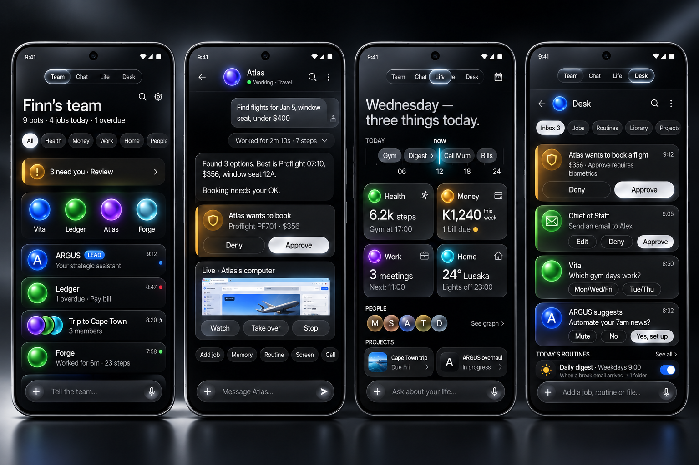

# ARGUS Overhaul — Argus-mobile × A-team × Bot HQ

> Living handoff. If you're picking this up mid-way: read **Status** and **Handoff log** first, then the slice docs in `docs/overhaul/`.
> Rules: commit straight to `main`, every commit title ends with `[skip ci]`, no build until the owner says build.

## Goal
One unified ARGUS app (this repo, `argus-mobile`, Kotlin + Compose) that contains:
1. **Everything in Argus-mobile** today (Blaze Android: chat, voice, orb, phone control, terminal, browser, media, memory, life logs, routines…).
2. **Everything in A-team** (`gitlab.com/blazeinchue/a-team`: team of bots as chats, Manager bot, jobs/approvals inline, Compose graph, Ubuntu workspace per bot, cloud computer, connectors, vault, skills, Needle on-device commands, `argus-agents-api`).
3. **Everything in Bot HQ** (`github.com/nickvasilescu/bot-hq`, MIT, from Nick Vasilescu's video "I Stole the Best Part of Every AI Agent… With One Prompt"): Grok-Bot-style texting UI with many bots + voice + X search, Muse-style social connections + editable soul/memory files, Dots-style per-agent computer you can watch/take over, Hermes agent engine, Composio apps with approval cards, routines/tasks/Library, bots talking to bots.

**Design:** A-team's design language is the base. Every feature must be reachable neatly, creatively, and in few taps.
**Vision:** an ecosystem of specialist agents — one per task and per part of the person's life — orchestrated by a Manager.

## Specialist slices (each writes its own doc, then this file is merged)
| # | Slice | Doc | Status |
|---|---|---|---|
| 1 | Bot HQ full feature inventory + port notes | [`docs/overhaul/01-bothq-inventory.md`](docs/overhaul/01-bothq-inventory.md) | done (89 features, 2cdb65b4) |
| 2 | A-team full feature inventory + port notes | [`docs/overhaul/02-ateam-inventory.md`](docs/overhaul/02-ateam-inventory.md) | done (72 features + design language, 086b8f21) |
| 3 | Argus-mobile inventory, architecture & merge map | [`docs/overhaul/03-argus-mobile-map.md`](docs/overhaul/03-argus-mobile-map.md) | done (25-row merge map, 73988433) |
| 4 | Design system + information architecture (A-team look, every feature placed) | [`docs/overhaul/04-design-ia.md`](docs/overhaul/04-design-ia.md) | done (~150-row feature map, 13 wireframes) |
| 5 | Agent ecosystem architecture (life-domain specialists, Manager, soul/memory, bot-to-bot, computers, models) | [`docs/overhaul/05-agent-ecosystem.md`](docs/overhaul/05-agent-ecosystem.md) | done (14 life agents, E0–E8 order, 1a21f133) |
| 6 | Integrated team plan: phases, workstreams, owners, milestones, risks, tests | [`docs/overhaul/06-team-plan.md`](docs/overhaul/06-team-plan.md) | done (30 reconciliations, 12 decisions, 11 phases, 102 tickets, 278-row coverage matrix) |

## UI concept
Early look (not final, can change): Team, Agent chat, Life, Desk.



## Status
- 2026-11-11: Overhaul kicked off. Sources pulled: argus-mobile@main (0.52.3 / vc 190 + three unreleased rounds), a-team@main (v2.18), bot-hq@HEAD. Specialists 1–5 landed all five slice docs by 20:56 CAT.
- 2026-11-11: **Slice 6 done — the plan is ready.** `docs/overhaul/06-team-plan.md` reconciles the slices (30 items), lists 12 decisions for Finn (each with a recommended answer the plan already assumes), sets 11 phases with versions (0.52.4 → 1.0.0, then 1.1.0), 13 workstreams with owners, a 102-ticket backlog (~336 agent-days), and a coverage matrix that places **all 254 source features** (BH 89 · AT 72 · AM 68 · merge map 25) plus 24 new ones on a phase, a ticket and a UI location — 0 missing.
- **Now:** P0 under way. ✓ P0-TM-01 (MR !40, 2026-11-11) ✓ P0-AG-01 (7f12551d) ✓ P0-SH-01 (21fe3ebb) ✓ P0-SH-02 (ccf1a382) and ✓ P0-API-01 (cd942dad) and ✓ P0-QA-01 (21513181) and ✓ P0-MG-01 (0167d249) and ✓ P0-IL-02 (daa6cbe0) and ✓ P0-IL-03 (60818dab, 2026-11-12) on main. ✓ P0-IL-01 (0.52.4 / 191, CI green on d35d26f7, 2026-11-12). **P0 complete.** P1 under way: ✓ P1-TM-01 (b862f9c2 + 849f7002, 2026-11-12) ✓ P1-TM-02 (702c41a8, 2026-11-12) ✓ P1-SH-02 (e8ab9dac, 2026-11-12) ✓ P1-TM-03 (160ebca1, 2026-11-12) ✓ P1-SH-01 (4f57ad61, 2026-11-12) ✓ P1-SH-03 (8cbc5f18, 2026-11-12) ✓ P1-TM-05 (cee55865, 2026-11-12) ✓ P1-SH-04 (b9481c6f, 2026-11-12) ✓ P1-SH-05 (60e5beb6, 2026-11-12).

## Handoff log
Append one line per session: date, who, what changed, what's next.
- 2026-11-11 · Hark · Created this file and the slice table. Next: slice docs land, then slice 6 merges them into the plan below.
- 2026-11-11 · Hark · Slices 1–5 published to docs/overhaul/. Slice 6 now writing 06-team-plan.md and the Unified plan section.
- 2026-11-11 · Hark (Specialist 6) · Published `docs/overhaul/06-team-plan.md` v1 (reconciliation, decisions, phases + versions, workstreams, backlog P0–P10, full coverage matrix, risks, QA plan, A-team migration, pick-up guide) and filled the Unified plan below. Next: Finn answers D1–D12; then dispatch P0 tickets 1–8 in parallel (see "Next 10 tickets").
- 2026-11-11 · Hark · Added UI concept image (docs/overhaul/ui-concept.png), provisional.
- 2026-11-11 · Hark · P0-TM-01 done: `team/` Models.kt (05 §9.1 + DEFAULT_RULES), TeamJson.kt (pure JSON), TeamSchema.kt (team.db v1 = 05 §9.2 DDL, 15 tables; v2 = indexes), TeamDb.kt (SQLiteOpenHelper, FKs on, newer file refused); TeamJsonTest 10/10 + TeamSchemaTest 7/7 pass on JVM, TeamDbTest (Robolectric) written, runs on "build"; nothing wired to UI (a1141b6f, merge b765db55). Next: P0-AG-01.
- 2026-11-12 · Hark · P0-AG-01 done: `agent/engines/BotEngine.kt` (05 §5.2 contract: TurnInput, TurnEvent, EngineCaps, RowSink), `agent/engines/LocalEngine.kt` (LocalEngine on Agent.Session, ToolSubset = core + bot groups + per-tool grants, RowMapper → BH rows message/event/notice/tool-call with seq/updatedSeq), `agent/TeamHooks.kt` (pure seam: identity block, tool subset/refuse, row sink, end), `TeamTools.kt` + `engines/AgentSessionDriver.kt` (Android glue); Agent.kt +7 lines (identity system msg, tool filter, runTool refuse/call/result, add() → row sink, endTurn, teamSession). TeamHooksTest 8/8 + LocalEngineTest 10/10 (fake LLM loop, Agent.kt ≤ 20-line check) + TeamJsonTest 10/10 pass on JVM (kotlinc 2.0.21, JDK 17); Gradle/Robolectric suites not run (no build). Nothing wired to UI. MR !45 closed, landed as 7f12551d (token can't press Merge). Next: P0-SH-01.
- 2026-11-12 · Hark · P0-SH-01 done: `ui/argus/ArgusTokens.kt` (pure: 04 §2 palette dark/light with AA variants, Plain/Orbit/Cobalt-night grounds, glass levels, type scale, space/radius/elevation/motion incl. reduced motion, bot + domain + BH colour maps, M3 roles, ArgusGlassRule, ArgusLookFlag `argus_look` default off), `ArgusColors.kt`, `ArgusType.kt` (Inter/Inter Tight; serif + mono = system until fonts are bundled under IL-02), `ArgusGlass.kt` (Surface/Raised glass, Chrome/Sheet via Haze 1.0.2 with 92 % tint fallback), `ArgusTheme.kt` (LocalArgusColors/Ground, M3 colorScheme + Typography, argusGround / ArgusGround). AA changes vs 04: dark mute #A6A6AE, dark danger text #FF8085, dark cobalt text #86A3FF, light danger/success/waiting text #C0272D/#0D744A/#895C00, light success fill #128A59, `dim` decorative only (+ `meta` token for timestamps), Orbit veil 82 % dark / 95 % light (04 said 60 %; the Earth's limb hits grey 0.67). Haze pulls compose ui/foundation 1.7.5; add Haze (Apache-2.0) to THIRD_PARTY_NOTICES in P0-IL-02. Cobalt-night light variant invented (#E9EDFF→#F4F5F8). SpaceWiringTest: 'ui/argus removed' now checks the old 3D-Home files only. Tests: ArgusTokensTest 13/13 + new ContrastTest case (Compose Color math) green on JVM; Compose files compiled with the Compose compiler against compose 1.7 / material3 1.3 / haze 1.0.2 (app classes stubbed). No Gradle build. MR !46 closed, landed as 21fe3ebb. Next: P0-SH-02.
- 2026-11-12 · Hark · P0-SH-02 done: `tools/gen-lucide.mjs` (A-team icons.js + lucide-static 0.460.0 for the 20 04 §2.7 icons A-team lacks → `ui/argus/icons/LucidePaths.kt`, 96 icons + 3 aliases, sorted, no timestamp; run twice = identical), `icons/Lucide.kt` (cached ImageVectors, A-team stroke-by-size 2.25/2/1.85), `icons/LucideSpec.kt` (semantics, domains, sizes), `ui/argus/OrbGeometry.kt` (pure botSVG numbers: 6 faces + tilts, rings, mixHex colours, states Idle/Working 8 s turn/Waiting/Talking +8 %/Away 40 % grey, status dot, sizes xs–hero, Manager = only cobalt), `BotOrb.kt` (Canvas BotOrb + ManagerOrb drawing the ARGUS A; A-team's manager.png not copied; no BH artwork). Tests: OrbGeometryTest 8/8 + LucidePathsTest 6/6 green on JVM; Compose files compiled with the Compose compiler against compose 1.7; OrbShotsTest (shots-only, light/dark × sizes × states) not run (needs Robolectric). Lucide ISC notice owed in P0-IL-02. MR !47 closed, landed as ccf1a382. Next: P0-API-01.
- 2026-11-12 · Hark · P0-API-01 done: `Cloud.tag` now sends `blaze_context: "full"` on every gateway call (A-team D6; gateway relevance.ts opt-out), always on. `agent/LiveModels.kt` = pure port of A-team models.js v2.13 (Wire names, parseLive, pick, plan, answered, avoidHeader, onFail, 5-min Cache with 6 h max age); `ModelRoute.livePrefer`; `agent/LiveModelsFeed.kt` glue + 5 lines in `LlmClient.call` (background refresh, X-Blaze-Prefer when the turn has no pin, served route from X-Blaze-Route), all behind `live_models` (default off). Finding: gateway 0.8.45+ sends X-Blaze-Provider/Model only in debug, so today `lastServedKey` is always empty (TurnModel never pins, empty-route avoid never fires); with the flag on the X-Blaze-Route token fills it (the gateway takes tokens back in Prefer/Avoid). Tests: LiveModelsTest 9/9 (v29 + v212 cases) + ModelRouteTest green on JVM; CloudTest's new assertion checked via a harness (Cloud.kt compiled with stubs). LlmClient edits not compiled (no build). MR !48 closed, landed as cd942dad. Next: P0-QA-01.
- 2026-11-12 · Hark · P0-API-01 follow-up (owner: "do what's best"): reading the served route from X-Blaze-Route is now always on (`LiveModelsFeed.served`), so TurnModel pins and empty-route avoid work again on the live gateway; the live pick and its label stay behind `live_models`.
- 2026-11-12 · Hark · P0-QA-01 done: `docs/overhaul/specs.md` = spec index, 833 specs (A-team `app/tests/*` PASS lines + log-only checks + Java, A-team `evals/test/*` cases, Bot HQ `tests/e2e.mjs` + `voice-call.mjs`), each mapped to a ticket by `tools/gen-specs.mjs` (file rule → keyword → file default; first pass, ticket owners re-check their rows). A-team `evals/` copied to `evals/` (guard.js + models.js vendored in `evals/vendor/`; only graders/guard/v212 tests + new `specs.test.mjs`). Local: `node --test evals/test/*.test.mjs` 34/34; refusals mock good 63/63, mock bad 0/63; code selfcheck all pass. Live `--suite refusals` against the gateway not run: needs an ARGUS `bz_` token in `ARGUS_TOKEN`. MR !49 closed, landed as 21513181. Next: P0-MG-01.
- 2026-11-12 · Hark · P0-MG-01 done: `docs/overhaul/ateam-export.md` defines `argus-team-export.v1` (bots + look, jobs, settings, profile stated/inferred, bot/team memory, routines, proactivity, optional Manager chats) and maps both it and A-team's Copy backup (`{agents, tasks}`) onto team.db / blaze.db + mem_scope. `team/ATeamExport.kt` (pure: detect, 13 validation rules, faceOf, scopeFor, schedule). Fixtures `app/src/test/resources/ateam/demo-team.{backup,export.v1}.json`, hand-built from A-team `demo()` @7c4b459a (not a phone export). `ATeamExportTest` 6/6 (JVM). Open for owner: imported open jobs land `confirmed = 0`; bot emails dropped; non-Manager chats not imported. MR !50 closed, landed as 0167d249. Next: P0-IL-02.
- 2026-11-12 · Hark · P0-IL-02 done: THIRD_PARTY_NOTICES (root + assets/legal, identical) gain an "ARGUS overhaul" section: Haze 1.0.2 (Apache-2.0), Lucide (ISC, Feather MIT portions; lucide-static 0.460.0), Bot HQ (MIT; design + test names, no artwork), A-team (MIT by owner grant 2026-11-11). `gateway/README.md` gets a read-only stale-copy banner (live gateway: Blaze-agent 0.9.7). `evals/README.md` provenance corrected. LegalAssetsTest gains `overhaulSourcesAreCredited`. Deviations table added under Decisions; D1–D11 recorded as taken. Simple Icons / noVNC not added (not in repo). MR !51 closed, landed as daa6cbe0. Next: P0-IL-03.
- 2026-11-12 · Hark · P0-IL-03 done: `docs/overhaul/do-not-port.md` lists 18 rows (BH-75/76/77/78/86, Bot HQ artwork, BH dead code ×7, BH mode kept on purpose, AT-01, AT-57, AT-67, cactus.wasm), each with reason and replacing ticket. `node tools/check-do-not-port.mjs` checks the 13 grep-able rows over app/src/main, tools, evals: 0 hits after dropping `composio` from a BotAppGrant comment. `node --test tools/check-do-not-port.test.mjs` 2/2. MR !52 closed, landed as 60818dab. Next: P0-IL-01 when the owner says "build".
- 2026-11-12 · Hark · P0-IL-01 done (owner said "build"; accepted one CI round and the untested gateway change): 0.52.4 / versionCode 191 (0d48f616), CHANGELOG / STATUS / about.md. Round 1 (422a500e) red: 2 of 3031 tests; fixed d35d26f7; round 2 green, APK artifact blaze-d35d26f7 (58.6 MB). Publish steps run only on the upstream repo, so versions.json and the GitHub release are not updated from the mirror. P0 complete; next P1.
- 2026-11-12 · Hark · P1-TM-01 done: `team/Bot.kt` (BotRules: ARGUS = Manager, fixed id `manager`, locked identity, undeletable; Tempo + Inbox seeds; specialists as WORKER templates) + `team/TeamStore.kt` (roster in team.db over `Sql`: ensure / insert / update / delete / saveSoul) + 8 optional bot fields on `Specialists.Spec`. TeamStoreTest 14/14 + TeamJsonTest 10/10 locally (JdbcSql). Not wired to UI yet. MR !53 closed, landed as b862f9c2. Follow-up 849f7002: worker ids `worker-<id>`, delegate acceptance test; TeamStoreTest 15/15, SpecialistStoreTest 4/4. Ticket closed; P1-TM-02 free to start.
- 2026-11-12 · Hark · P1-TM-02 done: `team/Rows.kt` (Bot HQ row model: RowKind, RowBodies preview + unread rules from store.ts toBot / loop.ts, Trigger envelopes from loop.ts triggerText, RowStore append / update / upsert by seq with newer revision winning / list / since / fresh = generation bump; team.db stays v2) + `team/BotThreads.kt` (one thread per bot: unread, preview, last activity, running, waiting approvals; open / markRead; fresh = new generation and new chat `team-<bot>-g<n>`; put = the engines' RowSink; send runs a turn on the bot's engine, one at a time per bot; `changes` flow = BH-81 in-process; ArgusChats + ArgusBridge read the user's chats read-only for the ARGUS thread) + `agent/ChatStore.kt` bridge (`list()` hides `team-*` chats, `argus(current)`). Tests on JVM (kotlinc 2.0.21, JDK 17, sqlite-jdbc): RowStoreTest 9/9, BotThreadsTest 13/13 (real LocalEngine + LocalEngineTest's FakeLoop), ArgusUpgradeTest 1/1; regression TeamStoreTest 15, TeamJsonTest 10, TeamSchemaTest 7, ATeamExportTest 6, LocalEngineTest 10, TeamHooksTest 8, ChatIndexTest 7; do-not-port 0 hits; evals 34/34. Not run: Gradle, Robolectric (TeamDbTest), CI. Agent.kt untouched (seam still +7). Nothing wired at startup or in the UI yet. MR !54 closed, landed as 702c41a8. Next: P1-TM-03 (row after this one) needs P1-SH-02 first; unblocked now: P1-TM-04 (needs TM-01) and P1-TM-05 (needs TM-02).
- 2026-11-12 · Hark · P1-SH-02 done: `ui/argus/kit/` (nothing wired to a screen yet). `KitSpec.kt` (pure: 04 §2.8 sizes, the 48 dp target rule, BotChatRow / NeedYou / Pins / Chips / Mention (@ bots, # files, / commands only at the start; filter starts-then-contains, max 6; apply) / Attachments (middle ellipsis keeping the extension) / Progress / CloudChip text, TalkBack descriptions `KitA11y`, the kit's AA colours) + Compose: `KitButtons.kt` (ArgusButton Glass/Primary/Danger × M/S, ArgusIconButton Glass/Flat/Avatar 38 in 48, badge), `KitFields.kt` (ArgusField, ArgusSearch), `KitRows.kt` (BotChatRow with Lead row, swipe Pin/Mute + TalkBack custom actions, long-press; MenuRow; SettingsGroup / SettingsRow), `KitStrips.kt` (PinStrip with long-press drag reorder + Move left/right actions, NeedYouBanner ink/amber/hidden, FilterChips, Segmented), `KitOverlays.kt` (ArgusSheet on ModalBottomSheet, MentionPopup, AttachmentBar, EmptyState incl. serif hero, ProgressLine, CloudChip hidden until P7). Tests: KitSpecTest 11/11 + regression ArgusTokensTest 13, OrbGeometryTest 8, LucidePathsTest 6 on JVM (kotlinc 2.0.21, JDK 17); kit + KitShotsTest compiled with the Compose compiler plugin 2.0.21 against compose 1.7.5 / material3 1.3.1 / haze 1.0.2 / ui-test 1.7.5 (app classes stubbed); do-not-port 0 hits; evals 34/34. Not run: KitShotsTest (Robolectric: shots light/dark × font 100/200 %, plus always-on 48 dp touch-bounds and merged-node checks), Gradle, CI, device. MR !55 closed, landed as e8ab9dac. Next: P1-TM-03 (Team screen) is unblocked now.
- 2026-11-12 · Hark · P1-TM-03 done: `ui/team/TeamModel.kt` (pure: header "N bots + Manager · N jobs today · N overdue", chips All only until P5, pins Manager first max 4 with overdue dots, Manager row then bots/groups by last activity, row time 10:42 / Tue / 1 Nov / 12 Nov 2025, "N overdue · <oldest>" red preview, `JobCounts.read` on the jobs table, `QuickAction.of` (Open, Pin/Unpin, Memory, Edit soul, Delete; the Manager has no Delete and no Pin toggle), `TeamActions` (setPinned through TeamStore, delete, A-team Demo team Nova / Atlas / Echo / Vega)) + `ui/team/TeamMode.kt` (stateless `TeamMode`, `TeamModeScreen` loading on IO and on BotThreads.changes, quick sheet and delete confirm on ArgusSheet, `TeamNav` callbacks for the shell). Not opened by the app yet (P1-SH-01 adds the mode). Kit touch-ups: ArgusSheet no longer takes a SheetState (callers needed the Material3 opt-in); the swipe background draws only while swiping. Tests: TeamModelTest 9/9 (JVM, sqlite-jdbc team.db); with the TM-02 baseline (86), KitSpecTest 11, ArgusTokensTest 13, OrbGeometryTest 8, LucidePathsTest 6 = 133/133 here; TeamShotsTest + KitShotsTest compiled, not run (Robolectric); do-not-port 0 hits; evals 34/34. Not run: Robolectric, Gradle, CI, device. MR !56 closed, landed as 160ebca1.
- 2026-11-12 · Hark · P1-SH-01 done: the ARGUS shell in `ui/ChatScreen.kt` behind `argus_look`, now on by default (off = the 0.52 shell, unchanged). `ui/argus/kit/KitShell.kt` (ArgusTopBar Home variant: me · search · bell · +; NotchSwitcher 46×22 handle, pill Team · Chat · Life · Desk, pull past 140 dp = Voice; ArgusComposer: + · 16 sp field up to 5 lines · mic → send → stop; ChipsRow; ArgusToasts + ArgusToastHost) + `ShellSpec.kt` (pure rules) + `ui/ArgusModes.kt` (HorizontalPager over the four modes, only the shown page composed; Desk placeholder with Projects). `ChatNav` gains TEAM / LIFE / DESK, `modeCommand` (/team /chat /life /desk), `rootTab`; `BackRule.Shell.argus`: Team is the root, the other modes and everything over them go back to Team. Team page = `TeamPage` (P1-TM-03's screen) on `team/TeamSql.kt` (Sql over TeamDb's framework SQLite) + `TeamGraph`; no bot engines yet. Life = the 0.52 Home board until P1-SH-05. Agent.kt untouched (seam still +7). Tests (JVM, kotlinc 2.0.21, JDK 17): ShellSpecTest 4/4, ChatNavTest 11/11 (1 new), BackRuleTest 9/9 (1 new; compiled with Views/BackRule and 3 small stubs), ArgusTokensTest 13/13 with its default-off assertion changed to on (the ticket turns the look on); local runs: 137/137 in one JVM run plus ChatNavTest + BackRuleTest 20/20 in a second (corrected 2026-11-12: this entry first said "full local run 157/157"). Whole main source set compiled with the Compose plugin against compose 1.7.5 + activity-compose 1.9.2 + lifecycle-runtime-compose 2.8.6 + runtime-saveable 1.7.5: 5119 errors before and after, all from libraries not here. This is a weak check (corrected 2026-11-12: this entry first said "the changed files have 0 errors"): the changed files showed the same errors in both trees (unresolved `R` in ArgusType.kt and ArgusTheme.kt, ChatScreen errors from missing libraries), so ChatScreen.kt was not really compiled. do-not-port 0 hits; evals 34/34. Not run: TeamShotsTest, KitShotsTest (Robolectric), the keyboard no-jump shot and low-RAM smoke ≤700 ms the ticket asks for, Gradle, CI, device. MR !57 closed, landed as 4f57ad61. specs.md v216b 11 "Back goes home" is covered by BackRuleTest.teamIsTheRootInTheArgusShell.
- 2026-11-12 · Hark · P1-SH-03 done: `ui/team/thread/ThreadModel.kt` (pure: team rows → thread items; tool calls between two messages are one turn, live `ActivityLine` at the end while running, else a `WorkChip` above the reply ("Worked for 2m 10s · 7 steps", "7 steps: 3 reads, 2 commands…", failed "Stopped after N steps · Go on"); step events feed the live line only; other events and notices → SystemNote; jobs / ok / file / handoff cards; engine pill = where the bot thinks (On this phone / Cloud / Your server), never a model) + `ui/team/thread/ThreadKit.kt` (ThreadIntro, UserBubble, AgentText with a body slot for AM Md/RichBlocks, SystemNote, ActivityLine (polite live region, elapsed clock) + StepList, WorkChip with grouped ToolCards, ToolCard (`$ cmd` + output 260 dp, Undo), JobCard, OkCard, FileCard, HandoffCard, PlainThreadCard, ThreadList following only at the end, `ThreadActions`). `agent/StepPill.kt` gains `StepTool` (tool → "Searching the web" / "Searched the web" + group; word rules; fallback "Working"; never the name) and `mentionsRoute`. Rich replies: `LocalArgusRich` in AnswerCards.kt (code 13/19 sp, 14 dp cards on the ARGUS soft fill, table header soft2 + line rules) provided by the shell; `RichReplies.Look` holds the numbers. Not opened by the app yet (bot threads still toast until the thread screen is wired). Tests (JVM, kotlinc 2.0.21, JDK 17): StepToolTest 3/3, ThreadModelTest 5/5 (both new); 145/145 in one JVM run (the 137 + 8) plus ChatNavTest + BackRuleTest 20/20 in a second. ThreadShotsTest (4 shots + live-region, no-raw-names, Undo) compiled, not run (Robolectric). Whole main source set: 5119 errors before and after, all from missing libraries; weak check, AnswerCards.kt / ChatScreen.kt / RichReplies.kt not really compiled; the new thread files and StepPill.kt did compile cleanly in the separate Compose build (stubs: BuildConfig). do-not-port 0 hits; evals 34/34. Not run: Robolectric, Gradle, CI, device. MR !58 closed, landed as 8cbc5f18.
- 2026-11-12 · Hark · P1-TM-05 done (main cee55865, MR !59 closed): `team/Jobs.kt` (JobStore on team.db `jobs` / `job_steps`, no schema change: add with duplicate drop and reopen of a failed or cancelled job, steps as the job's log, `JobFailure` plain words and backoff 1 / 5 / 15 min then stop), `team/JobQueue.kt` (JobQueue: deps waits-on with status "blocked", one running or waiting job per bot, user turn first, AgentBudget cap, runaway guard 12 starts / 10 min, priority then due then age, proactive jobs never start unconfirmed, stale runs failed on start, a run that ends without done_job waits for you; JobTools: add_job, agent_delegate, done_job, update_job, retry_job, agent_status, create_task, update_task), `team/DueWords.kt`, `team/JobsRuntime.kt` (runs on BgAgents in a chat bound to the bot, so its steps land in the bot's thread; TaskKeeper.hold keeps the process; ticks every 30 s). Hooks: BgAgents `onEnd` / `alive` / `start(chat=)`, TeamHooks `tools` / `toolDefs` / `runTool`, ToolRouter `jobs` group, BlazeApp init. Agent.kt +1 line (seam 8 of 20). Local JVM: JobsQueueTest 11, DueWordsTest 2; one run 158 OK + ChatNavTest / BackRuleTest 20 OK. Full-source compile vs main: no new errors except TaskKeeper.hold's WorkManager references (that library is missing here, as for the existing `started`). Not run: Gradle, CI, device, a job with the app closed.
- 2026-11-12 · Hark · P1-SH-04 done (main b9481c6f): Chat mode on the main chat. `agent/ManagerChats.kt` (pure, ports A-team talks.js from branch v2.19-chat-drawer 0788c808: the Manager's chats are time windows of the one main conversation, ✎ new chat stays put while the newest is empty, open / rename ≤ 80 / pin / delete with 5 s Undo / purge / repair / migrate; JSON in `chats/.manager_chats`, local only, never listed or synced), `ui/team/ChatDrawerModel.kt` (pure: titles 60 chars, search over titles then text with snippets, Pinned / Today / Yesterday / Previous 7 days / Older, unseen and replying dots, project chats in the same list; `ChatModeCopy` greeting + asks), `ui/team/ChatDrawer.kt` (`ChatModeRuntime`: ✎ = new window + `Agent.clear(false)` fresh context, deferred to the end of a running reply, + `BotThreads.fresh("manager")`; `ChatModeFrame`: top row history · ghost · ✎, ModalNavigationDrawer opened by the button or a 24×200 dp left-edge strip with `systemGestureExclusion`, empty state = Manager sphere + serif greeting + asks, Undo bar), `ChatStore.managerChatsText/saveManagerChats`, `ChatScreen` (Chat mode on main / private uses the frame; `MessageList(keep=)` shows only the open chat's window; send from an older chat goes to the newest). `RowMapper.activity` now shown-safe (StepPill.clean for step text, StepTool.label for tool calls): nothing showed it yet, but the reply stream to the screen would have printed "Using bank_balance". Agent.kt untouched (seam still 8 of 20). Local JVM: one run 180 OK (158 + ManagerChatsTest 12 + ChatDrawerTest 9 + LocalEngineTest +1, its "Using bank_balance" pin replaced); ChatNavTest / BackRuleTest 20 OK; check-do-not-port 0 hits; evals 34 pass. Compose compile of ChatDrawer.kt with the real kit sources + app stubs: OK. Full-source compile vs main: same error set before and after (6,059 here with this jar set; weak check). Not run: Gradle, Robolectric (ChatScreen / shots), CI, device, the drawer on a phone.
- 2026-11-12 · Hark · P1-SH-05 done (main 60e5beb6): Life mode v1. `ui/team/LifeModel.kt` (pure: serif day line "Thursday — three things today, two still ahead." / "nothing left today." / "nothing on today."; Today strip 06→24 (00→24 when something is earlier) with dots, now mark, all-day chips, from `ScheduleDay.itemsOn` (the [context] line's own items); every-N-min jobs not counted; ten domain tiles from ArgusTokens.DOMAIN_COLORS / LucideSpec.DOMAIN, each "Set up my life team"; weather panel from the Home board's cached reading (≤3 h, never fetched here); sections Day line · Sign in · Setup · Today · Your life · Projects · Panels; `HOME_CARDS` maps every SpaceHome card to a Life section) + `ui/team/LifeMode.kt` (stateless `LifeMode`, `LifeNav`, `LifeTags`; `LifePage` reads day items on IO each minute and on routine changes, the chat's newest answer, projects, setup). `TurnContextSource.dayEntries(now)` (public, same sources as the [context] line). ChatScreen: the shell's Life page is `lifePane()` (LifePage); `homePane()` (SpaceHome) stays for argus_look off; Today → Schedule view; tile → sends "Set up my life team, starting with <Domain>" to ARGUS and opens Chat. Agent.kt untouched (seam 8 of 20). Local JVM run 1: 195 OK (184 baseline set + LifeModelTest 11); run 2: ChatNavTest + BackRuleTest vs android-all 20 OK; do-not-port 0 hits; evals 34 pass. LifeShotsTest (4 shots + 5 always-on checks) compiled with the Compose plugin, not run (Robolectric). Full-source compile vs pristine main: identical error set (5,123 with this jar set; weak check). Not run: ScheduleDayTest (needs Routines/Android), SpaceWiringTest, Gradle, Robolectric, CI, device.

## Unified plan
Full detail, ticket tables and the coverage matrix: [`docs/overhaul/06-team-plan.md`](docs/overhaul/06-team-plan.md). Inputs: [01 Bot HQ](docs/overhaul/01-bothq-inventory.md) · [02 A-team](docs/overhaul/02-ateam-inventory.md) · [03 Argus-mobile map](docs/overhaul/03-argus-mobile-map.md) · [04 Design + IA](docs/overhaul/04-design-ia.md) · [05 Agent ecosystem](docs/overhaul/05-agent-ecosystem.md).

### In one paragraph
Argus-mobile stays the host (package `com.blaze.assistant`, one `:app` module). A-team's look and team-of-bots-as-chats become the product shape; Bot HQ's multi-agent UX and safety mechanics (rows, in-call approvals, bot-to-bot, rooms, watch/take-over, voice hand-off) are ported natively; Argus-mobile's runtime (agent loop, BgAgents, Orchestra, Mind, phone control, terminal, browser, media) is the engine of **every** bot. Every bot is data — identity + soul + memory + skills + tools + engine + apps + computer + permissions — run by one runtime, with **ARGUS (the Manager)** as the front door routing to **14 life-domain agents** (Tempo, Inbox, Pulse, Ledger, Career, Forge, Hearth, Pantry, Atlas, Circle, Tutor, Clerk, Scout, Studio) that spin up short-lived workers. The app has four modes — **Team · Chat · Life · Desk** — switched by the A-team notch. Zero-budget by default: paid services (Composio, xAI, Orgo) are optional adapters.

### Architecture
```
 ARGUS app (Kotlin/Compose)
 ├ ui/argus  A-team tokens · Lucide · BotOrb · Notch[Team|Chat|Life|Desk] · Composer(@bot /cmd $ #file mic) · Inbox · Voice
 ├ team/     Bot = persistent Spec · Rows · Jobs queue · ManagerTools · TeamBus (hop≤3) · Rooms · 14 Domains
 ├ agent/    BotEngine → LocalEngine (Agent.Session, frozen) · CloudRunEngine · HermesEngine (1.1)
 ├ policy/   Policy.decide(ActionClass, taint, autonomy) → approval/draft/question/connect cards → audit_log
 ├ memory    Mind/blaze.db + mem_scope · SOUL.md / MEMORY.md / USER.md projections
 ├ proactive SignalBus → domain proposers → ARGUS arbiter (caps, quiet hours, one dial) · routines per bot
 ├ computer/ LocalBrowser · Codespaces · self-hosted desk · Orgo (leases)   terminal/ Alpine system + Ubuntu workspace, home+tmux per bot
 └ connect/  argus-connect · MCP client · device OAuth · CloudSync (E2E) · TeamSync          voice/ on-device · Gemini · xAI (opt.)
        │ bz_ token everywhere
        ├─▶ Blaze Gateway (models, /v1/runs, live models, relay)      ├─▶ argus-connect (apps, skills, triggers; Composio optional, server-side)
        └─▶ argus-agents-api v2 (D1, REST+MCP, PATs, approvals, events) ◀─ Desktop / Claude / Cursor     └─▶ cloud desk (confirmed only)
```

### Phases (each shippable; patch per release, .9 rolls to next minor, each big feature = next minor)
| Phase | Version | Ships |
|---|---|---|
| P0 Groundwork | **0.52.4** | the three unreleased rounds on main + invisible seams (team.db, BotEngine, ui/argus tokens, BotOrb, LiveModels, `blaze_context`) |
| P1 One look, one team | **0.53.0** | A-team shell (Team·Chat·Life·Desk), ARGUS as a bot, bot threads, create bots with orbs, Tempo + Inbox, delegation as Jobs, Desk → Jobs, Settings re-tree, A-team backup import |
| P2 Safe hands | **0.54.0** | one policy engine, approval/draft/question/connect cards, Inbox + Need-you, Permissions, Activity (audit), Pause all, A-team guard ports |
| P3 Souls & memory | **0.55.0** | Bot profile, SOUL.md editor, memory scopes, What the team knows, auto-learn, per-bot model policy |
| P4 Apps & skills | **0.56.0** | argus-connect Apps page, per-bot apps/skills/MCP, connector writes behind cards |
| P5 Team talk & life | **0.57.0** | bot-to-bot + Handoff cards, rooms + huddle, 14 domain agents + setup picker, routing v2, Life mode, People graph, Compose graph |
| P6 Proactive team | **0.58.0** | routines per bot, SignalBus + arbiter + one dial, check-ins/brief/Today, pop-up + edge glow, widgets/QS/share/deep links |
| P7 Computers | **0.59.0** | Ubuntu workspace per bot, Terminal tabs, Library, code review, cloud desk leases, Computer viewer + take-over |
| P8 Voice & everywhere | **0.60.0** | voice two-agent calls, X search (optional key), agents-api v2 + sync + remote approvals, MCP relay, A-team v2.20 "Move to ARGUS" |
| P9 ARGUS 1.0 | **1.0.0** | every AM surface on the new look, domain wiring, A-team retired, full release gate |
| P10 Open engines | 1.1.0 | Hermes engine, cloud routines, optional paid adapters, targetSdk 35 |

### Workstreams and owners
| Code | Workstream | Owner | Code | Workstream | Owner |
|---|---|---|---|---|---|
| SH | Shell & Design | Design-system agent | PR | Proactivity & Routines | Proactivity agent |
| TM | Team & Manager | Team-runtime agent | VC | Voice | Voice agent |
| AG | Agents & Memory | Agent-runtime agent | API | API / Gateway & Sync | Platform agent |
| SF | Safety | Safety agent | LF | Life & Phone continuity | Continuity agent |
| CN | Connectors & Apps | Connectors agent | MG | Migration (A-team) | Migration agent |
| CP | Computers & Terminal | Computers agent | QA | QA / Evals | QA agent |
| IL | Integration lead (versions, docs, matrix) | Specialist 6 | | | |

### Decisions for Finn (the plan assumes the recommended answer)
| # | Decision | Recommended |
|---|---|---|
| D1 | One continuous chat with ARGUS + one thread per bot; "new chat" = fresh context with a history drawer | Yes |
| D2 | Persona names (Ledger, Atlas, Pulse…) with the life-area label underneath | Yes |
| D3 | The lead bot is called **ARGUS** (role Manager), undeletable | ARGUS |
| D4 | Alpine stays system; Ubuntu 24.04 opt-in workspace (~800 MB) shared by all bots, a home each | Yes |
| D5 | Third-party apps through argus-connect (credentials server-side); on-phone tokens only for device-bound apps; Composio never in the app | Yes |
| D6 | Automatic models; per-bot Depth + optional own Gemini key; no model-id picker | Yes |
| D7 | Hermes engine after 1.0 (1.1.0) | Defer |
| D8 | Cloud desk: Codespaces default; self-hosted desk on your PC (Desktop link) second; Orgo optional | Yes |
| D9 | Cloud routines with the phone off: after 1.0 | Defer |
| D10 | Retire A-team after migration (v2.20 "Move to ARGUS", archived at 1.0) | Retire |
| D11 | Confirm reversing the 0.51 "Halo merged" single-persona decision (bots are personas on one engine) | Confirm |
| D12 | Gateway work (relay, voice token, x-search) goes to `Blaze-agent`; we need access or an owner there | Give access |

**Answered (Finn, 2026-11-12: "anything I haven't answered go with what you see fit"):** D1–D11 taken as recommended above. D12: no write access granted yet, so gateway work stays on branches in Blaze-agent, never its `main`.

### Deviations from this plan and calls taken (Hark, P0, owner: "go with what you see fit", 2026-11-12)
Each line is a place the work differs from this file or 06-team-plan, or a choice the plan left open. Change any of them by saying so; each names where to undo it.

| Ticket | What the plan said | What was done | Why / where to undo |
|---|---|---|---|
| Process | MRs merged after CI | No CI; pure tests run locally; landed by cherry-pick to `main`, MR closed with a note (the token can't press Merge); every commit `[skip ci]` | Owner rule 2026-11-12 |
| P0-SH-01 | Orbit veil 60% | 82% dark / 95% light | At 60% the Earth's limb in argus_space.webp breaks AA text contrast. `ArgusTokens.orbitVeil` |
| P0-SH-01 | Spec colours as given | AA-adjusted variants, a new `meta` token, an invented cobalt-night light variant | AA contrast; 04 had no light Cobalt night. `ArgusTokens.kt` |
| P0-SH-01 | Haze `hazeSource` / `hazeEffect` | Haze 1.0.2 API (`haze` / `hazeChild`); pulls Compose 1.7.5 | Haze 1.0.2 is the version pinned; newer Haze renamed the API. `ArgusGlass.kt` |
| P0-SH-01 | Instrument Serif + JetBrains Mono | Not bundled: system fallback | Not bundled yet; when they are, add their OFL notices. `ArgusType.kt` |
| P0-SH-02 | All icons from A-team `icons.js` | 76 from A-team, 20 from lucide-static 0.460.0 (ISC) | A-team lacked them. `tools/gen-lucide.mjs` |
| P0-SH-02 | Manager sphere = `manager.png` | Cobalt redraw in code with the ARGUS "A" | Keeps the orbs vector, no raster asset. `ui/argus/BotOrb.kt` ManagerOrb |
| P0-API-01 | `blaze_context: "full"` (flag not specified) | Sent on every gateway call, unconditional | Pure gain; gateway ignores unknown fields. `Cloud.kt` |
| P0-API-01 | Served model from `X-Blaze-Model` | Gateway 0.8.45+ sends it only in debug builds; the `X-Blaze-Route` token is read instead, **always on** (45d4be86). Same-model pinning and empty-route avoid now run for everyone; not yet tried on a device | Owner "do what's best". `agent/LiveModelsFeed.kt served()` |
| P0-API-01 | Live model pick | Behind flag `live_models`, default off | Needs a device check first. `agent/LiveModels.kt` |
| P0-QA-01 | Spec index per ticket | 833 specs mapped by file rule, then keyword, then file default (first pass; `By` column). P1-SH-03 and P7-CP-03 hold large default buckets | Ticket owners recheck their rows. `tools/gen-specs.mjs` |
| P0-IL-02 | Add a LICENSE to a-team before copying its code (K16) | Owner granted instead (2026-11-11, P0-PLAN): A-team code may be copied under MIT; a-team not edited. The grant is recorded in THIRD_PARTY_NOTICES under ARGUS overhaul | Add a LICENSE to a-team only if you want it public |
| P0-QA-01 | Live eval run | Not run: needs an ARGUS `bz_` token in `ARGUS_TOKEN`. Mock and self-check runs pass | Run when a token is given |
| P0-QA-01 | guard.js / models.js shared | Vendored in `evals/vendor/` until P2-SF-07 | |
| P0-MG-01 | Fixtures from the A-team Demo team | Built by hand from `demo()` @7c4b459a at a fixed clock, not exported from a phone | Swap in a real Copy backup when one is to hand |
| P0-MG-01 | (open) | Imported open jobs land `confirmed = 0`: nothing starts by itself | `docs/overhaul/ateam-export.md` §4.2 |
| P0-MG-01 | (open) | Bot emails dropped; only the Manager's chat is imported | §4.1, §4.6 |
| P0-IL-02 | Notices for Simple Icons (CC0) and noVNC (MPL-2.0) | Not added: neither is in the repo yet | Added by the ticket that bundles them |
| P0-IL-03 | `tools/check-do-not-port.sh` | `tools/check-do-not-port.mjs` (Node, like the other tools) + a node test; also removed `composio` from a `team/Models.kt` comment (D5) | Portable regex and a testable rule list |
| P1-TM-01 | ARGUS seeded as the Manager | Shown name is `BrandName.NAME` ("Argus"), label "Lead", cobalt sphere; a bot already called Argus/ARGUS/Manager is renamed "<name> 2" (A-team renamed the Manager instead) | ARGUS keeps its name. `team/Bot.kt` RESERVED_NAMES, `TeamStore.ensure` step 3 |
| P1-TM-01 | Re-seed / repair (A-team drops corrupt rows) | Unreadable bot rows are skipped, not deleted (except the Manager's, which is rebuilt); a second MANAGER-kind bot is demoted to CUSTOM, not dropped | Keeps user data. `TeamStore.ensure` |
| P1-TM-01 | Delete a bot | Domain bots (Tempo, Inbox) are switched off (enabled=0, hidden=1), not removed, so the seed never brings them back; other bots are removed and their jobs unassigned | 05 §3.1 "seeded off". `TeamStore.delete` |
| P1-TM-01 | Manager lock | Voice, permissions, computer and apps stay editable on the Manager; everything else is refused (A-team locked look/model/prompt) | `BotRules.lockedDiff` |
| P1-TM-01 | 10 specialists become WORKER templates | Templates are derived, not stored; `delegate` still runs through `Specialists` unchanged (plain ids). Template ids are `worker-<specialist id>` so the Inbox-manager worker doesn't clash with the Inbox domain bot; `worker-*` ids are reserved (849f7002) | `BotRules.workerId` / `specialistId` |
| P1-TM-01 | Tempo / Inbox colours | Picked `#7C5CFF` (Tempo) and `#2BB673` (Inbox); workers ink `#8A8F98` | Not in 04. `team/Bot.kt` |
| P1-TM-02 | ARGUS thread bridges the AM ChatStore | The ARGUS thread is the current chat file read as rows (message i = seq i, roles mapped like RowMapper); ARGUS's live rows are counted (unread, preview) but never copied into team.db; `fresh("manager")` bumps the counter only, opening the new chat stays with the Chat screen (P1-SH-04) | No data move, one record. `team/BotThreads.kt` ArgusBridge, `BotThreads.fresh` |
| P1-TM-02 | Per-bot reply streams via LocalEngine | Each bot's model context is an ordinary chat `team-<bot>-g<generation>` kept by Agent.Session in filesDir/chats; `ChatStore.list()` hides them (so the chat list, search, Mind.migrate and Learning never see them). CloudSync still syncs them as chats, so Desktop would list them | Keeps Agent.kt untouched. `BotThreads.TEAM_CHAT_PREFIX`, `ChatStore.list` |
| P1-TM-02 | Bot HQ `next_seq` + per-bot `rev` | One counter per (bot, generation): next number = max(updated_seq) + 1, same rule as RowMapper; no team.db schema change | `RowStore.nextSeq` |
| P1-TM-02 | Unread as Bot HQ | Not counted while the thread is open (BH counts, the client clears); a fresh start also clears unread and the preview (BH keeps unread); row write and counter update are separate statements (Sql.tx doesn't nest), so a crash between them can leave a stale badge | `BotThreads.account`, `RowStore.fresh` |
| P1-TM-02 | Trigger taint (not specified) | Only another bot's words are marked untrusted (`bot:<id>`); routines and system notices are not; P2-SF-01 owns the real rule | `Trigger.untrusted` |
| P1-TM-02 | Wiring | team.db still isn't opened at startup and nothing calls BotThreads; the first screen ticket wires AndroidSql on TeamDb + `ChatStore.argus { current chat id }` + `AgentSessionDriver.engine` | P1-TM-03 / P1-SH-04 |
| P1-SH-02 | Danger button #FF6B62 dark / #D70015 light on a 16 % red fill | Dark: dangerText #FF8085 on 16 %; light: #B3141A on a 10 % fill | The 04 values reach 4.47:1 (dark, Plain) and 3.6:1 (light). `KitSpec.dangerText`, KitSpecTest |
| P1-SH-02 | Manager row: gold tint 7 % with the usual mute / meta / onInk | Light preview and time #5C5C64; "Lead" badge text #111114 on gold in both themes | Light mute is 4.39:1 and meta 4.40:1 on the tint; white on #D4A72C is 2.2:1. `KitSpec.managerPreview/managerMeta/LEAD_TEXT` |
| P1-SH-02 | NeedYouBanner amber variant (colours not given) | Amber fill with page ink (light) / onInk (dark) | White on amber is 2.3:1. `KitSpec.bannerText` |
| P1-SH-02 | ArgusSheet = Sheet glass with blur | Tint fallback (92 %) always | ModalBottomSheet draws in its own window, so Haze has nothing under it to blur. `ArgusSheet` |
| P1-SH-02 | BotChatRow swipe-end → Pin, swipe-start → Mute/Archive | Swipe toward the end = Pin / Unpin, toward the start = Mute / Unmute (no Archive yet); the row snaps back; both are TalkBack custom actions too | Archive has no store field until a later ticket. `BotChatRow` |
| P1-SH-02 | PinStrip long-press to reorder | Long-press + horizontal drag moves by whole slots; TalkBack gets Move left / Move right | Drag gestures aren't reachable with TalkBack. `PinStrip`, `Pins.move` |
| P1-SH-02 | MentionPopup triggers (not specified) | `/` only at the very start of the message; `@` / `#` at a word start; a word holding another sigil (an email) opens nothing | So "1/2", URLs and addresses don't open the palette. `Mention.query` |
| P1-SH-02 | KitShotsTest = shots | Shots stay BLAZE_SHOTS=1; the 48 dp touch-bounds check and the merged-node (TalkBack) checks in the same class always run in testDebugUnitTest | The ticket's 48 dp and TalkBack lines are checks, not pictures. `KitShotsTest` |
| P1-TM-03 | Team empty state | Shows when the roster has nobody but the Manager; Tempo and Inbox are seeded (P1-TM-01), so on a new install it shows only once both are switched off | A-team had no seeded bots. `TeamState.empty` |
| P1-TM-03 | Demo team | Adds A-team's four demo bots (Nova; Atlas and Echo reporting to Nova; Vega with face Tilt); no demo jobs until the jobs queue (P1-TM-05); names already on the roster are skipped; A-team `lead` = `reportsTo`, never `parentId` (a parent's delete cascades) | `TeamActions.addDemoTeam` |
| P1-TM-03 | Quick sheet for the Manager | Open, Memory, Edit soul (no Delete, no Pin: BotRules locks `pinned` true) | `QuickAction.of` |
| P1-TM-03 | Unassigned row / All jobs | Unassigned shows only when open jobs have no bot; All jobs always shows, with the open count; both are `TeamNav` callbacks until the jobs screen (P1-TM-05) | `TeamMode` |
| P1-TM-03 | Row swipes | Swipe toward the end = Pin / Unpin; no Mute (bots have no muted field yet) | `TeamMode` |
| P1-TM-03 | Need-you banner, search | Not on the screen yet: the banner is static until P2 and search isn't in the ticket | — |
| P1-TM-03 | specs.md rows mapped to P1-TM-03 (16) | Covered here: ui.test.js rows / header / quick sheet / pins now (TeamModelTest, TeamShotsTest), bot-hq e2e "app loads with sidebar" (TeamShotsTest). Misplaced by the keyword pass, left as generated: chat.test.js 104 header shows the new name (thread header → P1-SH-03), v214 142/158 cloud chip (→ P7), v216b 11 Back goes home (→ P1-SH-01), v218 97/104/105/130/174 connectors list (→ the Connectors ticket), ui.test.js sys / done before-after (→ P1-SH-03) | gen-specs.mjs needs the a-team and bot-hq checkouts, which aren't here, so the rules weren't re-run |
| P1-SH-01 | Look on, no switch yet | `argus_look` defaults to on as the ticket says; there is no switch in Settings to turn it off until the Settings re-tree (P1-SH-06). ArgusTokensTest's "off by default" assertion now checks on | `ArgusLookFlag.DEFAULT` |
| P1-SH-01 | Orbit ground | The shell's ground is Orbit (SpaceBackdrop's space view) unless Appearance picks another; Argus tokens elsewhere still default to Plain | `Argus.groundSetting(Ground.ORBIT)` |
| P1-SH-01 | Theme scope | The shell provides the ARGUS colours and ground only, not the Material3 scheme, so the 0.52 screens inside it (chat thread, Settings, sheets) keep their look until their tickets | `ArgusShellLocals` |
| P1-SH-01 | Home and Life | Life's page is the 0.52 Home board until P1-SH-05; every route home (/home, open_view home) opens Life; the app opens on Team and Back stops there | `ChatNav.rootTab`, `BackRule.OWN_BACK_ARGUS` |
| P1-SH-01 | Desk, Projects | Desk is a placeholder with a Projects button until P1-TM-07; Projects and project chats still show over the pager, not inside Desk | `DeskPlaceholder` |
| P1-SH-01 | Bell, New | Bell opens Chat (where questions and approvals are answered), dot when one waits, until Desk's Inbox. + opens New with Project and Private chat; bots and jobs join with P1-TM-04 / P1-TM-05 | `ArgusTopBar` callbacks |
| P1-SH-01 | Team page links not built yet | The ARGUS row opens Chat; other bots' threads, Edit soul, New bot, Unassigned and All jobs show a "comes in the next update" toast until P1-SH-03 / P1-TM-04 / P1-TM-05 | `teamNav` in ChatScreen |
| P1-SH-01 | Composer target | Sending from Team, Life or Desk goes to ARGUS and opens Chat (no routing until P1-TM-06); slash commands stay on their page. Team chips: Add job (fills "Add a job: "), Memory (Memory page), Routines (Schedule view) | `ShellSpec.Chips` |
| P1-SH-01 | Voice | Pulling the notch past 140 dp opens the call screen; hold-mic push-to-talk is not wired (ArgusComposer takes `onMicHold`, the shell passes none) | `ShellSpec.Notch` |
| P1-SH-01 | team.db wiring | `TeamSql` over TeamDb's framework SQLite instead of AndroidSql (the P1-TM-02 row): AndroidSql is the bundled SQLite, and two SQLite libraries locking one WAL file in one process can corrupt it. BotThreads gets no engines yet (reading only) | `team/TeamSql.kt` |
| P1-SH-01 | Toasts | ArgusToastHost shows above the composer; only the light/dark note uses it so far, other Toast.makeText calls are unchanged | `ArgusToasts` |
| P1-SH-01 | Acceptance not checked | No shell shot test was added and the keyboard no-jump shot and low-RAM smoke weren't run (both need the Gradle app build); the pager composes only the page on screen to keep the start cheap | — |
| P1-SH-03 | Cards not in this ticket | Approval, question, connect and draft cards show as a plain title + text card until P2-SF-02 | `PlainThreadCard` |
| P1-SH-03 | Undo | ToolCard shows Undo only when a tool-call row carries `undoable: true`; no engine sets it yet | `ThreadModel.step` |
| P1-SH-03 | Raw names | Sanitised at display (`StepTool`, `StepPill.clean`); LocalEngine's own activity text ("Using bank_balance") is left as is, since LocalEngineTest expects it | `StepTool`, `LocalEngine.activity` |
| P1-SH-03 | Engine pill | Shows where the bot thinks, not "gateway / model", because model names never show | `ThreadModel.engineLabel` |
| P1-SH-03 | Rich-reply restyle | Done in AnswerCards.kt (where code, tables and cards are drawn) through `LocalArgusRich`; RichReplies.kt only holds the numbers. Applies inside the ARGUS shell, so the 0.52 chat in it changes too | `LocalArgusRich` |
| P1-SH-03 | Not wired | No bot thread screen yet: the components aren't opened by the app until the thread screen ticket | — |
| P1-TM-05 | Requester | No requester column (schema stays v2): `jobs.source` is "bot:<id>" when a bot asked, else user / manager / … | `JobStore.requester` |
| P1-TM-05 | Runaway guard | 12 automatic starts per 10 minutes across the whole team (A-team counts the Manager's queue); retries count as starts | `JobQueue.RUNAWAY_*` |
| P1-TM-05 | Backoff | Each failure retries at 1, 5, then 15 min; after the 4th failure the job stays failed until retry_job or Retry. 05 §2.3 said "retry once"; the ticket's 1 / 5 / 15 wins | `JobFailure` |
| P1-TM-05 | Waiting | A run that ends with a reply but no done_job is WAITING with the reply logged as what the bot asked; answering it means Retry (or done by hand) until the job sheet | `JobQueue.finished` |
| P1-TM-05 | Manager jobs | ARGUS's own jobs run as plain background agents of the main chat, so their result comes back there; other bots' jobs post to their thread | `JobsRuntime` |
| P1-SH-05 | Domain tiles say 'Set up my life team' until P5 | All ten domains of 04 §3.3 (keys of ArgusTokens.DOMAIN_COLORS) shown by domain name, not lead name (04 and 05 name leads differently); a tile tap sends ARGUS "Set up my life team, starting with <Domain>" and opens Chat; the header link sends "Set up my life team". ARGUS answers conversationally; no leads are seeded | P5 replaces the tap with the domain page / interview. `LifeModel.setUpAsk`, ChatScreen `onSetUpLife` |
| P1-SH-05 | People card (04 §4.12) | Not shown: the People graph is P5 | `LifeModel.sections` |
| P1-SH-05 | Panels: weather | Read from the Home board's cached weather card only (≤3 h old, same limit as TurnContextSource); Life never fetches, so with no Home weather card or a stale one the panel is absent | `LifeModel.weather`, `LifePage` |
| P1-SH-05 | SpaceHome retired | Not deleted: still the page with argus_look off and for ChatNav.HOME; its cards (sign-in, setup, answer, projects, asks, new project) live in Life's sections (`LifeModel.HOME_CARDS`, LifeModelTest) | Delete with the legacy board at 1.0 (P9-IL-01) |
| P1-SH-05 | Day line written by the Manager each morning (04 §6.4) | Computed on the phone from the day's items (count and how many still ahead); no model call | `LifeModel.dayLine` |
| P1-TM-05 | After a restart | A resumed job run keeps going but is no longer bound to its bot, so its later steps don't reach the bot's thread; its end still closes the job | `JobsRuntime` |
| P1-TM-05 | Not in this ticket | Failed jobs in the bot and Manager prompts, the job sheet with failure log and Retry, notifications, BH create_task/update_task as cards, job_status/wait/kill (bgjobs), apply_patch path rule | — |
| P1-TM-05 | done_job | Always available (core tools) so any bot's tool subset can close its job; a result is required, a deliverable check is P2-SF-07 | `ToolRouter.core` |
| P1-SH-04 | Chats = windows of main | A-team stamps each message with its chat (`sid`); ARGUS keeps "one mind", so a Manager chat is a time window of the main chat (from ✎ to the next ✎) and Agent.kt is untouched. Undo: drop `ChatModeFrame` from ChatScreen (old Welcome + MessageList come back) and delete `chats/.manager_chats` | `ManagerChats` |
| P1-SH-04 | Older chats read-only | Only the newest chat takes messages; an older one opens read-only with a line saying so, and sending from it goes to the newest (talks.js lets you continue any chat). Needs per-chat sessions on main to lift | `ManagerChats.readOnly`, `ChatModeRuntime.beforeSend` |
| P1-SH-04 | Delete keeps the data | Deleting a Manager chat hides its window in Chat mode and the drawer for good after the 5 s Undo; the messages stay in the main chat file, journal and memory (no purge seam in Agent.kt yet). Project chats are deleted for real, as Projects does | `ManagerChats.purge` |
| P1-SH-04 | Search | Plain case-insensitive text search (talks.js), no FTS: ChatIndex has none and LongChat's FTS is per chat. Project chats match on title and preview only | `ChatDrawerModel.match` |
| P1-SH-04 | Local only | Chat titles, pins and dots are on this phone (talks.js: never synced); cloud sync still syncs the chat files themselves | `ChatStore.saveManagerChats` |
| P1-SH-04 | New chat while replying | The reply keeps streaming into the chat it belongs to; the new chat's fresh context starts when that reply ends (`Agent.clear` refuses while busy) | `ChatModeRuntime.onIdle` |
| Tests | Full test suite green | First CI round on main since 53a1a1d7 (GitHub run 43177708047, d35d26f7): Build APK green (build, build-without-youtube, app-template; release unit tests + screenshots). The first round (422a500e) failed 2 of 3031 tests: SpaceWiringTest version pin, BlazeThreadTest heads-up `why` needles; fixed in d35d26f7. Not run on main: Mobile build, Low-RAM smoke, Home focus/intro checks (those workflows only run on feat/ and smoke/ branches). No on-device test of the gateway change. | CI only builds Build APK on main |

### Next 10 tickets (all of P0; 1–8 in parallel)
| # | Ticket | Owner |
|---|---|---|
| 1 | ✓ P0-TM-01 `team/` + team.db schema + pure models — done, merged to main (MR !40, b765db55) | TM |
| 2 | ✓ P0-AG-01 `BotEngine` + `LocalEngine` seam (Agent.kt +≤20 lines) — done, on main (7f12551d; Agent.kt +7) | AG |
| 3 | ✓ P0-SH-01 `ui/argus` A-team tokens behind `argus_look` — done, on main (21fe3ebb) | SH |
| 4 | ✓ P0-SH-02 Lucide generator + `BotOrb` + Manager sphere — done, on main (ccf1a382) | SH |
| 5 | ✓ P0-API-01 `blaze_context:"full"` + `LiveModels` — done, on main (cd942dad) | API |
| 6 | ✓ P0-QA-01 spec index + A-team evals harness in `evals/` — done, on main (21513181) | QA |
| 7 | ✓ P0-MG-01 `argus-team-export.v1` format + fixtures — done, on main (0167d249) | MG |
| 8 | ✓ P0-IL-02 repo hygiene, notices, ask for a-team LICENSE — done (daa6cbe0; A-team MIT grant recorded) | IL |
| 9 | ✓ P0-IL-03 do-not-port register — done (60818dab) | IL |
| 10 | ✓ P0-IL-01 release 0.52.4 — CI green (d35d26f7) | IL |
